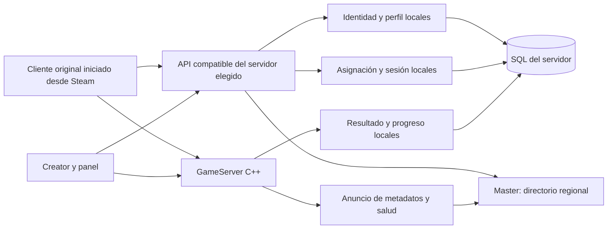

# Decisión vigente — cuentas globales y Easy Launch (2026-10-11)

Confirmado por el usuario: adquisiciones, cosméticos y desbloqueos permanentes, compartidos entre servidores, con identidad Steam y economía en un servicio central separado del Master. Esta decisión sustituye las secciones de diseño por servidor que se conservan abajo como contexto histórico de la implementación existente. No describe funcionalidad ya implementada ni una migración ejecutada.

- Master: únicamente directorio, regiones y anuncios de servidores; sin saldos, inventarios ni credenciales de jugadores.
- Servicio central de cuentas y economía: autentica Steam legítimo, vincula la cuenta global, mantiene SQL de saldos, compras con créditos ganados jugando y derechos adquiridos permanentes. Cerrar el juego, reiniciar o cambiar de servidor no vuelve a conceder ni elimina una adquisición. La permanencia requiere almacenamiento durable y respaldo/restauración verificados. Sin dinero real ni monetización.
- GameServers: simulación autoritativa y resultados identificados por partida y jugador. Enviar un resultado no autoriza por sí solo a emitir saldo. El servicio central debe validar procedencia, reglas, límites y duplicados antes de aplicar recompensas transaccionales. Un servidor no recibe acceso directo a la SQL global. Aún debe resolverse y probarse la confianza de servidores operados por terceros: firmar un resultado identifica al emisor, no demuestra que la partida ocurrió.
- Creator: administra nombre, región, mapas, modos, bots y eventos de su instancia. Las tasas que afecten XP o créditos globales deben cumplir la política central; el operador no puede conceder moneda global ilimitada. Los permisos de moderación local no conceden permisos de economía global.

## Easy Launch solicitado

Flujo solicitado: entrada sencilla desde CLI que prepare la instalación y dependencias, compruebe/configure red y abra el asistente gráfico de configuración. C++ para servicios y Creator, Windows/Linux; no es un launcher de Hawken. El juego sigue arrancando desde Steam.

Diseño propuesto para concretar antes de implementar:

1. Preparación: distribuir los componentes propios ya compilados y sus dependencias redistribuibles verificadas, elegir carpeta, conservar instalaciones/DB existentes y detectar fallos sin reemplazarlas. SQLite embebido evita instalar un servicio SQL para datos locales. La distribución legítima independiente de bibliotecas Steam sigue pendiente; no copiar ni redistribuir automáticamente la instalación del cliente como servidor.
2. Red: diagnosticar conflictos; gestionar sólo reglas identificables del producto para los ejecutables, protocolos y puertos realmente configurados. Solicitar elevación del sistema sólo para la operación que la precise; panel sin privilegios. Comprobar por separado escucha local, firewall y accesibilidad externa. NAT/router/CGNAT pueden impedir acceso aun con firewall abierto; no mostrar acceso público como verificado sin una prueba externa. Si cambia un puerto en el asistente, volver a aplicar y comprobar las reglas pertinentes.
3. Asistente gráfico: nombre y región del servidor, destino del servicio central y del Master, puertos, capacidad y las opciones de mapa/modo/XP/eventos efectivamente soportadas. Guardar configuración propia y permitir iniciar, detener y consultar diagnóstico. Controles todavía no conectados a gameplay deben aparecer como pendientes, sin simular efecto. Panel accesible localmente por defecto; no abrir su puerto administrativo a Internet con las reglas de juego.

Aceptación futura: instalación limpia y repetida sin pérdida de datos; error recuperable si faltan permisos/dependencias o hay puertos ocupados; arranque/cierre independientes del cliente; cambios del asistente con efecto observable; recompensas y compras idempotentes, inventario global conservado tras reinicio y cambio de servidor; Windows y Linux comprobados separadamente. El ensayo local actual permanece aislado y no abre puertos públicos.

Estado: requisitos confirmados; diseño de Easy Launch propuesto; instalador/GUI/economía global pendientes. No se migran ni reinterpretan saldos/identidades existentes sin un contrato de migración y pruebas. Prioridad previa conservada: funcionamiento real de la partida local y luego integración Master + servidor + Hawken.

---

## Contexto histórico: diseño anterior y pruebas de componentes locales

# HAWKEN — diseño vigente: datos por servidor

Esta revisión aplica la última instrucción del usuario: **MasterServer ligero, limitado al directorio de servidores/regiones; cuentas, cosméticos, XP, créditos, desbloqueos, estadísticas, eventos y sanciones en cada servidor con su propia SQL**. Sustituye la propuesta de progreso central del plan histórico. C++20 para servicios, GameServer y Creator; sólo existe el cliente Steam como material de reconstrucción.

Se conserva el plan detallado de fases en `research/2026-10-10/HAWKEN_FULL_IMPLEMENTATION_PLAN.md` para sus contratos, pruebas y gates. Sus referencias a C#/.NET, SQL global y economía central ya no son decisiones vigentes. Los informes estáticos se preservan como evidencia de aquella entrega. No se ha implementado ni validado esta arquitectura completa.

Estado de construcción2026-10-11: [21 suites/535 casos/19562 aserciones](evidence/menu-reliable-native-full-green/parent-acceptance.json), build/CTest0, sin skips. El backend nativo integra seis GET MenuSync con el AuthService existente; las respuestas vacías y la validación de URLs se verificaron con fixtures. El transporte fiable existe como módulo puro47/400 y todavía no está conectado a un socket de juego. La partida local y después Master+GameServer+Hawken permanecen como aceptación pendiente.

El [contrato post-sync](../research/2026-10-10/evidence/auth/post-sync-menu-contract/contract.json), SHA `4c22c079a4419207e9059772075c804d965a0db3c45470dc3fbac71bf4e08679`, conserva decisiones EULA/FTUX originales y PUT de strings a settings. Su persistencia SQL y lectura tras reinicio están [implementadas y probadas](evidence/user-game-settings-implementation/parent-acceptance.json), pendientes del ensayo con cliente original; no se establecen flags al crear cuentas. Las ofertas premium son una lectura posterior opcional, sin pagos ni derechos monetarios fabricados.

Avance de sesión2026-10-11: [asignación pura y RED HTTP](evidence/session-game-connection-red/parent-assignment-green-http-red-acceptance.json), SHA `665db8261e0a3c168e38f4f380f08fce0d0210bb85cd5e5b70c229ba86953bb0`: SessionAssignment25/1084 pasó; [adaptador HTTP y regresiones](evidence/session-game-connection-red/parent-http-green-acceptance.json), SHA `5af33386ed3f1021e6d050b52a62bbc945df9ebfee768e6f490c74f577585400`: build/CTest0, cinco suites35/1579 sin skips,162 inputs y cuatro pins estables,29 objetos Ninja VALID. `/session` y la asignación legacy están implementados como fachada optativa; la fixture sólo posee un contexto en memoria, sin puerto UDP. Main y los binarios del ensayo elevado conservan sus hashes previos. [Composición GameConnection](evidence/session-game-connection-red/parent-game-connection-green-acceptance.json), SHA `514a4b33cea2bcb5dc96428cdd3701490ea9eee48df25a156411ea1abd3ff205`, pasó45casos/497aserciones, build/CTest0,172 inputs y cuatro pins intactos,15 objetos Ninja VALID. La prueba confirma ACK1→ACK3 y conserva la retransmisión legítima cuando sólo llega ACK3; código de producción sin cambios. HelloValidated no acredita admisión. No es un gate completo de las24 suites registradas ni evidencia de menú/admisión/partida/Linux. Se implementará el owner UDP real con retiro sincronizado y revalidación de identidad.

## Responsabilidades

Steam de usuario pertenece exclusivamente a Hawken: el cliente obtiene su ticket y espera la respuesta de autenticación. El backend arranca sin iniciar una sesión de usuario; usa el contexto GameServer para validar el ticket, la identidad declarada y la licencia. El Master sólo lista servidores y regiones. La biblioteca nativa de Steam sigue siendo una dependencia técnica de esta prueba Windows; su distribución independiente y la ejecución sin Steam Desktop permanecen pendientes. La corrección GS-only está en verificación y todavía no demuestra una nueva sesión del cliente original.

| Componente | Datos y decisiones propios | Frontera |
|---|---|---|
| MasterServer | Identificador del servidor, región declarada, build, destinos, mapa/modo, capacidad y vigencia del anuncio | No cuentas de jugadores, tickets Steam, perfiles, cosméticos, saldo, XP, resultados ni bans de jugadores. |
| Backend de cada servidor | Verificación Steam, identidad local vinculada, perfil, inventario, loadout, progreso, ledger de créditos, estadísticas, sesiones y reservas | Autoridad exclusiva sobre su DB; nunca crea progreso válido en otro servidor. |
| GameServer propio | Transporte, admisión, replicación, simulación, equipos, armas, daño, objetivos y resultado autoritativo | Comunica sus resultados al backend de su servidor; no escribe la DB de otro operador. |
| Server Creator / agente | Crear y operar instancias; panel, diagnóstico, mapas/modos/bots, eventos, tasas, permisos, sanciones, consultas y mensajes | Administra únicamente sus instancias y DB autorizadas. No administra cuentas de otros servidores ni convierte el Master en un backend de jugadores. |

Una instalación puede ejecutar backend, GameServer y Creator juntos. Las responsabilidades se mantienen separadas en código para que el panel no sea necesario durante un tick de simulación y el Master no participe en cada acción del jugador. No se requiere una flota de procesos para la primera instalación.

## Identidad y progresión

SteamID64 identifica a la misma persona en distintos servidores, pero no comparte saldos, inventario, roles o sanciones. El backend sólo crea/vincula una cuenta después de una comprobación Steam legítima. Un ID decimal enviado por un cliente, el proceso Steam abierto o un resultado de telemetría no bastan para autenticar.

La clave local de cuenta es independiente del GUID wire que espere el cliente. SQL conserva el vínculo y el historial de alias. No se registra el contenido de tickets, grants, contraseñas o claves de sesión. El Master recibe únicamente metadatos necesarios para descubrir destinos.

Cada operador fija sus rates, eventos de XP/créditos, desbloqueos y recompensas cosméticas, incluyendo la posibilidad de obtener jugando objetos antes vendidos cuando su contrato funcione con el cliente original. No hay dinero real, pagos, donaciones con ventajas o compras de saldo.

El GameServer aporta hechos autoritativos. La regla local calcula la recompensa, persiste una transacción idempotente y la API de inventario/perfil la expone al cliente. Kills, curación efectiva, apoyo y objetivos sólo se premian donde existan eventos verificados; no se deducen del texto de un evento del cliente. Las reglas pueden diferir entre servidores y se identifican por versión en cada resultado.

Cambiar de servidor comienza con el progreso de ese destino. No se promete transferencia, sincronización o moneda universal. El operador puede conceder/configurar objetos en su propia DB mediante permisos administrativos explícitos y auditoría; eso no afecta a los demás servidores. No se habilitan objetos sólo porque aparezca un nombre en los paquetes.

## SQL y consultas

La primera implementación de almacenamiento local usará SQLite embebido por instalación, con transacciones, claves foráneas y migraciones versionadas. Es una decisión nueva de despliegue: permite distribuir el Creator con la dependencia y evita exigir un servicio SQL externo a cada host. PostgreSQL del plan previo deja de ser una dependencia central. No se implementarán dos proveedores antes de necesitar el segundo.

Grupos de tablas locales:

- Cuentas, vínculos Steam, perfiles, aliases, accesos y visitas.
- Instancias, generaciones, partidas, participantes, reservas y sesiones efímeras correlacionadas.
- Catálogo admitido, inventario, loadouts, XP, ledger de créditos y canjes/desbloqueos.
- Reglas y eventos versionados, resultados aplicados, estadísticas, auditoría y outbox.
- Roles por alcance, sanciones, plantillas de mensajes y consultas guardadas.

El loop de gameplay mantiene el estado activo en memoria; no consulta SQL por frame. Backend y Creator escriben mediante APIs propias y transacciones. Reinicio, reintento o doble entrega de un resultado no concede dos veces la misma recompensa.

Las consultas personalizadas se ejecutan desde el panel autorizado sobre vistas/columnas permitidas, con parámetros, tiempo/filas limitados y modo de sólo lectura. No se entrega la DB al cliente Hawken ni se convierte el comando en shell. Exportación, backup y restauración son operaciones del operador de ese servidor, con comprobaciones antes de reemplazar su DB.

M3 comienza con almacenamiento interno de cuentas/SteamID TEXT/alias/visitas/roles/bans, esquema versionado y visitas idempotentes. El vínculo Steam se persiste como formato; la autenticación legítima debe autorizar su uso antes de la futura API pública. No hay owner automático para el primer jugador. El identificador de cuenta se acompaña de server_id para rechazar cruces accidentales entre instancias; no es una credencial ni protege clones con el mismo server_id.

El módulo de consulta abre una conexión independiente readonly, sin crear DB y sin aceptar handles con funciones externas. Autoriza tuplas exactas (main,tabla,columna) de una política confiable, con funciones integradas acotadas; el nombre de una vista/CTE/alias no concede acceso. El READ sintético de columna vacía emitido por SQLite sólo se acepta con grant explícito vacío o después de un READ real autorizado de la misma tabla en esa consulta. El esquema confiable no puede contener columnas reales con nombre vacío. Las vistas son comodidad, no una barrera por filas. La política y DB se seleccionarán después de comprobar query.read en el panel; ese permiso aún no está implementado. SQL/binds/filas/bytes y ejecución cooperativa tienen presupuestos; el deadline no se presenta como límite duro de I/O ni de todo el heap. ATTACH/PRAGMA/escrituras/DDL/transacciones/extensiones/recursión quedan denegados. Almacén y consultas internos se verificaron en67 casos/1029 aserciones de `implementation/evidence/m3-cpp-final-green`; no se ha expuesto esa capacidad al cliente ni al panel.

## Directorio Master

El anuncio se limita a servidor/instancia, generación, URI de su API propia para el catálogo administrativo, endpoint/puertos de juego, región, nombre, build, mapa/modo, capacidad/ocupación, visibilidad y vencimiento. La URI administrativa no se inserta en el campo `Endpoint` de partida que consume Hawken.

Una credencial de anuncio autoriza sólo actualizar los metadatos de esa instancia. No equivale a una cuenta de jugador o permiso de progresión. El Master rechaza anuncios repetidos de una generación antigua y oculta anuncios vencidos. Intervalos/leases son reglas nuevas que se medirán; no se atribuyen a un protocolo de publicación original todavía desconocido.

Los handlers de listado no acceden a DB de jugadores. Filtros wire recuperados: Region, GameVersion, Map, GameType y ServerName. El schema Meteor mantiene su casing/tipos exactos; campos personales como `Users` no se rellenan con SteamID64 ni información privada para facilitar el directorio público. Las estadísticas públicas se derivan de instancias autorizadas, sin hacer sondeos a hosts ajenos.

Hay una dependencia concreta del cliente que requiere adaptación en su fachada local: el EXE RVA0xbd0810 deriva ocupación de la longitud de `Users`; RVA0xbe44e0 usa IDs de esa colección para encontrar la asignación y pedir `ClientSession`. Un directorio público con `Users` vacío muestra0 ocupados y no satisface ese recorrido de matchmaking. No se fabrican IDs para corregirlo. El snapshot Master inicial verifica formato/filtros, mientras la fachada y sesión del servidor deberán ofrecer los datos locales necesarios. Falta demostrar la proyección de otros destinos sin centralizar cuentas/progreso; se mantiene como gate de integración, no una compatibilidad obtenida.

Múltiples MasterServers replican sólo el directorio y sus anuncios vigentes. Su caída no detiene una partida ya admitida ni cambia créditos/perfiles. No necesitan compartir SQL de jugadores. El catálogo externo de masters/destinos es una función nueva: no se anuncia como selector nativo existente en Hawken.

## Destino del cliente: INI, DLL y TOML

El RE confirmó una única base `MeteorUri` que utiliza el SDK para login, perfil, listados, asignación y otros consumidores. El EXE de la muestra la sobrescribe durante la inicialización. Por eso cambiar el texto del INI no acredita que el tráfico llegue al destino elegido. El puente propio autorizado ya se probó como mecanismo y se observó su carga en Hawken; conserva los originales en disco.

Instrucción actual: la DLL auxiliar lee un TOML separado y el juego continúa usando Steam legítimo. `dinput8.dll` usa el import normal `DirectInput8Create`; `dxgi.dll` es import diferido. El puente sólo modifica en memoria el IAT GetCommandLineW del EXE identificado y entrega MeteorURI al callsite original; originales en disco intactos. Ocho procesos fixture comprobaron lectura fuera de DllMain, argumentos Unicode, caller permitido, DirectInput y rechazos; producción rechazó el host de ensayo. Después de045547 se confirmó URI pública y socket del PID en051458. [094223](evidence/local-steam-routing-20261011-094223/parent-runtime-review.json), SHA `3a5ab95bad6718a3ab05a98d52e1fb8867bb47c1c6c4b41e3df6e2b738f6ca8d`, confirmó carga/socket, licencia Steam, login/perfiles200 y cinco GET sync200; Master sólo recibió consulta del operador. El menú/sesión/partida siguen pendientes y la captura de ventana falló en este último ensayo. Cierre0/pipes0, retiro de archivos/regla y cinco originales correctos. Evidencia de mecanismo: `dll-bridge-feasibility.json`, `m4-routing-init-contract.json`, `client-bridge-design.json` y `client-bridge-functional`.

El ejemplo es `profiles/hawken-client.toml`: `[network]` con `meteor_uri = "http://127.0.0.1"`. Es base de API, no dirección UDP. Un sufijo `:8080` quedaba dentro del hostname y WinHttpConnect usaba puerto0; el ensayo necesita HTTP/80 sin puerto explícito. Evidencia estática: `implementation/evidence/m4-local-port-routing.json`, SHA-256 `087e6a291af05e314301b6aa0f953dd16866cc16fe7d8014be8a6d82156e32f0`. Las pruebas nativas ya observaron Hawken→backend80, mientras Master escuchó18080 y sólo fue consultado por el operador. Cambiar TOML requiere cerrar y reiniciar el juego con Steam activo.

La arquitectura local necesita que la API compatible del servidor elegido atienda esos contratos. Esa fachada puede consultar al Master para obtener anuncios, pero cuentas y progreso permanecen locales. `GET /userGameServers/{user}`, matchmaking y `/session` requieren contexto local y pertenecen a esa fachada, no a un Master público de metadatos.

La primera selección propuesta es explícita con el juego cerrado: escoger destino en el catálogo, configurar la URI del backend del destino y arrancar normalmente desde Steam. No se añade un launcher. Un cambio dentro del juego entre servidores con DB independientes exige demostrar renovación de perfil/grant/loadout y sesión; todavía no hay evidencia de que el browser nativo cambie la URI global por servidor. No se mostrará como conexión compatible un salto que reutilice un perfil de otra DB sin comprobación.

Ni redirecciones HTTP, un proxy de credenciales en el Master ni una lista de varias URI en el INI se toman como solución comprobada. Se evaluará el camino mínimo que respete el cliente original y la nueva frontera de datos. Un endpoint de partida y una base de API cumplen funciones distintas.

## Orden de ejecución y aceptación

Verificación vigente: [build/CTest Windows](evidence/starter-profile-native-green/parent-acceptance.json), 18 suites/465 casos/16072 aserciones, y [servicios121321](evidence/local-services-starter-20261011-121321/parent-runtime-review.json), backend+Master con diez consultas del operador. Catálogo Recruit, oferta gratuita, nueve instancias SQLv3 por cuenta y carga explícita `--starter-profile` están implementados. No hubo jugador en121321: ni menú, listado consumido por Hawken ni partida aceptados. El proveedor local conserva un único BeginAuth por proceso; la arquitectura final necesita admisión multiusuario.

1. **Base y contratos M1–M2:** integridad/INI, respuestas Meteor y codec interior con evidencia de los consumidores. Pruebas positivas/negativas, hashes/RVA y originales intactos. No son admisión Steam o gameplay.
2. **Servidor local M3–M8:** SQL local y permisos → Steam y perfil → directorio adaptado/asignación local → transporte/admisión → primera partida original. Gate: dos cuentas Steam legítimas juegan y el estado se conserva tras reinicio; entradas incompatibles/replay/sesiones/ban se rechazan.
3. **Operación M9–M15:** progreso/cosméticos locales y reglas/eventos → Creator/panel y comandos/consultas → INI/puente probado → builds e interoperabilidad Windows/Linux → directorios múltiples → distribución/backup/carga. Gate: cada control tiene efecto probado; ningún resultado de un servidor modifica otro.

M16, contenido nuevo/cook/UPK, continúa aplazado. Se valida la lista cerrada SHA-256 original. No se redistribuye el cliente Steam como GameServer ni se usa otro AppID para eludir su autenticación.

Los casos que demuestran aislamiento incluyen dos servidores con la misma cuenta Steam y diferentes inventarios/saldos, rates distintos sin cruce, ban local sin ban del otro, consultas sin acceso a otra DB y Master sin tablas/eventos de progreso. Estas comprobaciones se añaden al gate de la capacidad correspondiente; no se declaran ejecutadas ahora.

Por la instrucción más reciente del usuario se demuestra primero funcionamiento local con su copia Steam; la auditoría amplia y ASan se retoman después. Los controles ya implementados y los hallazgos se conservan en implementation/HAWKEN_SECURITY_AUDIT.md. Se mantienen un padre dueño, dos escritores con scopes separados y Luna como apoyo exclusivo del padre para revisión/evidencia/compilación, sin autoridad de aceptación ni cambios de source.
