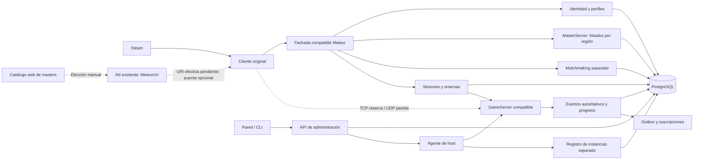

# HAWKEN — plan completo: MasterServer regional, Server Creator e INI con puente opcional

Fecha y base de evidencia: 2026-10-10. Estado: **DISEÑO PROPUESTO; no implementado**. Este plan continúa la investigación estática de la instalación Steam examinada. Los originales permanecen intactos. Ninguna fase descrita aquí equivale a un servidor compatible ya validado.

## 1. Objetivo y condiciones obligatorias

Construir posteriormente una infraestructura que permita al cliente legítimo encontrar servidores, autenticarse, entrar a partidas, conservar progreso y usar herramientas de administración. Los dos productos principales son el MasterServer, que sólo lista servidores por región, y el Server Creator descargable, con dependencias establecidas y panel de mapas, eventos y XP. Autenticación, cuentas, SQL, progreso y sesiones son responsabilidades separadas del directorio. Se conserva Windows/Linux, múltiples masters, GameServers, sanciones, consultas y mensajes. **Revisión del usuario:** Steam normal y URI en el INI, sin launcher; se estudia una DLL puente adicional para preservar esa URI sin editar los binarios originales en disco. El INI puro sigue contradicho en el camino observado y el puente aún no está implementado ni probado. Los créditos internos ganados jugando están permitidos; dinero real, moneda premium y monetización permanecen excluidos. **Última revisión:** UPK nuevos/cook/extensiones aplazados; la primera versión admite únicamente paquetes originales de un manifiesto SHA-256 aprobado. El [diseño ampliado del Creator](HAWKEN_SERVER_CREATOR_DESIGN.md) desarrolla dashboard tipo txAdmin, puertos/SQL, créditos, eventos, bots, modos existentes e integridad de paquetes.

| Requisito del usuario | Decisión del plan | Prueba de aceptación futura |
|---|---|---|
| Cuenta Steam legítima | Steam autenticado y autorización del título antes de emitir una sesión jugable; SteamID vinculado al perfil interno. | Ticket inválido, identidad discordante o autorización insuficiente impiden entrar. Steam instalado o un nombre de usuario no bastan. |
| Nada de piratería | El usuario conserva su instalación Steam y descarga únicamente el Server Creator, herramientas propias y dependencias redistribuibles autorizadas. | Instalador sin ejecutables/DLL/paquetes originales del juego; Steam permanece en el flujo. |
| Créditos y cosméticos ganados; autoridad central | El servicio de cuentas/progreso bajo el operador Master establece rates/XP/créditos y grants de cosméticos antes vendidos cuando sean compatibles. Creator administra partidas y propone eventos, sin emitir progreso global. Sin pagos, compra de saldo, boosts pagados ni ventajas por donación. | Host particular/x100 local no cambia saldo global; resultados elegibles y regla central generan ledger/canje/grant únicos, visibles y utilizables con el cliente original. |
| Sin launcher; INI y DLL adicional si resulta necesaria | `MeteorUri` en `Binaries\Win64\StormConsumerSettings.ini` sigue siendo la configuración. Estudiar un puente x64 adicional que evite la sobrescritura; no editar EXE/DLL/UPK originales. | A/B del INI, Steam normal, puente idéntico en ambas pruebas si se requiere. Destino efectivo, forwarding, orden de inicialización e integridad originales demostrados; sin argumentos sustitutos. |
| Linux también | Servicios, SQL, agente de host, CLI y administración nativos en Linux y Windows. GameServer nativo multiplataforma como objetivo. | Mismos fixtures de protocolo y escenarios en ambas plataformas. Ejecutar un PE bajo Wine no acredita un servidor nativo. |
| Guardar datos de quienes entran | Identidad de cuenta, perfil, accesos, partidas, progreso, sanciones y auditoría en SQL. | Reiniciar servicios conserva los datos y permite consultar el historial correcto. No persistir tickets Steam ni claves de sesión en informes/logs. |
| Consultas personalizadas | Consultas SQL parametrizadas y guardadas, con vistas y rol de lectura; cambios mediante comandos de dominio. | Consultas autorizadas funcionan; no permiten cambiar progreso, permisos o sanciones ni ejecutar comandos del sistema. |
| Mensajes y comandos personalizados | Registro explícito de comandos, permisos por alcance, plantillas y entrega por adaptadores verificados. | Mensaje llega al destinatario correcto; actor sin permiso no puede emitirlo ni ejecutar el comando asociado. |
| Eventos exponibles | Eventos propios de backend/servidor y adaptadores de eventos recuperados, identificados por origen y autoridad. | Suscripción, consulta y reenvío funcionan sin duplicar XP/desbloqueos. Telemetría del cliente nunca concede progreso por sí sola. |
| UPK originales íntegros; extensiones más adelante | Lista cerrada de paquetes por build con SHA-256/tamaño, manifiesto aprobado y rechazo de alterados/ausentes/extras en rutas de carga; no cook ni UPK nuevos en la primera entrega. | Hashes reales del host y prueba negativa de archivos alterados. El cliente requiere un verificador demostrado: reporte de hash/GUID por sí solo no acredita bytes remotos. |
| Plan muy completo, sin implementar aún | Diseño, contratos pendientes, modelo de datos, operaciones, backlog y pruebas de cierre. | Cada capacidad tiene una dependencia y un criterio de aceptación; no se oculta la falta de wire o runtime. |

### Hechos que limitan el diseño

**CONFIRMADO estático:** AppID declarado `271290`; APIs Meteor HTTP/JSON; login Steam/ticket convertido a Base64url; listados, advertisements y sesión distintos; PartyBeacon TCP; inicialización de partida UDP; SessionId/Key asociados a wrapper de paquetes; filtro regional de un callback UI, guards/flags de administración, fórmula parcial de XP y cadena de eventos XP→cola→POST de telemetría. Los 360 UPK se leyeron/descomprimieron y sus 22.519 exports Class/Function propios están representados en la extracción; ello no acredita revisión semántica de todos los cuerpos/defaults.

**PROBABLE:** identificación de las primitivas del wrapper como ChaCha20 original y HMAC-SHA512 truncado a 256 bits; varias relaciones nominales de eventos y gameplay.

**NO VERIFICADO:** autenticación Steam operativa para este proyecto, política de admisión servidor, registro original GameServer→backend, framing beacon completo, packet/bunch/channel y replicación completos, ejecución/permisos efectivos de comandos, factores/balance y reglas durables de XP/créditos, catálogo completo y cliente Linux funcional. La conexión sólo por INI está contradicha por la sobrescritura del camino Init recuperado; no se encontró una alternativa original en los consumidores revisados. La DLL puente es una propuesta nueva, no una solución validada. Cook, carga de contenido adicional y aceptación de nuevos modos/mapas requieren pruebas de esta build.

Las identidades de archivos, hashes y RVA/offset que sostienen estos hechos están en [arquitectura](HAWKEN_NETWORK_ARCHITECTURE.md), [autenticación](HAWKEN_AUTH_PROTOCOL.md), [master](HAWKEN_MASTER_SERVER_PROTOCOL.md), [partida](HAWKEN_GAME_SERVER_PROTOCOL.md) y [cuentas/eventos](HAWKEN_ACCOUNT_AND_EVENT_FINDINGS.md). El inventario y el catálogo no demuestran disponibilidad actual de servicios antiguos.

## 2. Plataformas, stack y fronteras

Baseline propuesto para la implementación futura: C#/.NET 10 LTS para control, API y herramientas; PostgreSQL 18 como SQL de referencia; C++ para codec/servidor de partida cuando se determine la vía viable de reconstrucción; panel web para administración y creador. La portabilidad de [.NET](https://learn.microsoft.com/en-us/dotnet/core/introduction) y su [política LTS](https://dotnet.microsoft.com/en-us/platform/support/policy/dotnet-core) sustentan la elección del plano de control, no la compatibilidad del protocolo Hawken. Se fijarán versiones y parches al implementar; no se instala este stack durante la investigación.

| Producto | Windows | Linux | Condición y límite |
|---|---|---|---|
| Fachada Meteor / Master / cuentas | Servicio nativo | Servicio nativo | HTTP wire idéntico, TLS probado con el cliente. |
| SQL | PostgreSQL administrado o local | PostgreSQL administrado o local | Migraciones, backups y consultas equivalentes; sin SQL expuesto al cliente de juego. |
| Creador y administración | Navegador + CLI/agente | Navegador + CLI/agente | Mismo catálogo de comandos/permisos. No depende de escritorio en el host. |
| Agente GameServer | Servicio propio | Servicio propio bajo supervisor del sistema | Sólo administra procesos autorizados y directorios de instancia propios. |
| GameServer compatible | Runtime verificado para esta build | Runtime nativo nuevo o fuente autorizada portable | La instalación suministrada no prueba un dedicado utilizable ni aporta un binario Linux. Es el mayor riesgo del proyecto. |
| Conexión del jugador | Steam + INI existente + puente opcional verificado | Steam/Proton + INI y puente de la instalación Windows si fuese necesario | Ningún launcher propio. Loader, URI y ABI se prueban por plataforma; Proton no convierte el PE en un cliente Linux nativo. |

La documentación de [Steam sobre Proton](https://partner.steamgames.com/doc/steamhardware/proton) describe ejecución de juegos Windows en Linux; **no verifica Hawken**. Matriz pendiente: arranque, Steam API, WinHTTP/TLS, menú, red, entrada a partida, render/audio y salida limpia. Las herramientas Linux pueden cerrarse aunque la compatibilidad del cliente Linux siga abierta, pero deben anunciar esa diferencia.

### Componentes y responsabilidades



Este diagrama es diseño nuevo. La fachada conserva una base Meteor única y enruta cada contrato al servicio responsable: el MasterServer sólo consulta listado/región; altas/leases, matchmaking, autenticación, perfiles, progreso y sesiones pertenecen a otros módulos. El Server Creator administra instancias y su panel; no inicia ni modifica el cliente. Registro interno, federación y eventos propios son interfaces nuevas. Pueden comenzar como módulos separados de un backend, sin asignar sus funciones al directorio; dividir procesos depende de carga, disponibilidad y aislamiento medidos.

| Módulo | Es dueño de | Nunca decide por sí solo |
|---|---|---|
| Identidad | Steam verificado, vínculo de cuentas, grants y roles | Resultado de una partida o recompensa aportada por el cliente. |
| Perfiles/progreso | Perfil, XP, estadísticas, instancias y desbloqueos | Licencia Steam ni capacidad real de un servidor remoto. |
| MasterServer / directorio | Consulta de listings, región/ubicación declarada y filtros sobre la proyección de servidores publicables | Registrar hosts, renovar leases, autenticar cuentas, conceder XP o emitir sesiones. |
| Registro de instancias | Altas, identidad de servicio, leases, salud y publicación de la proyección | Aceptar una IP anunciada sin comprobar identidad y alcance. |
| Matchmaking | Cola/advertisement, compatibilidad, reservas y asignación | Que POST repetido tenga que crear dos asignaciones. |
| Sesiones | Relación jugador/partida, vencimiento, claves y revocación | Identidad Steam a partir de SessionId enviado sin verificar. |
| GameServer | Simulación, admisión local, slots, eventos de partida | Otorgar roles globales, moneda o escribir SQL arbitrario. |
| Administración | Comandos tipados, permisos, sanciones, mensajes y auditoría | Ejecutar directamente texto recibido en consola del sistema. |
| Host agent | Ciclo de procesos, puertos, logs y salud | Registrar por sí mismo una identidad Steam o conceder progreso. |
| Server Creator | Paquete descargable, dependencias, panel y ciclo de instancias; configuración de mapas/eventos/XP permitida | Validar licencia por presencia de archivos o ampliar permisos del dueño fuera de su servidor. |

## 3. Contratos y recuperación que preceden a la implementación

Mantener un registro de contrato por operación: fuente/hash/RVA o posición de paquete, transporte, ruta, verbo, escape, headers, tipos, campos requeridos/opcionales, resultado, errores, llamada consumidora y estado de certeza. Los ejemplos deben ser sintéticos y carecer de secretos reales.

| Frontera | Base recuperada | Trabajo que falta para aceptación |
|---|---|---|
| Meteor HTTP | Envelope `Status`, `Message`, `Result`; grant y `Authorization: Basic`; verbos y schemas citados | Estados de fallo, callback/retry, vigencia del grant, TLS y secuencia real de menú/login. |
| Steam | AppID y obtención/encoding de ticket en EXE; AuthTicket en SDK | Confirmar API/tipo de ticket de esta versión y validarlo por una integración autorizada, sin reemplazarlo por un ticket sintético. |
| Listados | `Endpoint` y `Port` string; GET y adaptación local; tarea EXE sin SetRegion y callback UI con filtro regional/roles | Datos efectivos, paginación si usada, rama UI seleccionada y admisión backend; preservar diferencias entre browser y región de host. |
| Matchmaking | Advertisement POST/GET/DELETE, sesión GET y polling/asignación | Legacy activo, expiración, cancelación concurrente, transición a reserva y admisión. |
| PartyBeacon | Writers/readers parciales, tipos y TCP demostrado | Reconstrucción de stream, fragmentación/coalescencia y discrepancia writer40/parser44 por miembro. No inventar padding. |
| Paquete de partida | Wrapper `ID8 | nonce8 | ciphertext[n] | tag32`, guards de entrada y reader de bits | Vectores, dirección/nonce, packet/bunch/channel, versión/challenge/login y formato servidor. No tratar opcodes de control como datagramas planos. |
| Cuenta/progreso | Stats PUT con TransactionId, inventario GET, parsers GameItem/Transaction, logros/asignaciones y rewards | Consumers/catálogo real, reglas centrales y visualización de créditos/cosméticos ganados sin pagos. |
| Administración | Cuerpos/flags/guards seleccionados de Admin/ServerKickBan/ServerSay/start/end/mapas | Completar dispatch/serialización RPC y ejecutar positivos/denegados en servidor propio. No inferir un permiso universal desde AreAdminCommandsAllowed o LocalPlayer. |
| Eventos | Callbacks/gameplay/telemetría distintos; builders XP, cola local202 y POST `/gameClientEvent` array JSON | Autoridad, recepción, ack/reintento y resultado durable; otros candidatos aún requieren payload/callers. Telemetría no concede progreso. |

Los parsers GameItem y Transaction quedaron recuperados en la revisión estática final. GameItem acepta un object vacío, procesa strings/children y aliases; Transaction acepta object con campos string opcionales y Status representable como int32. El `Result` de Transaction es string, distinto del `Result` del envelope. El backend propio debe conservar el formato y aplicar sus invariantes de identidad/ownership/progreso; la tolerancia del parser no autoriza un objeto inválido. Detalle y evidencia en [cuentas/eventos](HAWKEN_ACCOUNT_AND_EVENT_FINDINGS.md).

Un servidor que responde JSON y aparece en una lista todavía no pasa este conjunto. La recuperación pendiente se sigue en [desconocidos](HAWKEN_UNKNOWN_AND_BLOCKERS.md); ampliar por consumidores concretos, no por semejanza con otro UE3.

## 4. Identidad Steam y autorización de acceso

La identidad interna es estable y se vincula a SteamID64 verificado. Callsign puede cambiar y no sirve para autorizar. La identidad Meteor del wire, SteamID, PlayFabId histórico e ID interno son campos diferentes.

Flujo futuro:

1. El usuario utiliza su instalación y cuenta Steam e inicia el juego desde Steam. Antes configura la URI controlada en el INI según la sección13, una vez superado su gate. El Server Creator no recibe la contraseña Steam ni inicia el cliente.
2. El cliente original obtiene su ticket por el camino recuperado. El backend recibe la representación esperada, comprueba formato y usa el mecanismo legítimo apropiado a ese ticket y AppID.
3. Verificar identidad y autorización/licencia del título por el procedimiento disponible y permitido. No aceptar sólo SteamID escrito por el cliente, ticket con otro AppID o sesión administrativa local del Server Creator.
4. Crear/vincular perfil, comprobar sanciones y devolver el contrato Meteor esperado. La ruta histórica por contraseña no concede acceso a un jugador que no haya satisfecho Steam.
5. Emitir sesión ligada al perfil, partida, servidor, miembros permitidos y vencimiento. Entregar contexto al GameServer por canal interno autorizado.
6. GameServer admite sólo jugadores con sesión vigente y vinculada a Steam; cierre, revocación o sanción terminan la autorización según alcance.

La [documentación Valve de autenticación](https://partner.steamgames.com/doc/features/auth) separa identidad y propiedad/autorización de la aplicación. Las [referencias de tickets](https://partner.steamgames.com/doc/webapi/ISteamUserAuth?l=english) y [claves de Web API](https://partner.steamgames.com/doc/webapi_overview/auth) determinan qué credenciales exige cada ruta. No está acreditado acceso del proyecto a esas capacidades para Hawken. La API moderna GetAuthTicketForWebApi documentada no se inserta en el cliente antiguo por suposición: el EXE estudiado tiene su propio camino GetSteamAuthSessionTicket.

**Gate de autenticación:** hasta validar ese camino legítimo y sus permisos concretos, las pruebas de parsing pueden usar fixtures sintéticos, pero no deben aceptar jugadores como si Steam ya se hubiese validado. Se conserva el requisito aunque falten recursos de integración. No se solicitan claves o tickets en este informe.

Estados internos propuestos: pendiente de Steam → Steam verificado → perfil autorizado → sesión emitida → reserva → jugador admitido → sesión cerrada/revocada. Sólo los estados que coincidan con el wire recuperado se exportan al cliente; los internos no introducen campos desconocidos en sus respuestas.

Pruebas negativas: ticket alterado/expirado/duplicado cuando corresponda, SteamID distinto, AppID incorrecto, timeout proveedor, licencia insuficiente, cuenta suspendida y sesión revocada entre asignación y entrada. Una caída del proveedor no convierte el acceso en invitado. Las pruebas se ejecutarán con cuentas legítimas de desarrollo y sin conservar secretos en trazas.

## 5. MasterServer regional y servicios separados de registro/matchmaking

El **MasterServer sólo sirve para listar servidores y su región**. Sus entradas incluyen identificador, nombre, región/código geográfico configurado, endpoint/puerto de partida, mapa/modo, build, ocupación/capacidad y estado publicable, adaptados al schema recuperado. La región del servidor no identifica el país de un jugador: no deducir ubicación personal de cada acceso ni exponer su IP en el listado. La UI construye regiones con items invType55 y atributos RegionName/RegionLocId/RegionFallbackName; también usa World/AllRegions y una derivación USA→USW/USE por nombre. Son lecturas/reglas locales recuperadas, no un enum wire completo ni prueba de países disponibles hoy. [Funciones y hashes](HAWKEN_MASTER_SERVER_PROTOCOL.md).

La base `MeteorUri` abarca contratos distintos del listado. Una fachada compatible enruta a servicios separados para mantener el cliente original. El directorio consulta una proyección del registro; el servicio de registro recibe altas/heartbeats, matchmaking reserva plazas y el servicio de sesiones emite el contexto de admisión. Esta separación es diseño futuro, no una afirmación sobre procesos originales.

### Registro propio de GameServers, fuera del MasterServer

El protocolo original de publicación servidor→backend sigue NO VERIFICADO. Los cuerpos cliente cerrados no lo proporcionan: InitListing retorna1, Refresh copia caché, Update modifica estado local y CreateOnlineGame noLAN llega a fallo `0x80004005`. [Bindings/cuerpos con archivo y hash](HAWKEN_MASTER_SERVER_PROTOCOL.md). Diseñar un canal interno propio para los GameServers nuevos; traducir su estado al listing que consume el cliente. Un host preexistente sólo usará ese canal cuando haya un adaptador verificado.

Modelo operativo de instancia: creado → aprovisionando → arrancando → listo → registrado → en partida → drenando → detenido; error y cuarentena son salidas explícitas. Separar estado del proceso, salud del socket y presencia en directorio.

Registro mínimo propuesto: `server_id`, comunidad/realm, propietario/host, build y perfil de protocolo, dirección anunciada, puertos de partida/reserva, región, mapa, modo, capacidad, visibilidad y estado. El servicio autentica la instancia, asigna una generación/lease y rechaza identidad repetida o build incompatible. No publicar direcciones wildcard, privadas inaccesibles a la audiencia o puertos que no pertenecen a la instancia.

Health/heartbeat propio: renovación de lease con secuencia creciente, generación de proceso, jugadores/capacidad y estado. Arranque verificado antes de visibilidad. Tras caducar se oculta del directorio y se cancelan asignaciones nuevas; reconexión del mismo host no resucita una generación vieja. Intervalo y vencimiento son parámetros nuevos medidos, no se copian automáticamente los defaults3/10/60 de los paquetes.

NAT y alcance: distinguir LAN, público y detrás de NAT. El creador puede enseñar puertos y verificar alcance desde un nodo controlado autorizado; no necesita explorar Internet ni contactar servidores ajenos. Port forwarding, IPv4/IPv6 y conexión del cliente original requieren pruebas específicas; la factory examinada es IPv4. No prometer traversal/STUN nativo por defecto.

### Directorio visible al cliente

Conservar rutas GET recuperadas y su escape: consulta por ID, filtros de `/gameServerListings` y `/userGameServers/{user}`. Convertir modelos internos a campos exactos, preservando `Endpoint`/`Port` y claves opcionales. Nunca insertar la URL de la API administrativa en el endpoint de partida.

Visibilidad propuesta: público, privado por grupo, LAN/local y oculto para mantenimiento; roles/capacidad compatibles se adaptan a campos existentes. Filtrar por build, región, modo/mapa y permisos. El SDK admite Region en GET, pero la tarea EXE revisada sólo fija GameVersion/Map/GameType; el callback OnlineGameServers filtra regiones/roles localmente y el callback legacy alternativo no contiene ese mismo filtro. Verificar la rama seleccionada antes de imponer un subconjunto regional o remapear Custom/World. Un filtro UI de roles no sustituye autorización de entrada. Los usuarios de un listing y sus estadísticas de ocupación se derivan del servidor autorizado; no del número de HTTP requests ni de publicidad autodeclarada.

### Advertisement, reserva y sesión, fuera del MasterServer

El adaptador conserva los schemas del informe master: POST advertisement devuelve string de ID; GET devuelve objeto; `/session` requiere su propio conjunto de campos. `RequestedMaps` es string en el serializer recuperado. No trasladar un array interno directamente a ese campo.

Modelo interno de búsqueda: solicitada → pendiente → capacidad reservada → asignada → conectando → admitida; salidas cancelada, vencida y fallida. Es diseño propio: hacer el mapeo sólo donde Status y callbacks reales estén recuperados. Concurrencia controlada: una cuenta/grupo no ocupa dos plazas por reintentos; asignación y reserva son una operación consistente; cancelar libera capacidad; una respuesta tardía no restaura una búsqueda cancelada.

Compatibilidad de grupos: miembros vinculados a Steam, tamaño permitido, versión común, mapa/modo/región y política de habilidades. Rating/XP matchmaking quedan definidos por reglas propias versionadas cuando se implemente; no se atribuyen las fórmulas históricas sin evidencia. La lectura repetida de `SkillRatingSearchMin` del parser se conserva como hecho del adaptador.

SessionId/SessionKey deben cumplir representación/longitud esperada por el cliente y quedar ligados a la asignación. Secretos efímeros fuera de SQL de reportes; persistir identificador/hashes de correlación, expiración y estado. No reutilizar clave/nonce entre sesiones o después de reiniciar una instancia. La política real de recepción servidor debe recuperarse antes de afirmar interoperabilidad.

### Múltiples MasterServers

Primero desplegar réplicas de una misma comunidad detrás de una fachada estable con autoridad SQL común. Grants, perfiles, IDs de advertisement y sesiones deben conservar significado al cambiar de réplica. Estado de partidas vive en el GameServer, no migra por el simple failover HTTP.

Después, catálogo externo firmado de comunidades/nodos publicado en web y panel administrativo: identidad de realm/master, nombre, región, URI HTTPS, protocolos/builds, estado, versión y expiración. El usuario elige una comunidad y cambia manualmente la única URI del INI. No presentarlo como lista nativa que Hawken interprete ni añadir varias URLs al INI sin parser demostrado.

El usuario elige comunidad/fachada con el juego cerrado, configura su URI en el INI y arranca desde Steam cuando esa vía esté validada. Réplicas/failover se resuelven detrás de una URI estable, sin selector de arranque ni argumentos sustitutos. Los nueve dominios por plataforma/entorno no prueban federación. Entre comunidades independientes, consentir pertenencia y mantener cuentas/progreso/sanciones por realm; no fusionar grants o aceptar sanciones de cualquier master sin autoridad definida.

Fallo de nodo: consultas del MasterServer pueden cambiar de réplica sin duplicar efectos. Matchmaking/sesiones usan retry acotado y recuperan su resultado por estado/ID, sin duplicar POST/reserva. Si no puede probarse recuperación inequívoca, esos servicios devuelven fallo compatible y liberan reservas. El servicio de asignación no concede la última plaza con datos desactualizados.

## 6. SQL: cuentas, accesos y consultas

PostgreSQL guarda datos persistentes. El proceso de partida no realiza una consulta SQL por frame: mantiene estado activo en memoria y publica hechos/checkpoints al backend. Administración y juego usan roles de base distintos; no se entrega conexión SQL al cliente Hawken. El panel/CLI del Server Creator usa una API autorizada; el jugador no instala SQL.

### Modelo lógico inicial, propuesto

| Tabla/grupo | Datos y claves | Invariantes |
|---|---|---|
| `accounts` | ID interno, SteamID64 como texto decimal validado/único, estado, fechas alta/último acceso | SteamID sin pérdida por JSON/JavaScript; no autenticar por callsign. |
| `account_links` | Cuenta, realm, MeteorUserGuid opaco, proveedor/ID externo cuando necesario | Un vínculo autoritativo por identidad; no asumir que GUID wire es UUID. |
| `profiles` / `profile_aliases` | Callsign, preferencias, versión y cambios de alias | Cambiar alias conserva historial y SteamID. |
| `access_sessions` | Cuenta, inicio/fin, resultado auth, motivo cierre y correlación | Sin tickets, grants en claro o contraseñas. Cuenta rechazada no cuenta como jugador admitido. |
| `player_visits` | Cuenta, server/match, reserva/entrada/salida, motivo | Distinguir conectar, ser admitido y participar; reparar cierre tras crash. |
| `hosts` / `server_instances` | Dueño, plataforma, generación, configuración versionada, estado | Una generación activa por instancia; puertos y directorios propios. |
| `server_leases` | Instancia/generación, secuencia, expiración y salud | Heartbeat viejo no prolonga lease ni publica proceso muerto. |
| `matches` / `match_players` | ID, build/mapa/modo, estado/tiempos, participantes/resultados | Sólo servidor asignado publica resultado; SteamID/cuenta coinciden con sesión. |
| `matchmaking_requests` / `reservations` | Owner/grupo, requisitos, estado, servidor, caducidad | Reserva exclusiva, liberación por cancelación/timeout, sin sobreocupación. |
| `player_stats` / `item_stats` | Métricas normalizadas, versión y referencias de eventos | Aplicación idempotente; no aceptar incrementos arbitrarios de un cliente. |
| `stat_transactions` | ID wire, cuenta, estado, operación/resultados y correlación | Respetar POST/PUT/GET y parser Transaction recuperados, sin duplicar progreso; estados/semántica servidor todavía por validar. |
| `item_catalog` / `player_items` | Tipo, contenido permitido, instancia y propietario | Catálogo e instancia distintos; concesión o canje con créditos ganados rastreable; sin dinero real. |
| `progression_rules` / `player_progress` | Versiones de regla, XP, nivel y objetivos | Reglas explícitas, valores acotados, avance reproducible. |
| `earned_credit_balances` / `earned_credit_ledger` | Cuenta, realm, unidad interna, saldo/version y entradas de recompensa/canje/reversión | Créditos exclusivamente ganados; unique por resultado+cuenta+regla; saldo y canje atómicos, sin saldo premium ni transferencias entre comunidades. |
| `achievement_catalog` / `player_achievements` | Definición/regla/reward IDs, estado y fecha ganada | Una concesión por clave definida; frecuencia/temporada controlada. |
| `unlock_grants` | Cuenta/item/logro, razón, evento origen, regla y fecha | Unique por cuenta+objetivo+versión/temporada; ninguna razón de pago. |
| `sanctions` / `sanction_history` | Cuenta, tipo, realm/server, motivo, actor, inicio/fin/revocación | Ban global/local distinguible, auditoría de cambios, no depender de alias/IP. |
| `admin_roles` / `admin_bindings` | Actor, permiso, alcance y vigencia | Owner no equivale a administrador de toda la red. |
| `events` / `event_outbox` | EventID, origen, secuencia, schema, payload depurado, despacho | Unique origen+generación+secuencia; progreso y outbox en la misma transacción. |
| `admin_actions` | Actor, comando/argumentos depurados, objetivo, resultado y correlación | Intento, autorización y ejecución distinguibles; sin secretos. |
| `saved_queries` / `message_templates` | Dueño/alcance, versión, parámetros permitidos y visibilidad | Cambios auditados; mensajes no ejecutan expresiones arbitrarias. |

Las tablas son diseño lógico, no DDL instalado. Normalizar identidades, estados y datos consultados; usar JSONB sólo para extensiones versionadas y payloads, no para ocultar invariantes de progreso o sanciones. Índices iniciales por SteamID, cuenta+fecha, server/match+fecha, sanción activa, evento origen/secuencia y unlock único; medir planes antes de añadir índices secundarios.

Transacciones: validar autorización/evento, registrar fact único, aplicar progreso/reward y añadir outbox conjuntamente. Repetir entrega devuelve resultado existente. Control de versión/lock en filas afectadas impide perder dos recompensas concurrentes. Migraciones numeradas, compatibles con despliegue por etapas, con pruebas de restauración. El estado efímero de claves de partida no entra en consultas de personas.

### Consultas personalizadas

Crear vistas `report` para cuentas, visitas, progreso y sanciones según permisos. Consultas guardadas tienen nombre, parámetros tipados, columnas visibles, máximo de filas, timeout, dueño y alcance. Los [privilegios PostgreSQL](https://www.postgresql.org/docs/current/ddl-priv.html) permiten separar lectura/escritura; además, las consultas avanzadas necesitan rol restringido, funciones permitidas y límites efectivos. Rechazar texto por una regex de `SELECT` no es una frontera suficiente.

Ejemplos propuestos, parametrizados (`$1`, `$2` son parámetros, nunca concatenación del texto de un jugador):

```sql
-- Historial de personas admitidas en un servidor.
SELECT account_id, callsign, joined_at, left_at, exit_reason
FROM report.player_visits
WHERE server_id = $1 AND joined_at >= $2
ORDER BY joined_at DESC, visit_id DESC
LIMIT 200;

-- Progreso y desbloqueos de una cuenta Steam verificada.
SELECT steam_id, callsign, xp_total, level, unlocked_items
FROM report.account_progress
WHERE steam_id = $1;

-- Sanciones efectivas dentro del alcance permitido.
SELECT steam_id, sanction_type, scope, reason, expires_at
FROM report.active_sanctions
WHERE realm_id = $1
ORDER BY issued_at DESC, sanction_id DESC
LIMIT 200;
```

Comandos de consulta sólo del plano de administración: guardar, listar, ejecutar con parámetros, exportar resultados autorizados y revisar ejecuciones. Para usuario avanzado, SQL de lectura sobre vistas en una conexión limitada; sin DDL/DML, funciones externas, acceso al sistema o esquema de secretos. Exportar CSV/JSON conserva SteamID como string, evita interpretar texto de jugador como fórmula y respeta el alcance de permisos.

Retención propuesta: cuentas/progreso mientras la cuenta esté activa; visitas y auditoría con período configurable y política explícita; IP sólo si sirve a diagnóstico/sanción auxiliar, con acceso y conservación limitados. No recoger nombre real, datos de pago o credenciales. Borrar/anonymizar datos de actividad cuando corresponda conserva la consistencia de resultados agregados y sanciones según política definida. Este diseño no importa datos de una población histórica de Hawken ni obtiene información de cuentas ajenas.

## 7. GameServer compatible y alcance real de la reconstrucción

El GameServer es una entrega independiente del MasterServer. Debe aceptar el cliente de esta build, reproducir su conexión y sostener una partida real. No alcanza con abrir UDP, aceptar un beacon o emitir una respuesta Welcome.

### Elegir una vía viable antes de desarrollar gameplay

| Vía | Recurso necesario | Ventaja | Gate y límite |
|---|---|---|---|
| Dedicado original autorizado del mismo build | Ejecutable servidor y recursos obtenidos legítimamente, condiciones de uso conocidas | Mayor posibilidad de conservar gameplay y serialización originales | No se encontró ni validó tal entrega en este trabajo. Comprobar arquitectura, dependencias, arranque, interfaz Meteor y disponibilidad Linux. No redistribuirlo automáticamente. |
| Fuente autorizada correspondiente al fork | Acceso legítimo a fuente, toolchain, contenido y permisos aplicables | Permite portar el servidor a Linux y añadir interfaces de administración sin cambiar el cliente | El proyecto no dispone de esa fuente como resultado de esta investigación. Compilar otro UE3 no sustituye este recurso. |
| Reconstrucción propia del protocolo y servidor | Wire completo, pruebas controladas y representación autorizada de datos necesarios | Control del backend y posibilidad de runtime nativo Windows/Linux | Mayor trabajo: codec, canales, replicación, física/gameplay y contenido. No se promete una fecha de partida jugable sin estimar estos bloques. |

La decisión se toma con evidencia y no bloquea la documentación de los contratos HTTP. Si sólo existe un runtime Windows permitido, anunciar esa limitación y completar primero su compatibilidad; el objetivo Linux nativo del GameServer permanece pendiente. No rebautizar Wine como port nativo ni distribuir archivos del cliente como servidor.

### Secuencia de conexión a validar

1. Una cuenta Steam verificada crea o recibe una asignación compatible con su build y grupo.
2. El backend reserva capacidad y crea la relación sesión/servidor/jugadores. La comunicación interna entrega al servidor el contexto autorizado antes de admitir al jugador.
3. Si el camino efectivo requiere PartyBeacon, completar reserva, aceptación/cancelación, travel y heartbeat TCP. Recuperar su framing y probar fragmentación/coalescencia.
4. El cliente prepara su conexión UDP y contexto SessionId/SessionKey. Verificar el wrapper bidireccional, dirección del contador, límites, autenticación y descarte de paquetes inválidos.
5. Desempaquetar los bits, packet/bunch/channel y mensajes de control del fork. Verificar challenge, login, versión, identidad y política PreLogin.
6. Enviar mapa/estado inicial, crear los actores y clases correctos, establecer canales y replicación. Confirmar posesión, entrada y visibilidad de otros jugadores.
7. Ejecutar una partida, registrar resultado autoritativo y cerrar sesión/reserva/visita de manera consistente. Crash o pérdida de red tienen una salida explícita.

Los pasos expresan el objetivo; su orden efectivo se determina en runtime controlado y por consumidores de código. El flujo completo sigue NO VERIFICADO. No obligar al cliente a comprender una secuencia diseñada por el backend si sus handlers esperan otra.

### Fronteras del codec

| Capa | Hecho recuperado | Aceptación futura |
|---|---|---|
| Socket | Factory concreta TCP para PartyBeacon y UDP para inicialización de partida, CONFIRMADO estático | Cliente y servidor usan el transporte esperado; bind/listen/connect y cierre probados en ambas plataformas. |
| Beacon | Writers parciales, heartbeat y discrepancia entre 40 bytes escritos y guard de 44 por miembro | Productor/consumidor coinciden para grupos de 1 y varios miembros; fragmentación, dos mensajes juntos, cancelación y desconexión no corrompen estado. |
| Wrapper de sesión | ID8, contador8, payload transformado y tag32; gates y verificación antes de transformar | Vectores independientes de ambos sentidos; alteración de ID/tag/payload, replay, contador regresivo y longitud inválida se rechazan. |
| Primitivas | ChaCha20 original y HMAC-SHA512 truncado a 256 bits PROBABLES por estructura | Confirmar con vectores y bytes exactos; no intercambiar con ChaCha20-IETF, ChaCha20-Poly1305 o SHA512/256. |
| Packet/bits | Reader concreto LSB, enteros acotados, flags y longitud de bunch en bits; anchos14/11/10/3 para límites potencia de dos | Terminador/bit count, límites dinámicos, ACK/colas y entrega de canales contrastados; fragmentación y serializers finales todavía pendientes. |
| Control channel | Códigos 1..37 dentro de un bunch, serializers parciales | Versión/challenge/login/welcome y todos los mensajes necesarios para entrada verificados; no considerar esos códigos primer byte de un datagrama. |
| Replicación | Metadatos de clases/properties/funciones en paquetes | Índices/nombres, tipos, RPC, confiabilidad, relevancia, apertura/cierre y estados replicados concordantes con el cliente. |
| Gameplay | Hooks y clases observados; simulación no recuperada por completo | Moverse, disparar, daño, muerte, respawn, objetivos y fin de partida producen estado coherente en dos clientes. |

El detalle de buffers y RVAs está en [protocolo GameServer](HAWKEN_GAME_SERVER_PROTOCOL.md). Resolver la discrepancia beacon 40/44 mediante el call path real y el framing; no insertar cuatro bytes arbitrarios para que un fixture pase. La señal inicial de activación del wrapper en un archivo no demuestra su selección durante toda conexión.

### Gameplay autoritativo

El servidor decide movimiento aceptado, daño, kills, equipos, estado de objetivos, tiempo y resultado. El cliente aporta comandos/entrada; los eventos de telemetría se registran aparte. Inventario y loadout usados al entrar se validan contra el perfil autorizado y el catálogo admitido. Un host no puede concederse roles, objetos o XP enviando JSON libre.

Recuperación por bloques: mapa y clases indispensables → spawn/posesión → movimiento/replicación → armas/daño → muerte/respawn → equipos y objetivos → resultados y reconexión → mapas/modos adicionales. Cada bloque necesita su propio escenario observado. No implementar todo un motor a partir del nombre UE3 ni asumir física, tick rate o balance históricos.

Separar perfil de protocolo, build de cliente y versión del runtime nuevo. La compatibilidad de una build no se hereda a otra. Conservar pruebas de fixtures por build, límites y endianess; usar tipos enteros explícitos y serialización portable entre Windows/Linux. Marcar una desviación intencional de reglas de juego sin presentarla como comportamiento original.

## 8. Creador de servidores y agente de host

El creador ofrece un flujo completo: preparar host → elegir comunidad/build compatible → configurar instancia → validar → iniciar → publicar → administrar → drenar/detener. Panel web y CLI utilizan la misma API propia y las mismas reglas. Un host Linux puede administrarse sin escritorio.

### Paquete descargable con dependencias y panel

El Server Creator lo puede descargar cualquier operador. Distribución propuesta: paquete Windows y paquete Linux por arquitectura soportada, con manifest de versión/build, checksums/firma, licencias y dependencias exactas. Incluir runtimes redistribuibles propios/autorizados o un instalador reproducible de las dependencias permitidas; no requerir SDK, compilador o bibliotecas que el usuario tenga que adivinar. Para .NET, evaluar publicación self-contained. Es diseño futuro, no un paquete ya creado.

El paquete contiene panel, agente de host, CLI administrativa, configuración propia y GameServer sólo cuando su runtime pueda distribuirse legítimamente. No incluye EXE/DLL/UPK originales de Hawken, credenciales del proyecto ni claves Steam. Si el runtime autorizado exige contenido del juego, localizar una instalación Steam legítima y declarar ese requisito. PostgreSQL puede ser un servicio configurado por el operador: declarar la dependencia, comprobar versión/esquema/conexión y aplicar migraciones; SQL no se instala en el cliente del jugador. Dependencias propias fijadas y comprobadas; los recursos de servidor que aún faltan se muestran como bloqueo, no como descarga ficticia.

Primer inicio: comprobar plataforma/dependencias → crear datos propios fuera del juego → configurar identidad del host y servicios de cuentas/registro/directorio → conectar SQL con el rol adecuado → abrir panel → crear instancia. Descargar el creador no concede permisos globales ni permite suplantar otro servidor. La UI muestra listo, bloqueado o fallido según pruebas reales de dependencias, salud y alcance de puertos.

Panel mínimo: instancias y región, mapa/modo y rotación, jugadores, kick/mute/ban, historial, logs, consultas/mensajes, eventos, créditos y progreso. Dashboard inspirado en txAdmin mediante herramientas propias, sin depender de FiveM. Diagnóstico por transporte/puerto, SQL y admisión; un proceso vivo no acredita entrada de jugadores. El dueño selecciona mapas/modos presentes y compatibles, bots según capacidades demostradas y eventos con inicio/fin UTC, condiciones, reglas XP/créditos y alcance. Esas opciones se guardan en configuración propia/SQL versionada; no cambian el INI del cliente ni paquetes originales del juego. Primera versión: paquetes originales cuyo SHA-256 coincide con el perfil aprobado; UPK nuevos, cocinado y extensiones quedan aplazados por el usuario.

XP y créditos de eventos requieren permisos, rangos validados, reglas y autoridad de resultados de la sección10; ninguna compra de saldo ni moneda premium. En comunidades con progreso compartido sólo eventos/servidores autorizados conceden progreso compartido. Un operador cualquiera configura reglas locales, pero no aumenta por sí mismo XP/créditos compartidos ni usa telemetría del cliente como prueba. Mostrar vigencia/reglas, evitar entregas duplicadas y restaurar la configuración de reglas al terminar sin borrar recompensas ya ganadas. Controles de eventos/mapas/bots sólo se anuncian operativos tras demostrar su adaptación al runtime recuperado.

Aceptación: máquina Windows/Linux sin entorno de desarrollo, descarga verificada, dependencias establecidas, panel accesible, instancia creada/registrada, listado regional visible y partida real. Cambiar mapa y activar/cerrar un evento XP exige resultado observable, persistencia y auditoría; una pantalla no demuestra esas capacidades.

### Configuración y experiencia de creación

| Área | Opciones propuestas | Validación |
|---|---|---|
| Identidad | Nombre, descripción, propietario y realm | Límites de texto, ID estable y alcance del actor; alias no sustituye identidad de instancia. |
| Build/runtime | Perfil de protocolo y versión del runtime autorizado | Coincidencia con build del cliente y disponibilidad del runtime en el host. |
| Red | Bind, dirección publicada, puerto UDP de partida, puerto TCP de reserva si requerido | Puertos libres/asignados, direcciones publicables y alcance LAN/público; sin asumir un puerto histórico fijo. |
| Diagnóstico | Conflictos de bind, escucha, firewall/NAT, alcance exterior y estado SQL | Pruebas independientes por transporte; probe externo propio y correlacionado para afirmar alcance público. SQL autenticado/esquema/rol comprobados; no exponer su puerto al jugador. |
| Juego | Mapa, modo, capacidad, equipos, rotación y reglas admitidas | Valores del catálogo verificado; capacidad y modos realmente soportados. |
| Bots / paquetes originales | Población, equipos y elegibilidad; perfil cerrado de SHA-256 por build | Ruta de IA/template/modo verificada; presupuesto y replicación. Rechazar paquetes alterados/ausentes/extras; ampliación de contenido aplazada. |
| Acceso | Público, grupo/privado, LAN y mantenimiento | Autenticación Steam continúa obligatoria; privacidad no habilita invitados. |
| Progreso | Elegibilidad por reglas de comunidad, práctica o partida válida | Host y modo admitidos; las partidas de prueba no conceden progreso productivo. |
| Operación | Inicio al arrancar host, política de reinicio, límites de recursos, directorio propio | Usuario de servicio con permisos mínimos y rutas dentro del área de instancia. |
| Administración | Roles de dueño/moderador, mensajes y consultas disponibles | Catálogo de comandos y permisos de alcance explícitos. |

No exponer un campo para argumentos arbitrarios del sistema o un editor libre de archivos originales. Configuración propia versionada por instancia, con validación y comparación antes de aplicar. Los cambios que requieren reinicio se indican como tales; nombre o mensaje no deberían reiniciar una partida si el runtime permite actualización segura.

La previsualización muestra puertos, mapa/modo, visibilidad, quién puede administrar, si concede progreso, recursos y qué ocurrirá al aplicar cambios. Crear varias instancias no copia contenido del juego dentro de cada una: cada runtime accede sólo a material autorizado mediante el mecanismo que se valide.

### Agente y ciclo de proceso

El agente registra su host con una identidad de servicio propia, informa plataforma/capacidad y recibe sólo operaciones tipadas autorizadas. Cada proceso posee una generación, working directory, puertos y archivos propios. El agente no acepta shell libre desde el panel.

Arranque: validar configuración → reservar recursos/puertos → lanzar runtime → comprobar salud y build → confirmar registro/listing. Un proceso que sólo existe en el sistema no está listo. Detención: retirar nuevas asignaciones → informar a jugadores si el canal está validado → drenar o cerrar según política → registrar resultado/salida → detener proceso → liberar lease/puertos. Drenar tiene timeout explícito y resultado auditado.

Crash: marcar generación fallida, ocultar listing, cerrar/reparar visitas y reservas, conservar logs depurados y reintentar con backoff acotado. Tras repetidos fallos dejar estado error que requiera inspección; no mantener un bucle infinito visible como servidor sano. El proceso nuevo recibe generación y contexto de sesión nuevos.

Actualización: descargar únicamente runtime/herramientas propias autorizadas, verificar firma/hash, probar salud de una instancia de prueba, drenar y sustituir. Rollback conserva configuración compatible y no revierte SQL a ciegas. No actualizar DLL/EXE/UPK del juego del usuario mediante el agente.

Windows: servicio sin ventana interactiva en hosts. Linux: proceso administrado por supervisor, rutas y permisos nativos, arranque/parada limpia. Equivalencia funcional de la CLI, señales de cierre, logs y codificación. No añadir contenedores como requisito de un host personal; podrán ser un empaquetado posterior si el runtime y recursos lo permiten.

### Aceptación del creador

Crear dos instancias con puertos distintos; ambas aparecen sólo tras estar listas. Un puerto ocupado o mapa incompatible falla antes de publicar. Detener una no afecta a la otra. Crash/reinicio no deja listing fantasma ni duplica recompensas. El dueño administra únicamente sus instancias; una cuenta sin permiso no puede iniciar procesos, leer sus logs privados o modificar el host.

## 9. Administración, baneos y seguimiento de cuentas

La consola administrativa es un plano propio autenticado, no una exposición directa de consola UE3 a Internet. Panel, CLI y comandos de juego, cuando se verifiquen, llaman operaciones de dominio comunes y producen la misma auditoría.

### Roles y alcance

| Rol propuesto | Capacidades | Alcance |
|---|---|---|
| Jugador | Perfil propio, progreso propio, información pública, apelación | Su cuenta; no ejecuta consultas de otras personas. |
| Dueño de instancia | Crear/configurar, iniciar/drenar/detener y asignar moderadores locales | Sus instancias y límites autorizados del host. |
| Moderador de servidor | Ver participantes, advertir, kick, mute y sanción local según permiso | Servidores asignados; sin ban global ni edición de XP. |
| Administrador de comunidad | Sanciones globales del realm, catálogo y operación de comunidad | Su comunidad; sin invadir otros masters independientes. |
| Analista | Consultas/vistas y exportaciones permitidas | Datos depurados y alcance concedido; lectura solamente. |
| Operador de infraestructura | Salud de servicios/hosts, backups y despliegues | Recursos asignados; no recibe por ello permiso de cambiar logros o sancionar jugadores. |

Permisos concretos por acción: `players.read`, `messages.send`, `players.kick`, `sanctions.local.write`, `sanctions.realm.write`, `queries.run`, `queries.define`, `servers.manage`, `progress.correct` y `roles.manage`. Una denegación también se registra sin revelar datos que el actor no puede consultar. Evitar que otorgar un rol permita escalar por encima del propio alcance.

### Sanciones y ejecución

Tipos iniciales: advertencia, mute temporal, kick, suspensión de servidor y suspensión de comunidad. Cada sanción tiene cuenta Steam vinculada, actor, motivo, alcance, inicio/fin, estado, evidencia/correlación y revocación. Usar SteamID/cuenta estable; alias e IP sirven como información auxiliar y no sustituyen identidad.

Ban: comprobar permiso y alcance → registrar sanción en SQL con transacción → revocar sesiones/reservas afectadas → emitir comando de desconexión a instancias pertinentes → recibir resultado → auditar. Si el servidor no confirma, la sanción sigue impidiendo nuevas entradas y la acción queda pendiente/fallida; no mostrar ejecución instantánea ficticia. La comprobación de admisión cierra la carrera entre asignación y ban.

Kick sólo expulsa la sesión indicada; no convierte automáticamente la cuenta en baneada. Mute restringe canales implementados; no prometer que silencie voz externa si no existe adaptador verificado. Desbanear cambia el estado y su historial; no borra quién emitió la sanción. Expiración automática y revocación manual usan la misma evaluación de sanción efectiva.

Sanciones locales no se propagan como globales por el simple hecho de federar masters. Apelación mínima: jugador consulta estado/motivo permitido, envía referencia a revisión y un administrador autorizado registra decisión. No divulgar evidencia interna o datos de terceros en el mensaje de rechazo al jugador.

Los cuerpos seleccionados de `HawkenAccessControl.AdminLogin`, `R_PlayerController_Base.ServerKickBan`, AdminSay y ServerChangeMap tienen flags/guards recuperados, con hash/export/offset en [protocolo GameServer](HAWKEN_GAME_SERVER_PROTOCOL.md). KickBan permite IsServerAdmin o LocalPlayer; AreAdminCommandsAllowed también limita intentos de login y no es un filtro universal de rol. El gate final de ServerChangeMap no prueba que todos los efectos previos del wrapper tengan igual protección. Ejecución y permisos efectivos siguen NO VERIFICADOS: completar dispatch/serialización y comprobar acciones permitidas/denegadas en servidor propio. El registro SQL nuevo no depende de un archivo stock de bans.

### Seguimiento de cuentas

Ficha administrativa: SteamID/cuenta, aliases, fechas alta/última conexión, servidores visitados, sesiones admitidas/rechazadas, partidas, progreso, desbloqueos, sanciones y acciones sobre la cuenta. La vista tiene alcance y distingue conexiones fallidas de participación real. Una cuenta que reaparece con otro nombre conserva el mismo historial.

Listado de jugadores actuales deriva de la generación del GameServer y sesiones admitidas; histórico deriva de `player_visits`/`matches`. Reconexiones crean continuidad o una nueva visita según política explícita, evitando doble contabilización. Crash cierra visitas como resultado desconocido/interrumpido; no asigna victoria/abandono deliberado sin evidencia.

La ficha permite ejecutar consultas guardadas y comandos permitidos con el ID ya resuelto. Toda corrección de datos/progreso registra valor anterior/nuevo, motivo y actor. No ofrece una caja para escribir SQL de actualización ni para ejecutar un comando de sistema sobre una cuenta.

## 10. Progresión, créditos ganados y desbloqueos sin monetización

El usuario confirmó créditos ganados jugando y después precisó que las recompensas globales deben gobernarse centralmente para evitar que cada servidor fabrique saldo/desbloqueos. **Decisión de diseño recomendada:** servicio de cuentas/progreso separado del directorio, bajo el operador Master/comunidad; conserva SQL, catálogo, rates, topes y eventos globales. Los GameServers autorizados reportan hechos; el backend calcula y concede. Creator sólo administra el host, selecciona presets o propone eventos; no recibe permisos SQL/grants de escritura global.

Se admite un saldo earned-only por comunidad y canjes o grants directos de contenido permitido. Cosméticos antes vendidos son candidatos a premios ganados si el ID, inventario, equipamiento y consumer original se verifican; no se promete el catálogo completo. Comenzar con XP y un único saldo HP/HC ganado, sin crear dos monedas innecesarias. Sin dinero real, compra de MP/saldo, conversión pagada, boosts pagados, venta de acceso/contenido o recompensas por donación. Los endpoints históricos de compra de Meteor Credits/PayPal quedan excluidos. La correspondencia Hawken Points→wallet y su persistencia se verifica con consumidores; la condición histórica premium de un objeto no obliga a conservar una tienda de pago.

Steam prueba identidad/propiedad según la vía de autenticación válida; no certifica el resultado de una partida. Sólo hosts controlados/aprobados podrán afectar la cuenta global; un resultado firmado autentica al emisor, no garantiza una simulación honesta. Servidores particulares conservan mapas/bots/eventos locales y pueden tener progreso aislado en un realm distinto si se demuestra ese despliegue, sin transferirlo a la cuenta principal. Múltiples réplicas Master de una comunidad comparten autoridad coherente; comunidades independientes no fusionan saldos por usar el mismo SteamID.

### Reglas de progreso propuestas

| Fuente autoritativa | Resultado propuesto | Condición |
|---|---|---|
| Partida elegible completada | XP de cuenta y/o mech según regla versionada | Servidor permitido, participación efectiva y resultado único. |
| Tiempo/resultado/objetivo de partida | Créditos internos ganados conforme a regla versionada y topes | Servidor y regla elegibles; evidencia propia del resultado, sin acreditar por evento libre de cliente. |
| Curación / asistencia / apoyo | XP o créditos por contribución elegible, si el adaptador demuestra sus datos | Vida realmente recuperada/aporte único; límites y exclusión de autocuración/daño aliado/replay según prueba. Contador/telemetría cliente no autorizan premio. |
| Objetivo de modo | Avance de objetivo y XP de juego | Objetivo verificado por simulación, no por POST libre de telemetría. |
| Uso y dominio de mech | Nivel/tier y desbloqueo directo permitido | Métricas de servidor y catálogo recuperado; no depender de compra. |
| Logro | Concesión de objeto o desbloqueo | Regla satisfecha, frecuencia/temporada y concesión idempotente. |
| Asignación diaria/de temporada | Avance y recompensa directa | Calendario/zonas horarias explícitos y ventana de elegibilidad; sin cuota pagada. |
| Corrección administrativa | Reparación documentada de progreso perdido | Permiso específico, motivo y vínculo a evidencia; no recompensa comercial. |

Se recuperaron AwardXP con redondeo FFloor(+0.5), ScorePoints con factores global/modo/antiadicción/partes de mech, mutaciones de ExpPoints/EarnedExpPoints y notificaciones XP locales. [Fórmula y coordenadas](HAWKEN_GAME_SERVER_PROTOCOL.md). Falta el balance completo, getters/reglas de cada factor y liquidación durable del servicio. Definir coeficientes, topes, participación mínima, tratamiento de partida interrumpida, práctica/bots y reglas de repetición antes de habilitar progreso. Versionar cada regla; conservar en el resultado cuál se aplicó. No inventar números como si fueran el balance histórico de Hawken. El panel de eventos XP seleccionará reglas autorizadas y duración/alcance; un host comunitario no concede progreso global por anunciar un multiplicador.

Obtener catálogo de mechs, armas, módulos, cosméticos y sus IDs/compatibilidades mediante parsing legítimo y funciones consumidoras. No conceder una string arbitraria que el cliente no pueda cargar. Separar definición de objeto de instancia de usuario, nivel/estado y loadout. Comprobar límites y combinaciones permitidas al equipar y al admitir una partida.

El modelo Reward recuperado contempla IDs y variantes de stats/items, además de campos de moneda opcionales. Diseñar concesión directa y canje de créditos ganados sobre catálogo/contratos admitidos, incluidos cosméticos antes vendidos cuando se demuestre su entrega. Si una pantalla necesita wallet/ofertas, contrastar consumers, precio earned-only y saldo; excluir rutas de pago manteniendo únicamente los contratos compatibles probados. Una llamada cliente de GiveWalletCurrency no autoriza por sí misma incrementar saldo: el backend debe correlacionarla con resultado elegible y aplicar una sola recompensa. El [diseño Creator, sección9](HAWKEN_SERVER_CREATOR_DESIGN.md) especifica autoridad central, fórmula propuesta por contribuciones sin tarifas históricas inventadas, topes, anti-farming, catálogo cosmético, ledger y pruebas; la [evidencia enfocada](evidence/auth/creator-progression-findings.json) conserva el cálculo script y sus límites.

### Persistencia de resultados

GameServer publica resultado autorizado con MatchID, generación, participantes y secuencia. El backend valida elegibilidad, registra hecho único, aplica estadísticas/XP, evalúa logros/asignaciones, concede objetos y escribe eventos/outbox dentro de transacciones consistentes. Una entrega repetida tras timeout devuelve el resultado ya aplicado.

El adaptador Meteor conserva el flujo observado de `userGameTransaction`, PUT de stats y recuperación de resultado por ID cuando sea necesario. No confundir un request del cliente con autorización para modificar cualquier stat. Se requiere determinar la relación real entre escritura cliente/servidor y callbacks antes de decidir cómo responder sin romper la UI.

Consulta de perfil/inventario refleja sólo progreso confirmado. Si una partida está pendiente de persistir, mostrar ese estado en herramientas propias; no declarar recompensa confirmada y luego perderla por crash. El cliente antiguo recibe únicamente contratos que entiende. Reconciliación reintenta resultados autorizados; no vuelve a conceder una recompensa por reiniciar el proceso.

### Pruebas de progreso

Una partida válida concede XP/créditos esperados; duplicarla no suma dos veces. Evento cliente manipulado, host no autorizado, participante ajeno, valor fuera de rango o resultado de generación vieja se rechazan. Dos canjes concurrentes no gastan el mismo saldo ni lo dejan negativo; dos logros sobre el mismo objeto conservan unicidad. Reinicio de SQL/backend entre resultado y entrega no pierde el hecho ni duplica XP/créditos. Un unlock aparece en inventario/loadout y puede usarse en partida con el cliente original. Ninguna prueba requiere dinero real o moneda premium.

## 11. Eventos: investigación, exposición y autoridad

Separar tres superficies: callbacks de APIs del SDK, hechos de gameplay y telemetría. Un callback `OnWriteUserStatsComplete` informa un resultado local; no equivale a un kill. Un evento telemétrico `match_Ended` tampoco basta para conceder XP.

### Mapa de candidatos recuperados

| Candidato y fuente | Evidencia / certeza | Uso futuro condicionado |
|---|---|---|
| `R_EventTracking.SendEvent_MatchCreated`, `SendEvent_MatchStarted`, `SendEvent_MatchEnded` | HawkenGame.upk, exports 23978/24004/24022, posiciones virtuales `0x97abc3`/`0x97b81c`/`0x97c089`; declaraciones CONFIRMADAS | Recuperar callers/payload/autoridad y correlacionar con lifecycle del servidor. |
| `SendEvent_PlayerSpawned`, `SendEvent_PlayerKill`, `SendEvent_PlayerSustainedDamage` | Mismo paquete, 24090/24137/24167, `0x97e7d7`/`0x98146d`/`0x9827e2`; declaraciones CONFIRMADAS | Candidatos para panel/eventos, nunca aceptar recompensa por un mensaje cliente sin autoridad. |
| `SendEvent_MatchEndMechStatus` | Mismo paquete, 24239, `0x9840a7`; campos de mech/XP/tier declarados | Relación con resultado y escritura persistente NO VERIFICADA. |
| SDK `/gameClientEvent` y `Client/WritePlayerEvent` | Builders y casing recuperados en [cuentas/eventos](HAWKEN_ACCOUNT_AND_EVENT_FINDINGS.md) | Adaptador de telemetría separado, con procedencia y límites; no reenviar automáticamente a servicios históricos. |
| GainedXP / MechGainedXP → cola → POST `/gameClientEvent` | GAME exports24224/24232; EXE builders `0xdb1d60`/`0xdb23b0` → converter/consumer; SDK `0x51740`/`0x526a0`/`0x52560`. Cadena estática CONFIRMADA en [juego](HAWKEN_GAME_SERVER_PROTOCOL.md) y [transporte](evidence/auth/event-queue-transport.json) | Exponer como telemetría observada: MatchID, XPAmount, GainReason, IsSkillXP e IDs de mech bajo guards. El 202 local no es commit SQL ni autoridad de premio. |
| Callbacks de stats/inventario/logros | Interfaces y declarations citadas en el informe de cuentas | Estado de operación y diagnóstico; no inventar un bus público ya existente. |

El paquete HawkenGame.upk citado tiene SHA-256 `d1a33a064de4451e5a39e13a28e4a8f2913ce6d9b54ca65bae47118d32849ed0`; las posiciones son virtuales después de descompresión. El hash/offset y propiedades completos están en [protocolo GameServer](HAWKEN_GAME_SERVER_PROTOCOL.md). La cadena XP→HTTP está cerrada estáticamente para los cuerpos indicados; otros nombres/estructuras no demuestran emisión, recepción, permiso o dirección wire. El worker Meteor envía cada5000ms un array JSON, drena la cola antes del envío y no muestra recuperación durable por evento; el backend nuevo requiere su propio outbox/ack. En las clases de mapas, SendOutDamageXPOnDeath sólo genera un pickup en el cuerpo revisado: no convertir ese nombre en un premio.

### Contrato nuevo de eventos

Envelope interno propuesto: `event_id`, `schema_version`, `event_type`, `occurred_at_utc`, `received_at_utc`, `realm_id`, `server_id`, `process_generation`, `match_id`, `account_id` cuando aplica, `source_kind`, `source_sequence`, `authority`, `correlation_id` y `payload` tipado. SteamID externo sólo se expone según permiso; ningún ticket, grant o clave entra al payload.

Familias iniciales: identidad/sesión, servidor/lease, matchmaking/reserva, jugador/visita, partida/resultado, progreso/unlock, sanción, comando y mensaje. Gameplay de frecuencia alta se agrega o muestrea para consultas según propósito; resultado, admisión, sanción y unlock se conservan de forma duradera. No inundar SQL con cada frame de posición o cada callback irrelevante.

Autoridad explícita: backend para grants/sanciones/progreso; GameServer autorizado para simulación/resultado; host agent para estado de proceso; cliente para telemetría no confiable. El consumidor valida tipo, origen, generación y referencias. Orden garantizado sólo dentro del origen/secuencia definido; no afirmar orden global por usar timestamps.

Transporte propio: publicación autenticada al backend y outbox SQL; al principio no necesita un broker externo. Dispatcher con checkpoint/reintento, deduplicación y cola de entregas fallidas. Una vez aplicado un hecho no se vuelve a aplicar por reproducir su notificación. Suscriptores pueden recuperar desde cursor; retención y expiración de cursor son explícitas.

### Salidas para herramientas

1. Consulta histórica y filtros por fecha, cuenta, servidor, partida, tipo y autoridad mediante vistas/API propia.
2. Flujo al panel mediante SSE o WebSocket seleccionado al implementar, con autenticación, cursor y alcance del actor.
3. Suscripción de herramientas propias a tipos permitidos, con payload versionado y límites.
4. Webhook opcional configurado por administrador autorizado, con destino propio aprobado, firma/reintento y sin enviar datos de cuenta por defecto. Es diseño posterior, no un servicio externo contactado en esta investigación.

Las suscripciones no ejecutan shell, SQL de escritura o RPC libre. Automatización de mensajes admite reglas declarativas sobre eventos aprobados, cooldown y alcance; una notificación duplicada no emite cien mensajes. Replay histórico tiene marca explícita y no ejecuta efectos operativos salvo una operación de reconciliación autorizada.

Pruebas: evento duplicado/desordenado, origen revocado, versión desconocida, consumidor caído, reinicio durante outbox y cursor expirado. Un analista de un servidor no recibe eventos privados de otro realm. Emitir un evento cliente con nombre de logro no concede un unlock. Las herramientas muestran qué eventos están realmente observados y cuáles son propuestas sin adaptador.

## 12. Comandos y mensajes personalizados

El registro de comandos describe nombre, argumentos tipados, permiso, alcance, validación, efecto, idempotencia y respuesta. Panel y CLI comparten el registro. Un posible comando dentro del juego necesitará además un adaptador cuyo transporte/permiso esté demostrado.

### Catálogo inicial propuesto

| Grupo | Comandos de herramienta propia | Efecto / permiso |
|---|---|---|
| Servidores | `server create`, `validate`, `start`, `status`, `drain`, `stop`, `restart`, `list` | Ciclo de instancia; `servers.manage` y alcance del dueño/host. |
| Personas | `player list`, `inspect`, `visits`, `kick` | Consulta o expulsión de sesión concreta; separar permisos de lectura y acción. |
| Sanciones | `sanction add`, `list`, `inspect`, `revoke` | Tipo/duración/razón/alcance obligatorios; permiso local o realm. |
| Partida | `match inspect`, `start`, `end`, `rotate-map` | Estado y acciones permitidas; sólo tras validar runtime/adapter. |
| Progreso | `progress inspect`, `reconcile`, `correct` | Consulta según alcance; corrección sólo con rol central y evidencia, sin pagos. Ser dueño del host no concede ese rol. |
| Mensajes | `message send`, `template save`, `preview`, `schedule`, `cancel` | Texto/plantilla, destinatarios, canal, expiración y límites. |
| Consultas | `query save`, `list`, `run`, `export` | Consultas de lectura y parámetros; permisos de definición/ejecución distintos. |
| Eventos | `event list`, `subscribe`, `replay` | Lectura por cursor/alcance; replay informativo sin repetir efectos. |
| Roles | `role inspect`, `grant`, `revoke` | Sólo autoridad competente; ninguna autoescalada. |

Son nombres de una CLI futura, no comandos recuperados de Hawken. Un alias personal puede expandirse sólo a comandos registrados con argumentos válidos; no a un script libre, shell o lista de SQL. El permiso se vuelve a comprobar al ejecutar, incluyendo comandos programados cuando el actor perdió su rol.

### Mensajes y plantillas

Destinatarios: comunidad, instancia, partida, equipo, grupo o cuenta. Cada uno requiere un canal verificado. Separar mensaje al panel del Server Creator de texto visible dentro de la partida. Estados de envío: aceptado → encolado → enviado al adaptador → entregado cuando exista confirmación observable; expirado/fallido/cancelado. Si el cliente no devuelve ACK de visualización, no llamar «leído» a un envío de red exitoso.

Plantillas con sustituciones permitidas como `{callsign}`, `{server_name}`, `{map_name}`, `{remaining_minutes}` y `{reason}`. Resolver desde datos autorizados, escapar para el canal, limitar longitud y filtrar controles/formato dañino. Texto nunca se evalúa como código o comando. Previsualizar destinatarios y contenido depurado; impedir que una plantilla consulte datos privados para un público no autorizado.

Ejemplos de plantillas propias:

| Plantilla | Texto | Activador propuesto |
|---|---|---|
| Bienvenida | `Bienvenido, {callsign}. Servidor: {server_name}.` | Primera admisión de la visita, con cooldown. |
| Reglas | `Las partidas autorizadas otorgan XP y créditos ganados. No hay compras con dinero real.` | Comando de ayuda/bienvenida o anuncio espaciado. |
| Mantenimiento | `El servidor cerrará en {remaining_minutes} minutos al finalizar la partida.` | Acción de drenado programada y confirmada. |
| Moderación | `Aviso de moderación: {reason}.` | Acción autorizada dirigida al jugador o grupo permitido. |
| Rotación | `Próximo mapa: {map_name}.` | Rotación validada por runtime. |

Los cuerpos/flags seleccionados de `ServerSay`, `ServerTeamSay`, `SendGameChat` y `AdminSay` están recuperados en [protocolo GameServer](HAWKEN_GAME_SERVER_PROTOCOL.md); `ClientMessage`/`Broadcast` también requieren correlación del target/dispatch del adaptador. No se probaron mensajes administrativos arbitrarios operativos ni aislamiento de equipo: el override TeamSay Hawken llama ServerSay. Completar transporte/destino y permisos efectivos antes de anunciar entrega en partida. Si no se valida chat del juego, ofrecer mensajes en herramientas propias y mantener pendiente esa entrega.

Ejemplos de uso de la CLI propuesta, con IDs ilustrativos de un entorno propio:

```text
hawkenctl server status --realm comunidad-uy --server arena-01
hawkenctl player inspect --realm comunidad-uy --steam-id 76561198000000000
hawkenctl sanction add --realm comunidad-uy --server arena-01 --steam-id 76561198000000000 --type suspension --duration 24h --reason "Incumplimiento de reglas"
hawkenctl message send --realm comunidad-uy --server arena-01 --channel announcement --text "El servidor cerrará al finalizar esta partida."
hawkenctl message preview --template bienvenida --server arena-01 --account cuenta-01
hawkenctl query run visitas-servidor --server arena-01 --since 2026-10-10T00:00:00Z
hawkenctl event subscribe --server arena-01 --types player.admitted,match.ended
```

Los ejemplos no se ejecutaron y no identifican una cuenta real utilizada. Las comillas son parte del parsing de la herramienta; sus argumentos no se concatenan a una consola del sistema. Ejecuciones masivas requieren selección/alcance visibles y límites; el efecto de cada destinatario queda correlacionado al comando original.

Mensajes programados persistidos en SQL: actor, template/version, destino, horario UTC, recurrencia permitida, cooldown, estado y siguiente ejecución. Reinicio no duplica el mismo slot de programación. Reintento después de una entrega incierta sólo se realiza si el adaptador permite idempotencia o si se acepta explícitamente la semántica de duplicado. No insertar anuncios comerciales ni recompensas de pago.

Pruebas: actor sin rol, target fuera de alcance, alias ambiguo, texto largo/Unicode, plantilla inválida, controles, servidor apagado, actor revocado y envío duplicado. La denegación no ejecuta el comando ni expone la consulta. Logs conservan la acción y depuran información sensible.

## 13. Conexión por INI, sin launcher

El jugador inicia el juego desde Steam. No se construye un launcher, wrapper o selector que lo arranque. Las herramientas del Server Creator pertenecen al operador. La revisión del usuario admite investigar una DLL puente adicional para conservar la URI del INI sin editar el EXE ni las DLL/UPK originales en disco. Ese puente cambiaría el comportamiento de selección de URI en memoria; «archivo intacto» no significa «ninguna intervención en ejecución». No se implementó ni instaló tal DLL en esta investigación.

### Archivo y clave reales

Archivo: `F:\SteamLibrary\steamapps\common\Hawken\Binaries\Win64\StormConsumerSettings.ini`, SHA-256 original `08eda2cb20539996b7c1a91480c1ee2f64e02743c9bbee0bfc4f3543d8fec3d9`. Es plano, **sin sección**. Línea4/offset `0x4d`: `MeteorUri = https://v2-services-live-pc.playhawken.com`. No inventar `[MasterServer]`, `MasterServerAddress` ni una clave de DefaultEngine.ini como equivalentes.

La URI es la base de llamadas Meteor, también de autenticación/perfiles. El destino propio necesita fachada compatible que enrute a los servicios separados; no es la IP/puerto UDP de un GameServer ni su panel. Ejemplo ilustrativo de la única línea futura, no aplicado ni validado en runtime; `.example` no es un servicio activo:

```ini
MeteorUri = https://master.tu-comunidad.example
```

### Obstáculo confirmado en esta build

SDK SHA-256 `f63fef02ffb517ca7844a769d03412ad82bd22198397302ee3c090c63a970c57`, factory RVA `0x1edd0` → constructor `0x1ee80` → slot `+0xd0`/`0x1ef50` → `0x74220`: abre y parsea INI antes de devolver core. EXE SHA-256 `4a861ecb4ac7add9554f8daf8f98ad2c12b9cb6c1865a83e8be808beb46ea8a2`, RVA `0xbc3510`: después llama setter slot0/SDK `0x74810` y sustituye `meteoruri` por live-PC/global. Slot `+0x28`/`0x74c00` activa el executor sin releer INI. **CONFIRMADO** por [cadena y bytes](evidence/auth/ini-endpoint-flow.json), [instrucciones originales](evidence/auth/ini-endpoint-disassembly.txt) y [auth](HAWKEN_AUTH_PROTOCOL.md).

**Interpretación:** el INI se consume, pero su URI no gobierna ese camino tras la sobrescritura. El [dispatcher Init recuperado](evidence/auth/ini-endpoint-native-closure.json) enlaza wrapper `0x3ff0f0`, vtable `0x169c610`, slot `+0x288` y `0xbc3510`; GetCommandLineW en `0xc77450` alimenta el parser del override global. INI-only está contradicho en el flujo observado. No se encontró una alternativa de URI API en los scripts/consumidores revisados; otro camino/configuración soportada sigue **NO VERIFICADO**, sin inferir ausencia universal por la búsqueda negativa. `MeteorURI=` se conserva como hallazgo, fuera de la solución solicitada. Se admite como diseño nuevo el puente adicional; no sustituir Steam, introducir launcher/argumentos o redirigir servicios ajenos mediante DNS/hosts.

### DLL puente: viabilidad estática y selección

Archivo/hash de los tres imports siguientes: EXE `Binaries\Win64\HawkenGame-Win64-Shipping.exe`, SHA-256 `4a861ecb4ac7add9554f8daf8f98ad2c12b9cb6c1865a83e8be808beb46ea8a2`, x64. Se cotejaron descriptor y nombres con bytes originales; [registro reproducible](evidence/dll-bridge-feasibility.json).

| Candidato | Localización y evidencia | Interpretación / estado |
|---|---|---|
| `dinput8.dll` | Import normal `DirectInput8Create`; descriptor RVA `0x1ad30a8`, offset `0x1ad24a8`; IAT RVA `0x128e078`. | **CONFIRMADO** enlace normal; **PROBABLE** mejor portador para esta build por no depender del delay import gráfico. Carga junto al EXE y timing efectivo **NO VERIFICADOS**. |
| `dxgi.dll` | Delay import `CreateDXGIFactory`; descriptor RVA `0x1ad2c9c`, offset `0x1ad209c`; IAT RVA `0x1bb6228`. | **CONFIRMADO** enlace diferido. Su activación y orden respecto de Init Meteor son **NO VERIFICADOS**; no elegirlo por costumbre. |
| `version.dll` | Ningún import normal/diferido en los 86 PE inventariados; negativos limitados a esas tablas. | **CONFIRMADO** resultado acotado. Carga dinámica/transitiva no excluida; portador **NO VERIFICADO**. |

Los tres nombres no existen actualmente junto al EXE y no figuran en el snapshot local de KnownDLLs. Son hechos del host observado, no una garantía del loader. Microsoft documenta factores previos al directorio del EXE, incluidos módulos cargados, KnownDLLs y redirección SxS: [orden de carga](https://learn.microsoft.com/en-us/windows/win32/dlls/dynamic-link-library-search-order). No se cambia el registro, el sistema ni `steam_api64.dll`.

El puente propuesto reenvía correctamente los exports al módulo legítimo del sistema y conserva entrada/render. La lógica propia se inicializa fuera de DllMain conforme a [restricciones del loader](https://learn.microsoft.com/en-us/windows/win32/dlls/dllmain). Debe demostrarse un punto seguro a tiempo para conservar `MeteorUri` frente al setter SDK `0x74810`; añadir una DLL vacía o un simple forwarder no soluciona la sobrescritura. SHA/build conocido, ABI x64, ASLR y ausencia de modificaciones de binarios en disco son condiciones. Ante build/URI inválidas, debe fallar de manera observable sin fallback a producción en el entorno aislado. No cambia comprobaciones Steam, permisos, saldo, anticheat o TLS.

**Gate:** probar primero el camino original si se encuentra; de lo contrario demostrar carga/forwarding/timing del puente y A/B del INI con Steam normal. El puente es **NO VERIFICADO** hasta esas pruebas. Editar una línea, cargar una DLL o ver el proceso abierto no acredita la URI efectiva, autenticación ni una partida.

### Procedimiento futuro, después del gate

1. Cerrar el juego, comprobar build y localizar su INI real. Guardar una copia exacta, ubicación y hash fuera del juego.
2. Elegir URI HTTPS de una comunidad controlada desde su página/catálogo. Comprobar identidad, región y build; esa elección no concede cuenta o licencia.
3. Cambiar sólo `MeteorUri`, conservando comentarios, formato, codificación y demás valores. No añadir credenciales, XP, créditos o administración al INI del cliente. Si el puente ha superado el gate, añadir únicamente su DLL propia verificada sin sobrescribir ningún archivo original.
4. Arrancar normalmente desde Steam con cuenta legítima, sin launcher ni `MeteorURI=` en argumentos. El backend valida Steam y atiende el contrato Meteor; el puente mantiene solamente la selección de URI.
5. Observar sólo destinos propios autorizados y registros depurados; demostrar URI efectiva y ausencia de tráfico a producción. No conservar tickets, grants o contraseñas.
6. Comparar EXE/DLL/UPK originales y diff de una línea del INI; restaurar la copia y comprobar su SHA. Si se añadió puente, retirarlo mediante su manifest, sólo si el archivo coincide con el propio instalado. Verificaciones/actualizaciones de Steam podrían cambiar la build: revalidar configuración y compatibilidad sin interceptar ese proceso.

Prueba A/B: dos endpoints propios, misma build/cuenta y mismo puente si fuese necesario, sólo URI del INI distinta y mismo arranque Steam sin override. Ambos deben observar la operación esperada. Probar URI inválida, INI ausente, build desconocida, export/forwarding fallido, TLS inválido, backend caído y restauración; aislar estos escenarios antes del arranque para no disparar fallback a servicios ajenos. Puertos explícitos, pinning y TLS efectivos siguen pendientes. No usar DisableSteamSSO, desactivar TLS o instalar certificados globales como atajo.

### Regiones, varios masters y Linux

Un INI selecciona una fachada; sus listados incluyen las regiones recuperadas. Réplicas de una comunidad se resuelven detrás de URI estable. Para cambiar comunidad, cerrar el juego y editar manualmente la misma línea; catálogo web/panel informan, sin arrancar al cliente ni introducir discovery nativo no demostrado.

Backend, Creator, panel/agente y CLI administrativos serán Windows/Linux. Para el cliente Windows en Linux, validar Steam/Proton y el INI de esa instalación Windows, nombre/case y permisos; si se usa puente, probar su selección/carga y forwarding en Wine/Proton por separado. El snapshot KnownDLLs de Windows no prueba ese loader. Gate separado: URI efectiva por INI, Steam API, WinHTTP/TLS, menú, listado regional, partida mixta, progreso y salida. No afirmar cliente Linux nativo o soporte Proton por compilar el backend.

Diagnósticos en panel/CLI del operador y backend: build, estados/códigos, timestamps y correlación; depurar tickets, grants, SessionKey, contraseñas y datos privados. Ningún launcher del jugador ni captura completa de autenticación en soporte.

## 14. Interfaces propias de control y administración

Las rutas siguientes son **DISEÑO NUEVO**, no endpoints descubiertos del cliente. Separarlas de la fachada Meteor y documentarlas con schemas versionados. El cliente Hawken no necesita entenderlas.

| Interfaz nueva propuesta | Operaciones | Responsabilidad |
|---|---|---|
| `/admin/v1/servers` | Crear/consultar/configurar instancia | Dueños/operadores con alcance. |
| `/admin/v1/servers/{id}/commands` | Start/drain/stop/restart/mapa/mensaje como comando tipado | Operación asincrónica con ID, estado y resultado. |
| `/admin/v1/accounts/{id}` | Perfil/historial autorizado | Cuenta estable; no lookup por alias ambiguo como autorización. |
| `/admin/v1/sanctions` | Emitir/consultar/revocar | Sanción transaccional y efecto sobre sesiones. |
| `/admin/v1/queries` | Guardar/listar/ejecutar lectura | Vistas restringidas, parámetros y límites. |
| `/admin/v1/messages` | Plantillas/envíos/programación | Destinos y canales permitidos. |
| `/admin/v1/events` | Consulta/stream/replay informativo | Cursor, schema y permisos. |
| `/control/v1/hosts` | Registro/salud del agente | Identidad de servicio y generación. |
| `/control/v1/instances` | Lease, salud, capacidades y resultado de comandos | Traducción al listing Meteor. |
| `/control/v1/matches` | Estado/resultados de servidor autorizado | Autoridad, secuencia e idempotencia. |
| `/control/v1/sessions` | Entrega/revocación de contexto autorizado | Secretos de sesión con vigencia y alcance. |

REST/JSON resulta suficiente inicialmente para control; un canal persistente del agente sólo se añade si permite recibir comandos con la latencia necesaria. Wire de gameplay permanece separado. No introducir headers/campos nuevos en Meteor por copiar esta API propia.

Cada mutación recibe correlación e idempotency key con ámbito de actor/operación. Repetir con misma clave y parámetros devuelve el resultado; reutilizarla con otros parámetros produce conflicto. Operaciones de proceso retornan ID consultable y estado real; HTTP aceptado no significa servidor iniciado. Consultas paginadas por cursor estable y límites, no offsets sin límite sobre historial completo.

Autenticación de administración: identidad legítima vinculada y roles de la comunidad, sesión propia con expiración/revocación y protección de acciones sensibles. Agentes/GameServers usan identidad de servicio distinta de la del dueño/jugador. Rotación de esa identidad no altera SteamID de cuentas. Transporte privado autenticado, sin credenciales embebidas en el Server Creator ni en el runtime distribuido.

Error propio con código estable, mensaje apto para usuario, detalles permitidos y correlación. Mapear a errores Meteor sólo cuando el consumer esté recuperado. No devolver stack traces, paths privados, SQL o secretos al cliente antiguo.

## 15. Despliegue, operación y verificación

### Topología inicial

Comunidad pequeña: una fachada/backend modular, PostgreSQL y uno o más hosts de partida. Herramientas separadas del juego, HTTPS de dominio controlado y canales de servicio autenticados. Servidor público y servidor LAN requieren escenarios distintos de alcanzabilidad. No hacen falta varios masters para probar la primera conexión.

Escala posterior: réplicas backend detrás de una fachada, SQL con estrategia de disponibilidad y dispatcher de eventos con dueño/checkpoints definidos. Sólo una autoridad concede la última plaza o aplica el mismo resultado. Distribuir regiones cuando lo justifique latencia/carga; mantener a los GameServers cerca de sus jugadores sin fingir que la réplica HTTP migra la simulación.

Config propia: comunidad, URLs públicas/internas, catálogo/builds, SQL, límites, leases, retención y reglas de progreso. Secretos fuera de versionado y logs. Migraciones se ejecutan por un dueño de despliegue; no todas las réplicas compiten por alterar SQL al iniciar. Usar backups y migraciones ensayadas antes de habilitar datos de personas.

### SQL y recuperación

Backups completos y estrategia incremental/registro según el objetivo acordado; cifrado y acceso de operador. Definir RPO/RTO y probar restauración sobre una base aislada, no sólo comprobar que existe un archivo. Una restauración conserva identidades, grants de unlock, sanciones y claves de deduplicación. Reconciliar resultados/leases posteriores al punto restaurado; invalidar sesiones cuya autoridad no pueda demostrarse.

Retención/índices/particionado de visitas y eventos dependen del volumen medido. Comenzar con transacciones y claves correctas; no fragmentar la identidad entre bases antes de necesitarlo. Pool SQL acotado, consultas con timeout y errores observables; fallo de una consulta administrativa no bloquea el tick de gameplay.

### Observabilidad sin secretos

Métricas: éxito/latencia auth por estado, health de listings y leases, cola/cancelación/asignación, reservas activas, jugadores admitidos, pérdidas/replay/malformed packet, tick/CPU/RAM, resultados pendientes, errores de persistencia, latencia outbox, sanciones pendientes y entregas de mensajes. Etiquetas de alta cardinalidad como SteamID se consultan en registros autorizados, no como una dimensión global de todas las métricas.

Correlación: cuenta interna → sesión → advertisement/reserva → server/generación → match → resultado → transaction/unlock → mensaje/acción. Cada enlace tiene ID opaco y no requiere guardar secretos. Diagnóstico muestra el primer estado que falló en vez de atribuir todo a «master offline».

No registrar paquetes completos de login ni campos AuthTicket/AccessGrant/Password/SessionKey. Captura futura sólo local autorizada y limitada a tráfico necesario no sensible; antes de usar cuentas reales verificar qué se recogerá. Para protocolo de gameplay usar fixtures/contadores saneados y separar evidencia pública de datos privados.

### Objetivos medibles propuestos

Estos son objetivos de pruebas futuras, **no resultados medidos ni características históricas**:

| Área | Objetivo inicial | Cómo evaluarlo |
|---|---|---|
| API propia/listings SQL | P95 menor de 200 ms en LAN de referencia, excluyendo validación externa Steam | Dataset/concurrencia/hardware declarados; medir colas y pool SQL. |
| Reserva y consistencia | Cero sobreocupación y cero asignación duplicada por reintento | Competir por última plaza, cancelar/timeout y fallar una réplica. |
| Persistencia | Cero duplicados de resultado/XP/unlock en escenarios de retry/crash probados | Repetir IDs, reiniciar antes/después de commit y reconciliar. |
| Directorio | Ocultar lease caducado dentro del plazo configurado | Matar proceso/host y medir hasta dejar de asignarlo. |
| Gameplay | Presupuesto de tick por runtime/hardware/build recuperados | Perf real con jugadores y movimiento; tick rate se fija tras compatibilidad, no por un supuesto UE3. |
| Eventos/mensajes | Latencia y pérdida dentro de objetivos declarados por canal | Medir outbox, backpressure, destino offline, reconexión y límites. |
| Integridad del cliente | EXE/DLL/UPK intactos; única intervención de conexión: línea `MeteorUri` del INI validado | Rehash, diff de una línea y restauración exacta; distinguir archivos que genera el juego. La investigación actual no cambia siquiera el INI original. |

Declarar número de jugadores/concurrencia y duración de cada escenario antes de medir. Un benchmark HTTP no prueba una partida; un proceso con exit 0 no demuestra gameplay; compilar Linux no demuestra que el cliente pueda entrar. Después de aprobar un escenario para los mismos inputs, repetirlo sólo cuando cambien esos inputs o aparezca una duda concreta.

### Casos de fallo e invariantes

| Fallo | Comportamiento esperado |
|---|---|
| Steam no valida / permiso de API ausente | Rechazo o estado temporal compatible; nunca sesión invitada. |
| Backend reinicia | Operaciones idempotentes recuperables, sesiones según vigencia, sin duplicar reservas/recompensas. |
| SQL no disponible | No confirmar escrituras inexistentes; limitar cola duradera permitida y parar nuevas operaciones que requieran consistencia. |
| GameServer cae | Listing oculto, reservas/visitas reparadas y resultado no inventado. |
| Heartbeat viejo después de reinicio | Generación/secuencia invalida el mensaje; no resucitar listing antiguo. |
| Paquete alterado/replay | Descarte antes de consumir payload, límites y motivo depurado. |
| Ban durante entrada | Comprobación final de admisión y revocación evitan una nueva sesión autorizada. |
| Query lenta o maliciosa | Timeout/rol/alcance efectivos sin afectar gameplay ni permitir DML/sistema. |
| Suscriptor/mensaje offline | Reintento acotado, cursor/expiración y resultado observable. |
| Versión incompatible | Directorio filtra según consumer/build; admisión rechaza y panel informa de forma comprobable. |

## 16. Roadmap de implementación futura y gates

El orden prioriza una conexión legítima y una partida verificable. SQL y administración pueden prepararse antes, pero no justifican presentar un GameServer como terminado. Las fases siguientes no se ejecutaron en esta investigación. Cada fase tiene una entrega observable y dependencias; una fase de compatibilidad pendiente no se sustituye por una pantalla o un test del propio código.

| Fase | Trabajo y entregable | Dependencia | Gate de aceptación |
|---|---|---|---|
| M0 — Base de investigación | Congelar muestra/build, hashes, matriz de contratos y preguntas; conservar proyectos Ghidra/REA y evidencia | Instalación legítima y acceso de lectura | Inventario consistente, links válidos, cada contrato con fuente y certeza. La entrega actual satisface esta base estática con las limitaciones documentadas. |
| M1 — Viabilidad y materiales | Decidir vía GameServer, validar recursos autorizados, Steam y selección efectiva por INI con puente opcional | M0 | Camino original o puente adicional probado frente al setter EXE; Steam/TLS sin launcher/argumentos ni cambios de originales en disco. Runtime/fuente viable; los obstáculos de API no se ocultan con fixtures. |
| M2 — Contratos de compatibilidad | Contrastar parsers recuperados y completar consumers, errores/timers y secuencia mínima del cliente; fixtures HTTP/JSON y bitstreams saneados | M0; runtime controlado cuando disponible | Fixtures contrastados con consumidores originales, campos/tipos/escape correctos y negativos relevantes; sin falsa autenticación de Steam. |
| M3 — Backend y SQL | Backend modular, migraciones, cuentas vinculadas, perfiles, visitas, permisos, auditoría y repositorios | M1/M2 para contratos; esquema propuesto | Crear/vincular una cuenta Steam legítima, reiniciar y recuperarla; rol/alcance y unicidad verificados, sin guardar secretos. |
| M4 — Fachada de identidad | Login Steam legítimo, grant/envelope, perfil y contratos auxiliares mínimos requeridos por menú | M1–M3 | Cliente original completa login/perfil por servicio controlado; tickets inválidos/identidad distinta se rechazan; originales intactos. |
| M5 — Directorio regional y asignación separada | Master de listings/filtros/regiones; servicios distintos de advertisements, reservas/sesiones y cancelación | M4, modelos y estados verificados | Cliente ve regiones/destinos y crea/cancela búsqueda sin sobreocupación; Master no emite grants/sesiones ni concede XP. Todavía no acredita gameplay. |
| M6 — Registro y hosts | Agente Windows/Linux, registro propio, leases, salud y listing derivado; CLI básica | M3/M5, runtime elegido | Dos instancias aisladas, rechazo de host no autorizado, expiración y reinicio sin listing fantasma; proceso listo antes de publicación. |
| M7 — Transporte y admisión | Resolver beacon40/44/framing; wrapper/vectores; packet/control/login/PreLogin | M1/M2/M5, material runtime o wire suficiente | Cliente original alcanza admisión real; replay/MAC inválido/versión/sesión/ban se rechazan. Pruebas Windows/Linux del codec. |
| M8 — Primera partida compatible | Mapa/modo inicial, actores/canales/RPC, movimiento/armas/daño/respawn/resultado | M7 y vía GameServer viable | Dos cuentas Steam legítimas juegan una partida completa, observan estado coherente y salen sin corrupción; evidencia runtime con build/hardware. |
| M9 — Progreso central y cosméticos ganados | Catálogo/instancias/loadouts, XP/créditos/rates centrales, hosts autorizados, ledger/canjes/grants, stats/transactions, logros y cosméticos compatibles | M2/M3/M8 | Resultado elegible persiste, créditos/cosméticos utilizables; host x100 local o no autorizado no concede global, retry/crash idempotentes, ningún pago. Gate original de reglas modificadas explícito. |
| M10 — Server Creator descargable | Dependencias, dashboard estilo txAdmin, diagnóstico red/SQL, mapas/modos/bots, eventos locales y propuestas/presets centrales, consulta de progreso, roles/sanciones/historial | M6/M8/M9, permisos/canal nativo cuando usado | Windows/Linux sin SDKs; alcance público y SQL/admisión probados; acciones/bots/ban efectivos. Credencial del Creator no permite emitir saldo/grants globales. |
| M11 — Queries, mensajes y eventos | Vistas/consultas guardadas, templates, comandos, exposición/stream/outbox y adaptadores verificados | M3/M8/M10; autoridad de eventos | Consulta y mensaje personalizados funcionan; DML/shell/escalada rechazados; eventos duplicados no repiten progreso/efectos. |
| M12 — INI y puente opcional | Guía de URI/regiones, DLL propia si requerida, backup/restauración, Steam normal y diagnóstico backend | M1/M4/M5/M8 | Sólo una línea original cambia y opcionalmente se añade la DLL verificada; URI A/B, forwarding/timing, TLS, hashes y restauración demostrados. |
| M13 — Linux completo | Paquetes nativos de backend/agente/herramientas/GameServer viable, matriz cliente Steam/Proton | Fases correspondientes, fuente/runtime portable | Interoperabilidad Windows↔Linux y partida mixta; distinguir backend Linux aprobado de cliente/LinuxGameServer aún no probados. |
| M14 — Múltiples masters | Réplicas/failover compartido, catálogo firmado y aislamiento de comunidades | M5/M6/M9/M12 y una comunidad estable | Caída de réplica sin duplicar asignación/progreso; comunidades independientes no comparten autoridad/grants sin acuerdo explícito. |
| M15 — Operación y entrega | Instaladores propios, backups/restore, upgrades/drain, límites y manuales | Todas las capacidades que se anuncien | Recuperación ensayada, pruebas de carga declaradas, negativas y compatibilidad finales; distribuir únicamente material permitido. |
| M16 — APLAZADO: extensiones de contenido | Posible futura investigación de cook/carga y contenido añadido; fuera de la primera versión por decisión del usuario | Nueva decisión de alcance, M8/M10/M15 y materiales autorizados | No habilitar ni cocinar ahora. Futuro gate: revisión del hash exacto, cooker compatible, carga/replicación y pruebas mixtas sin sustituir originales. |

M0 es documentación/evidencia delimitada; M1–M16 son trabajo futuro. El [diseño del Creator](HAWKEN_SERVER_CREATOR_DESIGN.md) descompone diagnóstico, operación, reglas, bots y contenido en gates verificables. Algunas tareas de esquema, pruebas de codec y CLI pueden avanzar mientras se resuelven materiales, pero no consumirán ni fabricarán una autorización Steam ausente. La ruta crítica es M1 → M4/M5 → M7 → M8. Gameplay reconstruido puede ser el bloque más grande y no tiene estimación fiable todavía.

### Backlog concreto por responsabilidad

| Módulo / prioridad | Tareas principales | Evidencia de cierre |
|---|---|---|
| Compatibilidad P0 | Recuperar grant/errores, menú mínimo, consumers de item/transaction, selección legacy, framing beacon y entrega bunch/channel | Contratos versionados, fixtures positivos/negativos y call paths originales citados. |
| Identidad P0 | Verificador Steam autorizado, vínculo ID estable, sesión/revocación y mapeo Meteor | Login original válido; rechazo SteamID/AppID/ticket incorrectos; ninguna ruta alternativa salta Steam. |
| Directorio P0 | Modelo listing exacto, filtro, ownership, traducción de lease y eliminación de caducados | Cliente consulta listing correcto y no recibe host caducado/incompatible. |
| Matchmaking P0 | Advertisement, cancelación, selección por capacidad/build/grupo, reserva y sesión | Última plaza concurrente, timeout/retry y cancelación tardía consistentes. |
| GameServer P0 | Selección runtime, codec/crypto, admisión, actores/gameplay inicial | Entrada y primera partida completa con dos clientes legítimos. |
| SQL P0 | Esquema/índices iniciales, migraciones, transacciones, unicidad, outbox y restore | Reinicio/restauración conservan cuenta/progreso/sanción e idempotencia. |
| Progreso P1 | Catálogo, reglas XP/créditos, ledger/canjes, unlocks, stats/callbacks y restricción de reglas modificadas | Crédito ganado persistente y objeto utilizable; duplicados/concurrencia no duplican concesiones ni gasto. |
| Admin P1 | RBAC por realm/server, sanciones, kick, inspección y auditoría | Acción permitida y denegada verificadas; suspensión efectiva durante entrada. |
| Host/creador P1 | Dashboard/permisos, dependencias, puertos TCP/UDP, probe externo propio, diagnóstico SQL, proceso/generación, health y drenado | Dos instancias independientes Windows/Linux; alcance/admisión separados de proceso vivo, crash sin listing fantasma. |
| Eventos P1 | Registro de autoridades, schemas, secuencia/outbox, cursor, suscripción y replay | Consumidor reiniciado recupera notificaciones sin duplicar efectos. |
| Consultas/mensajes P1 | Vistas, rol limitado, saved queries, templates y registro de comandos | Consulta parametrizada y mensaje real, alcance y negativos efectivos. |
| INI/puente P0 / guía P1 | Viabilidad original o DLL adicional, configuración `MeteorUri`, catálogo y restauración | URI efectiva sin launcher/argumentos ni alterar binarios en disco; loader/timing/forwarding demostrados si se usa puente. |
| Portabilidad P1 | Tipos/endianess, servicios/CLI, paths y empaquetado Linux; Proton separado | Mismos fixtures y escenarios más cliente mixto cuando viable. |
| Escala/federación P2 | Réplicas de comunidad, failover, backpressure y catálogos de otros masters | Fallos controlados conservan autoridad y no fusionan cuentas/sanciones ajenas. |
| Bots/modos P1–P2 | Adaptador IA/template/equipos, catálogo modo→mapas, plazas/bots y elegibilidad de recompensa | Spawn, sustitución por humanos, AI y replicación coherentes; prueba por modo y política de progreso visible. |
| Integridad P0/P1 | Manifiesto cerrado SHA-256/tamaño por build, verificador host/cliente y rechazo de modificaciones | Originales coinciden; alterado/ausente/extra falla; alcance de prueba remoto explícito. Manifest local no firmado no acredita aprobación Valve ni attestation. |
| Contenido APLAZADO | UPK nuevos/cook/extensiones reservados para otra etapa | No ejecutados ni habilitados en la primera versión; requiere nueva decisión y gates específicos. |

P0 desbloquea la conexión/partida. P1 completa lo pedido para operación de personas/servidores. P2 amplía una base estable. Ninguna prioridad excluye requisitos del alcance final; sólo establece dependencias y evita desarrollar administración sobre un servidor ficticio.

## 17. Matriz de trazabilidad del pedido

| Capacidad solicitada | Evidencia presente | Sección / fase | Criterio final |
|---|---|---|---|
| MasterServer compatible, sólo directorio regional | HTTP/listings y browser regional recuperados parcialmente; advertisement/sesión pertenecen a servicios separados | 3, 5 / M5 | Cliente original lista GameServers y regiones correctas; el servicio de sesión separado verifica búsqueda/cancelación/admisión cuando ese flujo sea necesario. |
| Registro de GameServers | Declarations/defaults; wire original NO VERIFICADO | 5, 8 / M6 | Registro propio autenticado, lease/capacidad y traducción a listing; adaptador original sólo si se recupera. |
| Múltiples masters | Variantes de entorno y override; federación nativa NO VERIFICADA | 5, 13 / M14 | Catálogo web, cambio manual del INI entre comunidades y failover interno detrás de URI estable, sin duplicar autoridad. |
| GameServers | TCP/UDP, wrapper/control y paquetes parcialmente recuperados | 7 / M7–M8 | Dos clientes Steam juegan una partida completa con gameplay coherente. |
| Server Creator / dashboard tipo txAdmin | Diseño nuevo; referencia primaria CitizenFX y capacidades Hawken separadas | 8 y diseño Creator / M6, M10 | Dependencias establecidas, diagnóstico red/SQL, panel operativo y entrada real Windows/Linux, con permisos/acciones auditadas. |
| Baneos y demás | Hooks y cuerpos/flags/guards seleccionados de Admin/KickBan/mapas | 9 / M10 | Sanción persistente, alcance, revocación y admisión coherentes; positivos/denegados verificados en runtime. |
| Seguimiento de cuentas | SteamID/ticket, perfiles, stats y sesiones; historial nuevo | 6, 9 / M3, M10 | Identidad estable, visitas/partidas y consultas con permiso. |
| Desbloqueos ganados | Stats/achievements/reward/item surfaces | 10 / M9 | Juego autorizado concede objeto directo visible y utilizable, de forma idempotente. |
| Créditos del juego, ninguna monetización | Aclaración expresa: saldo ganado jugando; cálculo HP y wrappers presentes | 1, 10 y diseño Creator / M9 | Recompensas por resultados autorizados, ledger/canjes idempotentes; sin dinero real, saldo premium o ventaja pagada. |
| Eventos exponibles | Declaraciones/callbacks y cadena XP→cola→POST distinguibles de premio durable | 11 / M11 | Payload/origen/autoridad documentados; lectura/stream/replay seguros; telemetría no escribe progreso. |
| Sin launcher; INI y DLL propia opcional | Lectura/sobrescritura confirmadas; DINPUT8 normal, DXGI diferido y VERSION no demostrado | 13 / M1, M12 | INI determina URI; Steam normal, originales intactos y puente adicional sólo si loader/timing/forwarding se verifican. |
| Eventos XP/mapa, bots y modos | Cálculos/guards/rutas UPK propios; efectos runtime pendientes | 8, 10, 11 y diseño Creator / M8–M10 | Evento se aplica/cierra una vez; mapa/modo/bots demostrados y recompensa respeta elegibilidad. |
| Paquetes SHA-256; extensiones aplazadas | 360 UPK originales rehashados contra inventario; Guid es una comparación diferente de SHA-256 | Diseño Creator / integridad M1/M10; M16 aplazado | Lista cerrada e integridad local demostradas; admisión del cliente sin modificaciones requiere verificador fiable, todavía pendiente. |
| Linux | No se validó runtime Linux original en esta muestra | 2, 7, 13 / M13 | Servicios/herramientas nativos; GameServer y cliente con resultados separados. |
| SQL para personas | Diseño nuevo; requests de cuenta/stats observados | 6 / M3, M9 | Persistencia y restauración de identidad/historial/progreso con unicidad. |
| Consultas personalizadas | Diseño nuevo | 6, 12, 14 / M11 | SQL de lectura parametrizado, guardado y limitado por permisos. |
| Mensajes personalizados/comandos | Cuerpos/flags de Say/TeamSay/AdminSay/Broadcast; TeamSay Hawken llama ServerSay | 9, 12 / M10–M11 | Texto llega al destino verificado; comandos sin permiso rechazados y auditados; no prometer aislamiento de equipo por el nombre. |
| Steam legítimo y sin piratería | AppID/ticket paths y reglas del usuario | 4, 13 / M1, M4 y gate global | Identidad/autorización comprobadas; ninguna distribución o bypass del juego. |
| No implementar ahora | Alcance actual documentación y análisis | Todo este informe | No hay servidores, Server Creator o base SQL producto de esta entrega; sólo herramientas de investigación. |

## 18. Recursos necesarios y límites de la siguiente etapa

Para continuar análisis estático no hace falta una contraseña Steam ni datos personales. Ghidra funciona y conserva sus proyectos; JDK portátil, REA y UE Explorer/UELib están verificados. El barrido de los 360 UPK y la extracción adicional terminaron con advertencias conservadas; las funciones seleccionadas tienen procedencia y revisión explícitas. La próxima implementación necesita resolver estos recursos concretos:

| Recurso / pregunta | Por qué importa | Acción que produciría evidencia |
|---|---|---|
| Cuenta Steam legítima e instalación autorizada de la build | Mantener la condición de acceso y poder observar el cliente real | El usuario inicia sesión en Steam por su propio flujo; el trabajo usa sólo estados/resultados necesarios y no recoge credenciales. |
| Integración Steam apta para este título/ticket | Identidad y propiedad no se prueban por archivo local ni ticket sintético | Determinar API y permisos concretos disponibles; validación servidor legítima en un entorno controlado. No solicitar claves en el chat ni dar por supuesto acceso publisher. |
| Runtime/fuente servidor autorizado, o decisión de reconstrucción | Define viabilidad, scope de gameplay y Linux | Examinar el artefacto/fuente permitido y sus hashes; si no existe, estimar recuperación wire/gameplay por módulos. |
| Entorno de pruebas local aislado | Evitar credenciales y tráfico a infraestructura ajena | Plan de alcance, destino controlado/TLS, observación depurada y hashes antes/después; no iniciar el juego a producción como experimento. |
| Fixtures o evidencia local saneada del mismo build | Resolver framing, errores, orden y admission sin suposiciones | Capturar sólo lo autorizado/no sensible y correlacionar con RVA/consumidores, conservando límites de evidencia. |
| Catálogo/consumidores completos de items, wallet y transactions | Créditos ganados, desbloqueos/UI y persistencia correcta | Contrastar HP/MP, callbacks y saldo; el cálculo script y la tarea GiveWallet local no demuestran concesión backend. Revisar [cuentas/eventos](HAWKEN_ACCOUNT_AND_EVENT_FINDINGS.md). |
| APLAZADO — cooker/carga de contenido añadido | Sólo para una futura extensión, fuera de la primera entrega de Creator; un decompilador no produce paquetes compatibles | Retomar únicamente tras nueva decisión. Demostrar versión/plataforma, dependencia/GUID/ruta y carga de dos clientes; no instalar UDK genérico como solución supuesta. |
| Permisos/canal de administración | Los guards/flags estáticos seleccionados no prueban entrega ni permiso efectivo | Completar dispatch/serialización y comprobar comando permitido/denegado en runtime propio. |
| Hardware/Linux de referencia | No existe una medición ni prueba multiplataforma actual | Declarar plataforma/versiones y ejecutar los mismos escenarios de codec/partida/operación. |

La ausencia de uno de estos recursos no borra hechos estáticos ni habilita un atajo de autenticación. El plan sigue siendo revisable y útil mientras se resuelven. Los bloqueos específicos tienen archivo/hash/RVA en [HAWKEN_UNKNOWN_AND_BLOCKERS.md](HAWKEN_UNKNOWN_AND_BLOCKERS.md).

No fijar un calendario de servidor jugable hasta cerrar M1 y estimar M7/M8. Tampoco anunciar «Linux compatible» por compilar una API .NET o «mensajes compatibles» por ver una declaration. Fecha/estimación futura debe separar trabajo demostrado de riesgo de recuperación.

## 19. Definición final de aceptación del proyecto futuro

La implementación futura se acepta únicamente sobre las capacidades que estén verificadas. Para cerrar todo el alcance pedido se necesita:

1. Cliente original legítimo, Steam autenticado/autorizado y URI del INI efectiva, con puente adicional sólo si se verifica; sin launcher ni argumentos sustitutos, binarios/paquetes originales intactos en disco.
2. MasterServer sólo listado regional; registro, matchmaking y sesión separados, múltiples nodos con capacidad, cancelación, expiración y fallos consistentes.
3. GameServer que permita una partida completa a dos o más clientes legítimos; protocolo, gameplay, admisión y rechazo probados.
4. Creador/administración para Windows/Linux con roles, sanciones, seguimiento de cuentas, mensajes y comandos efectivos dentro de alcance.
5. SQL que conserve cuentas/visitas/progreso/sanciones, consultas personalizadas limitadas, migraciones y restauración ensayadas.
6. XP, créditos y cosméticos ganados persistentes/utilizables, con rates/eventos/grants del servicio central; Creator no fabrica progreso global. Resultados/canjes idempotentes, sin dinero real ni monetización.
7. Eventos con schema, fuente y autoridad demostrados, consultables/exponibles sin duplicar efectos ni revelar secretos.
8. Server Creator descargable con dependencias y dashboard de mapas/modos/eventos/XP/créditos/bots, pruebas de puertos/SQL/admisión, catálogo de masters y guía INI/puente, distribución autorizada y Steam preservado.
9. Resultados Linux separados para backend/herramientas, GameServer nativo y cliente bajo Steam/Proton; fallos pendientes visibles.
10. Paquetes originales de la build que coincidan con el manifiesto SHA-256 aprobado, rechazo probado de alterados/ausentes/extras y alcance de verificación del cliente documentado. UPK nuevos/cook/extensiones quedan fuera de esta primera entrega y aplazados.
11. Evidencia final de hashes, escenarios, inputs/builds, resultados y limitaciones. Un gate ausente mantiene esa capacidad pendiente.

La entrega actual termina la investigación estática delimitada y este diseño; no declara aprobadas estas pruebas futuras. Los informes de evidencia y sus verificaciones permanecen en la carpeta de investigación, separados del directorio del juego.

## 20. Optimización final solicitada 2026-10-12 — pendiente

Después de verificar entrada, partida completa y el resto de capacidades del proyecto, mejorar el netcode y el rendimiento del cliente original. Este trabajo no adelanta ni sustituye los gates funcionales actuales.

- Netcode: medir latencia, jitter, pérdida/reordenamiento, frecuencia y regularidad de actualizaciones, ancho de banda y registro de impactos. Mejorar el servidor respetando el formato, predicción y semántica que consume el cliente original; comparar los mismos escenarios antes/después y rechazar cambios que alteren daño, movimiento o juego a favor de la latencia.
- FPS del cliente: investigar con REA/Ghidra los puntos costosos del EXE/UE3, medir CPU/GPU y tiempos de frame con el mismo mapa, hardware y configuración. Aplicar sólo optimizaciones demostradas; conservar el EXE y paquetes originales intactos en disco.
- Fallos UE3: construir una lista de errores observados con reproducción, logs/dumps, módulo/hash/RVA, causa confirmada y solución. Evaluar qué soluciones pueden integrarse en nuestra DLL de forma reversible y compatible con esta versión. No asumir que un parche de otra versión es portable; probar activación/desactivación, estabilidad y ausencia de regresiones antes de aceptarlo.

Estado: pedido registrado; investigación, implementación y mejora medida todavía NO VERIFICADAS. No se instalaron ni aplicaron parches por esta ampliación.
