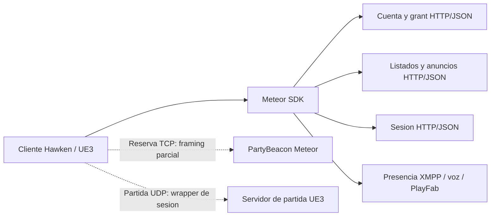

# HAWKEN — arquitectura observada y diseño futuro

## Inicialización concreta del driver — 2026-10-13

**CONFIRMADO estático.** EXE SHA `4a861ecb4ac7add9554f8daf8f98ad2c12b9cb6c1865a83e8be808beb46ea8a2`: vtable TcpNetDriver RVA15cd310, slot298/celda15cd5a8=`c06e9e4001000000`, selecciona callback9e6ec0. Si driver+1b0 es null y el nombre UTF16+1a0 no está vacío, carga una clase compatible con NetConnection mediante0e9560; guarda el resultado y devuelve su presencia. El caller9e70e0 almacena contexto+88 y devuelve1 sin comprobar ese retorno. [Cuerpo69 instrucciones, literales y errores de arnés preservados](../../implementation/evidence/native-server-reuse-research/ghidra-driver-init-callback/parent-contract.json) y [revisión independiente](../../implementation/evidence/udp-pri-integration/luna/next-prerequisites/native-callback-and-ack-review/native-callback-and-ack-review.json).

Interpretación: esta fase resuelve una **clase**, no una instancia de conexión o jugador. La correspondencia del nombre con NetConnectionClassName es **PROBABLE** por contexto; falta el binding reflejado. Las seis referencias conservadas y el scan directo E8 sólo hallan el wrapper conocido hacia4821c0; no excluyen consumidores virtuales/indirectos. Hosting seleccionado, autoridad y spawn/posesión siguen **NO VERIFICADOS**. El [protocolo de actores y MechSetup](HAWKEN_GAME_SERVER_PROTOCOL.md) mantiene sus requisitos separados. No hubo nueva ejecución del cliente ni modificación de originales.

## Reglas comunitarias y modo hardcore solicitados

Requisito añadido por el usuario: permitir al operador ajustar el daño para modalidades hardcore y, cuando el cliente original lo permita, desactivar HUD, minimapa y elementos de información. **DISEÑO PENDIENTE DE IMPLEMENTACIÓN Y VALIDACIÓN:** Core aplica las reglas de partida; Creator/panel permite configurarlas; Nexus publica los metadatos de esas reglas junto al servidor y su región. No se modifica el EXE ni se parchean UPK para prometer compatibilidad.

La existencia de una opción local de HUD no prueba que el servidor pueda imponerla. Hay que distinguir controles locales, comandos remotos y propiedades replicadas, comprobar sus consumidores y probar el resultado con el cliente original. El catálogo de controles disponibles se limitará a los que tengan evidencia. La progresión global permanece en el servicio de cuentas/economía separado; los límites de recompensas para partidas modificadas requieren política y validación propias, no se derivan automáticamente del multiplicador de daño. Primero se completa y verifica la partida normal.

## Nombres y despliegue previstos de HawkLink

Nombres propuestos por el usuario y adoptados para la documentación:

| Nombre | Alcance |
|---|---|
| HawkLink | Proyecto completo. |
| HawkLink Core | Servidor dedicado que ejecuta las partidas. |
| HawkLink Nexus | Master que registra, descubre y lista servidores comunitarios por región. |
| HawkLink Protocol | Documentación de endpoints, formatos y evidencia de ingeniería inversa. |

El servicio central de cuentas/economía y el Server Creator/panel siguen siendo componentes separados, todavía sin nombre propio. Estos nombres no cambian los identificadores del protocolo, nombres originales del juego ni ejecutables de los ensayos existentes.

**Diseño previsto, no infraestructura ya desplegada:** Nexus puede alojarse en un VPS accesible por los clientes; aún no hay proveedor, país ni dominio seleccionados. En el ensayo actual el Master sólo escucha en localhost. Los operadores alojan Core cerca de sus jugadores. Nexus entrega direcciones y regiones; el ping útil debe medir el trayecto cliente–Core, no Nexus–Core.

**CONFIRMADO por análisis estático — PortTester:** el cliente toma la IPv4 numérica de `listing.EndPoint` y realiza cinco intentos de conexión TCP no bloqueante al puerto fijo **15520**, con timeout de 1000 ms. Ignora `listing.Port` en esta prueba y conserva el menor resultado no negativo; no envía payload ni valida una respuesta de aplicación. Por tanto mide establecimiento TCP más el tiempo de planificación del cliente, no RTT del protocolo de combate. Archivo original `HawkenGame-Win64-Shipping.exe`, SHA-256 `4a861ecb4ac7add9554f8daf8f98ad2c12b9cb6c1865a83e8be808beb46ea8a2`; RVA `0xa4fbb0` (destino), `0xa6bc10` (connect), `0xa54980` (estadísticas), `0xa7ffc0` (consulta). Evidencia: `implementation/evidence/native-port-tester/contract.json` y `parent-review.json`, 51 hashes y 1053 instrucciones cotejadas. **NO VERIFICADO:** recepción real, asignación del resultado a la cifra visual del navegador y disponibilidad del juego. Si todos los intentos agotan el timeout, la ruta recuperada puede devolver el valor inicial 1000 pese al callback de fallo; no interpretar ese valor como prueba de conexión. Un listener compatible en Core es trabajo pendiente.

El combate debe ejecutarse con estado en memoria en Core, sin esperar una consulta SQL central por movimiento, disparo o impacto. El servicio global conserva en SQL las compras, cosméticos y progreso vinculados a la identidad Steam verificada. Un resultado sólo se acredita tras validación y transacción duradera, con identificador único para impedir doble acreditación al reintentar. Core debe conservar resultados pendientes hasta confirmación; eso aún requiere implementación. Si la conexión central falla, el combate no debe quedar bloqueado por ese enlace, pero las compras o recompensas globales pendientes no se presentan como confirmadas. Las políticas de admisión y continuidad sin conexión siguen pendientes de definición y prueba.

La latencia central puede afectar login, compras y sincronización de resultados; la latencia de combate depende principalmente del trayecto cliente–Core y de su ejecución. Separar responsabilidades evita poner Nexus o SQL dentro del ciclo de simulación, pero no elimina por sí solo esas latencias. La compatibilidad completa y el despliegue público continúan sin verificar.

Investigación iniciada2026-10-10; actualización2026-10-11. Instalación: `F:\SteamLibrary\steamapps\common\Hawken`. Este documento conserva evidencia/arquitectura; la implementación C++ vigente está en [el diseño local](../../implementation/HAWKEN_SERVER_LOCAL_DESIGN.md) y [su estado](../../implementation/IMPLEMENTATION_STATUS.md). Master/backend están ensayados separadamente, Steam de una cuenta validado y cinco GET de sincronización200 entregados en [094223](../../implementation/evidence/local-steam-routing-20261011-094223/parent-runtime-review.json), SHA `3a5ab95bad6718a3ab05a98d52e1fb8867bb47c1c6c4b41e3df6e2b738f6ca8d`. Menú, asignación de sesión, partida e integración del listado con Hawken **NO VERIFICADOS**. La decisión vigente del usuario es cuenta, economía y compras permanentes globales mediante un servicio central separado; el Master conserva sólo metadatos regionales. Los resultados históricos de esta introducción no describen por sí solos el estado actual de implementación.

Actualización2026-10-11: [21 suites/535 casos/19562 aserciones](../../implementation/evidence/menu-reliable-native-full-green/parent-acceptance.json), build/CTest0 y cinco originales intactos. Backend propio SHA `c9f93b10ca2bf74486a241308e78d3bc9d430fc207b4e73cdd7048d55b7dc803` integra los seis GET MenuSync; Master SHA `a54f5163d16f0309ad2f0b829990c046a203fe6d399da9a04eb9251e85e6ffa5` sigue como directorio separado sin cuentas ni saldos. El transporte fiable puro está verificado47/400, sin listener UDP. **CONFIRMADO construcción/fixtures; NO VERIFICADO partida, selección del Master por el cliente ni despliegue Linux.**

La siguiente conexión exige selección local autorizada, GET/session y distribución interna del mismo ID8/key32 al UDP, antes del control1a→1b→1c→1d→Hello. No se deduce esa provisión de un ticket Steam ni del listado. [Contrato de sesión](evidence/game/session-provision-contract/contract.json), SHA `d3cdcde052e3687982faca96cabce19443a2cce2c777899bebc3e97496ae20d0`, mantiene destinos por cuenta y rutas alternativas legacy/byGUID; emisión/TTL/revocación propios y compatibilidad real permanecen pendientes.

## Evidencia que determina las fronteras

Las etiquetas CONFIRMADO, PROBABLE y NO VERIFICADO se refieren a la muestra estática. Un diseño propuesto no es un descubrimiento del funcionamiento del servicio original.

| ID / estado | Archivo y SHA-256 | Localización | Evidencia observada e interpretación |
|---|---|---|---|
| ARC-01 CONFIRMADO | `Binaries\Win64\HawkenGame-Win64-Shipping.exe`, `4a861ecb4ac7add9554f8daf8f98ad2c12b9cb6c1865a83e8be808beb46ea8a2` | Imports PE en `evidence/pe-linkage.json`; funciones beacon RVA `0xa77b20`, `0xa77fb0`, `0xa76ea0` | Importa 341 funciones Meteor y funciones WSOCK32; contiene serializers de reserva/heartbeat propios. El backend HTTP y el networking del motor cruzan fronteras de módulos distintas. |
| ARC-02 CONFIRMADO | `Binaries\Win64\Meteor.Sdk.Cpp.Win32.Client64.dll`, `f63fef02ffb517ca7844a769d03412ad82bd22198397302ee3c090c63a970c57` | RVA `0x40a20`/`0x401b0`, transporte `0x6ed50`, envelope `0x708a0` | Constructor/ejecutor de login, WinHTTP y parser JSON Meteor. Es una biblioteca cliente de servicios; no demuestra un servidor desplegable dentro de la DLL. |
| ARC-03 CONFIRMADO | Misma DLL y hash | RVA `0x7de00`, `0x7f0d0`, `0x80e80`, `0x822e0`, `0x82d40`, `0x83b30` | Operaciones distintas de listado, filtro, advertisement y sesión. Comparten consumidor/base HTTP, sin demostrar que el backend original use un solo proceso. |
| ARC-04 CONFIRMADO | Misma DLL y hash | Parsers RVA `0x7a610`, `0x84150`, `0x84f40`; serializer `0x847d0` | Hay modelos JSON diferentes para GameServerListing, ClientMatchmakingAdvertisement y ClientSession. `Port` del listing es string; `AssignedServerPort` de sesión se convierte a int. No intercambiar estos tipos. |
| ARC-05 CONFIRMADO | `HawkenGame\Config\DefaultEngine.ini`, `6f839d73d16f512fbbf29e4d35ea12ba1e8604c8372ea72cad90dabff2526599` | Línea 143, offset `0x103f`; línea 456, offset `0x43f3` | Selecciona `OnlineSubsystemMeteor` y declara `bUseLegacyMatchmaking=true`. Es selección distribuida, no selección observada en ejecución. |
| ARC-06 CONFIRMADO | `Binaries\Win64\StormConsumerSettings.ini`, `08eda2cb20539996b7c1a91480c1ee2f64e02743c9bbee0bfc4f3543d8fec3d9` | Línea 4, offset `0x4d` | Declara una base Meteor HTTPS. Variantes de plataforma/entorno del EXE no prueban descubrimiento de múltiples masters. |
| ARC-07 CONFIRMADO | Meteor DLL y hash anterior | RVA `0xc9410`, `0xc01b0`, `0xa50c0`, `0x53e60` | Presencia XMPP, credenciales Vivox, login PlayFab y telemetría DeltaDNA tienen consumidores/flujos distinguibles. Su obligatoriedad para jugar sigue NO VERIFICADA. |
| ARC-08 CONFIRMADO | EXE y hash anterior | RVA `0xbc3510`, `0xc70e20`, `0xbe7a10`, `0xbe44e0`, `0xbeb170` | Inicialización usa base live-PC y override global alimentado por `MeteorURI=`. URI/socket locales y auth ya observados. El dispatcher polling/asignación y la copia SessionId/Key son estáticos; cambio de destino por browser, provisioning y failover siguen NO VERIFICADOS. |
| ARC-09 CONFIRMADO | EXE y hash anterior | RVA `0xa64090`, `0xa79510`, `0x998120`, `0xa63c10`, `0x9e7000`, `0x9e3550`, `0xa58380`, `0xa56390`, `0x9ef440` | SessionId/Key se decodifican de Base64url a 8+32 bytes, se insertan en contexto de conexión y alimentan wrapper de paquetes. Salida: ID8, contador8, payload transformado y tag32; recepción comprueba ID, dirección/contador y MAC antes de transformar. La política de admisión del servidor no está recuperada. |
| ARC-10 CONFIRMADO | EXE y hash anterior | Inicializador RVA `0x11c6e20`, vtable RVA `0x15c6d00`; constructores `0xa55e10`/`0xa55970`; callers `0xa64490`, `0xa63ae0`, `0xa633f0` | Factory +0x20 crea TCP para PartyBeacon; +0x10 crea UDP en inicialización de conexión de partida. Es trazabilidad estática del transporte, no una conexión ejecutada ni framing completo. |
| ARC-11 CONFIRMADO forma de lectura | EXE y hash anterior | RVA `0x9ee9e0`, `0x68200`, `0x804d0`, `0x83e40`, `0x6d7d0`; vtables `0x12bc4e0`/`0x1588d00` | Reader concreto usa bits LSB primero; bounded integers con límites `0x4000`, `0x800`, `0x400` y `8`, y payload cuya longitud se mide en bits. El camino crea/entrega canales; no demuestra toda la replicación ni una sesión jugable. |
| ARC-12 CONFIRMADO parsers | Meteor DLL y hash anterior | RVA `0x60730`, `0xd6880`; callers de inventario/transacciones en informe de cuentas | GameItem/Transaction aceptan object y procesan campos opcionales; Transaction contiene su propio Result string. Tolerancia de parser no define ownership, regla de progreso o política del servidor. |
| ARC-13 CONFIRMADO filtro local | `HawkenGame\CookedPCConsole\HawkenGame.upk`, `d1a33a064de4451e5a39e13a28e4a8f2913ce6d9b54ca65bae47118d32849ed0`; EXE y hash de ARC-01 | Export 26634, virtual `0x9c114f`; consulta EXE `0xbb9cf0` → SDK `0xb7a0`/`0x7f0d0` | Un callback del navegador filtra región/roles en el array recibido. La tarea HTTP examinada fija GameVersion/Map/GameType, sin SetRegion. El callback legacy alternativo no tiene ese mismo filtro. No convertir las regiones UI en enums wire inventados ni dar por probada la rama efectiva. |
| ARC-14 CONFIRMADO XP y telemetría | EXE y hash de ARC-01; Meteor DLL y hash de ARC-02 | EXE `0xdaea90`, `0xd89c40`, `0xd89550`, `0xdb1d60`, `0xdb23b0`, `0xbe0e10`; SDK `0x51740`, `0x526a0`, `0x52560` | ScorePoints aplica factores y mutaciones locales de XP; sus eventos llegan a una cola y luego a POST `/gameClientEvent` con array JSON. El 202 es aceptación local. No acredita commit SQL, recepción remota o autoridad para otorgar progreso. |
| ARC-15 CONFIRMADO imports; puente PROBABLE/NO VERIFICADO | EXE y hash de ARC-01 | DINPUT8 descriptor RVA `0x1ad30a8`, IAT `0x128e078`; DXGI delay descriptor `0x1ad2c9c`, IAT `0x1bb6228` | DINPUT8 es candidato estático de DLL adicional; DXGI diferido y VERSION sin import en 86 PE. [Bytes y ambiente](evidence/dll-bridge-feasibility.json). No se probó loader/forwarding/timing ni se instaló un puente. |
| ARC-16 CONFIRMADO HP y gates, saldo durable NO VERIFICADO | HawkenGame.upk y hash ARC-13; EXE y hash ARC-01 | IncrementPlayerHP #38615 virtual `0xbf18ec`; WriteStats #10231 `0x7e6407`; Give tick EXE `0xbe4400` | Acumulación HP y gate por reglas modificadas recuperados. Tarea Give observada sólo marca estado/tiempo; no acredita concesión backend. [Evidencia](evidence/auth/creator-progression-findings.json), [cuentas](HAWKEN_ACCOUNT_AND_EVENT_FINDINGS.md). |

Fuentes nativas: [decompilación principal del SDK](evidence/ghidra-sdk-functions.jsonl), [servicios](evidence/ghidra-sdk-services.jsonl), [auxiliares](evidence/ghidra-sdk-auxiliary.jsonl), [schemas](evidence/ghidra-sdk-schemas.jsonl) y [parsers de resultados](evidence/ghidra-sdk-results.jsonl). Cada registro incluye hash del programa, dirección de entrada, pseudocódigo y referencias. El [batch de 29 funciones EXE](evidence/ghidra-main-functions.jsonl) conserva el ID REA `ev_f40e06077c59faa017ce58b417dd5336de0da3db2a4af0895c3744c66a44651c` y su fuente completa. El detalle contractual está en [autenticación](HAWKEN_AUTH_PROTOCOL.md), [endpoints](HAWKEN_ENDPOINT_CATALOG.md), [master/matchmaking](HAWKEN_MASTER_SERVER_PROTOCOL.md) y [partida](HAWKEN_GAME_SERVER_PROTOCOL.md).

## Modelo observado

El código demuestra un conjunto de operaciones cliente. La secuencia completa usada por una sesión del juego y la correlación entre grant, advertisement, reserva y admisión UE3 son PROBABLES o NO VERIFICADAS donde se indica.

Las flechas HTTP corresponden a calls y parsers observados. Las flechas hacia la partida no prueban un flujo ejecutado. Ningún destino externo fue contactado.

Fuentes adicionales: [flow EXE](evidence/ghidra-main-flow.jsonl), [admisión y decodificación](evidence/ghidra-main-admission.jsonl), [inicializadores](evidence/ghidra-main-auth-socket.jsonl), [conexión UDP](evidence/ghidra-main-gameplay.jsonl), [vtable original](evidence/socket-singleton-vtable.json), [wrapper](evidence/ghidra-main-session-packet.jsonl), [primitivas](evidence/ghidra-main-crypto-primitives.jsonl), [recepción](evidence/ghidra-main-crypto-wire.jsonl) y [entrada al lector de bits](evidence/ghidra-main-packet-receiver.jsonl). Identificación ChaCha20 original/HMAC-SHA512 truncado a 256 bits: PROBABLE por estructura; no se ejecutó un vector contra el binario.

La continuación estática se conserva en [lector de paquete](evidence/ghidra-main-final-reader.jsonl), [helpers](evidence/ghidra-main-final-bits.jsonl), [constructor](evidence/ghidra-main-bitreader-ctor.jsonl), [vtable/máscaras originales](evidence/bitreader-vtables.json), [métodos concretos](evidence/ghidra-main-bitreader-methods.jsonl) y [AtEnd recuperado](evidence/ghidra-main-bitreader-atend.jsonl). El probe inicial no reconocido de AtEnd se conserva; su definición se creó sólo en memoria durante un proceso readOnly, sin cambiar el PE o guardar cambios de análisis. [GameItem/Transaction](evidence/ghidra-sdk-final-models.jsonl) completan la estructura de esos modelos; autoridad y datos del backend siguen pendientes.

## Arquitectura futura propuesta

**Requisito del usuario:** una cuenta Steam legítima y autenticación válida serán obligatorias para acceder al futuro servicio. La identidad Meteor/perfil y la sesión de partida deberán estar vinculadas a esa identidad Steam verificada. No se diseñan cuentas invitadas ni emisión de grants que sustituya la validación de Steam. Las rutas por contraseña o grant heredado presentes en la muestra son hallazgos del cliente; no establecen una excepción a este requisito del diseño futuro.

Los dos productos principales solicitados son **MasterServer de listado por región** y **Server Creator descargable con dependencias y panel de mapas/eventos/XP**. El Master sólo consulta la proyección de listings/ubicación y filtros; el servicio de registro recibe altas/heartbeats y publica esa proyección. Autenticación, cuentas/progreso/SQL, matchmaking y sesiones permanecen separados: son contratos requeridos por el cliente, no funciones asignadas al directorio. La región del servidor no identifica la ubicación personal de jugadores.

Se recomienda una fachada Meteor delante de identidad/perfil, directorio, asignación/sesiones y partida. Pueden comenzar como módulos de un backend, conservando interfaces separadas; dividir procesos no cambia por sí solo el wire. La existencia de esos procesos en la infraestructura original es NO VERIFICADA.

| Componente propuesto | Responsabilidad e interfaz visible al cliente | Condición para llamarlo compatible |
|---|---|---|
| Autenticación y perfiles | Autentica una cuenta Steam legítima mediante integración autorizada y vincula su identidad a Meteor/perfil. Conserva las rutas usadas por el cliente, el envelope `Status`, `Message`, `Result`, grant escalar y prefijo `Authorization: Basic `. | Verificar el ticket Steam por el mecanismo legítimo correspondiente, además de escape doble del identificador, tipos, errores y reglas del grant. No reemplazarlo por Basic de email/contraseña ni presumir JWT estándar. |
| Directorio o Master Server | Atiende GET `/gameServerListings/{id}`, filtros `/gameServerListings` y `/userGameServers/{user}`. Publica el esquema wire recuperado, respetando `Endpoint` y `Port` string. | Conocer campos opcionales/obligatorios, filtros/escape/paginación y conversión a `StormGameServerListing` local del motor. Mantener consistente la región visible en la ruta UI seleccionada. El registro remoto original no está demostrado. |
| Matchmaking y sesiones | POST, GET y DELETE de advertisements de cliente; GET `/session`. Correlaciona OwnerGuid, Users, región/versión, asignación y claves de sesión. | Reproducir transiciones y tipos de `ClientMatchmakingAdvertisement`/`ClientSession`, incluidas las lecturas repetidas observadas de `SkillRatingSearchMin`. Vincular la sesión con la admisión a la partida. |
| Game Server | Sostiene reservas/beacon y después conexión, canales, replicación, RPC y gameplay UE3 de esta versión. | Recuperar transporte, framing, handshake y serialización del fork. Una respuesta HTTP o beacon correcta no demuestra una partida jugable. |

Los campos se adaptan en la frontera de protocolo; no deben renombrarse para igualarlos al modelo interno. El status HTTP, el `Status` del envelope y el estado local del objeto ApiResult son tres valores diferentes. El resultado de POST advertisement es una string JSON dentro de `Result`; el resultado GET advertisement es un objeto. Estos contratos deben conservarse aunque el almacenamiento interno use otros tipos.

Perfil, inventario, party y presencia pueden requerirse para alcanzar la pantalla de búsqueda y crear reservas. El conjunto mínimo no está demostrado por el mero hecho de recuperar login/listado. Un futuro adaptador debe registrar sólo estados y fallos necesarios para validación, sin conservar contraseñas, grants, tickets Steam ni credenciales de voz.

### Registro y salud de servidores

**DISEÑO PROPUESTO — NO VERIFICADO en el cliente original:** cada Game Server anuncia a una interfaz interna propia su identidad, dirección alcanzable, versión, mapa, modo, capacidad y estado. El servicio de registro controla leases/expiración y produce la proyección publicable; el MasterServer sólo la consulta y lista. Matchmaking reserva capacidad con una identidad de sesión común. Esta interfaz interna no se presenta como protocolo recuperado de Hawken y no tiene todavía un formato HTTP/UDP asignado.

Se cerraron los consumidores concretos: EXE `0x400560` → `0x7fdf60` sólo devuelve 1; Refresh `0xbdc880` copia una entrada de caché; CreateOnlineGame no LAN `0xb84690` → `0xb84060` retorna fallo `0x80004005`; Update `0xb9aba0` modifica estado local. Archivo/hash EXE de ARC-01, [bindings y cuerpos](HAWKEN_MASTER_SERVER_PROTOCOL.md). Los defaults `AdvertisementHeartbeatFrequency` y `ServerListingUpdateRate` no convierten esas operaciones locales en publicación remota. El alta/update/heartbeat dedicado original sigue NO VERIFICADO; una interfaz propia de registro debe etiquetarse como diseño nuevo.

### Descubrimiento de varios Master Servers

**DISEÑO PROPUESTO — NO VERIFICADO como función nativa de Hawken:** varios nodos de directorio se mantienen detrás de la misma fachada que entiende el cliente. Un registro interno compartido o federado permite que cualquiera atienda la consulta y entregue destinos válidos. Grants, advertisement IDs y sesiones deben conservar significado al cambiar de nodo; los estados de reserva y caducidad requieren una autoridad común.

La fachada puede seleccionar nodos internamente según salud/región. El cliente usa rutas recuperadas y recibe varios servidores de partida. Un catálogo web/panel permite elegir comunidad y cambiar manualmente la única URI del INI con el juego cerrado, una vez viable esa vía; no requiere launcher. Un catálogo interpretado por el propio cliente requiere parser/selector demostrados, todavía ausentes. Las nueve URLs `v2-services` son candidatos de plataforma/entorno, no federación demostrada.

### Encaminamiento por INI y HTTPS, sin launcher

El usuario exige Steam normal y selección por `MeteorUri` del INI plano `Binaries\Win64\StormConsumerSettings.ini`, línea4/offset `0x4d`, hash StormCfg de ARC-06, sin launcher. **CONFIRMADO:** SDK factory `0x1edd0`/`0x1ee80` → `0x1ef50` → `0x74220` lee INI; luego EXE `0xbc3510` llama setter slot0/SDK `0x74810` y sobrescribe URI con live-PC/global. Slot `+0x28`/`0x74c00` activa executor sin releer. [Cadena y bytes](evidence/auth/ini-endpoint-flow.json), con hashes SDK/EXE antes citados. El [cierre del dispatcher](evidence/auth/ini-endpoint-native-closure.json) enlaza Init UPK → wrapper `0x3ff0f0` → vtable `0x169c610`, slot `+0x288` → `0xbc3510`. La fuente global se trazó desde GetCommandLineW en `0xc77450` hasta el parser de `MeteorURI=`. **INI-only está contradicho en este camino**; no se encontró otro selector original de API en los consumidores revisados, sin demostrar ausencia universal. La revisión admite una DLL adicional que preserve la URI en memoria sin editar binarios originales en disco: es un diseño nuevo **NO VERIFICADO**, no un arreglo ya probado. `dinput8.dll` es candidato PROBABLE por ARC-15; carga, forwarding, momento seguro fuera de DllMain y efecto frente a SDK `0x74810` son gates. `MeteorURI=` sigue fuera de la solución solicitada. La fachada propia enruta auth/perfiles/sesiones/directorio a módulos separados; TLS/pinning pendientes. No se modificó siquiera el INI ni se añadió una DLL al juego. [Procedimiento y pruebas](HAWKEN_FULL_IMPLEMENTATION_PLAN.md).

### Panel, eventos y persistencia del Server Creator

El Creator gestiona instancias, puertos/SQL, mapas/modos existentes, bots, eventos XP/créditos, sanciones y mensajes por un plano administrativo propio. Los guards/flags de administración y rutas de bots/mapas se recuperaron; ejecución remota y efectos runtime siguen NO VERIFICADOS. [Funciones y coordenadas originales](HAWKEN_GAME_SERVER_PROTOCOL.md). ARC-14/16 proporcionan observaciones/cálculos locales: el backend futuro aplica progreso sólo por resultados de GameServers autorizados, Steam, reglas y transacción SQL. Créditos ganados jugando permitidos; MP premium/dinero real/monetización excluidos. Práctica, progreso local y compartido tienen elegibilidad distinta; no eludir el gate bModifiedGameRules. La telemetría cliente nunca otorga recompensas. El [diseño Creator y brainstorming](HAWKEN_SERVER_CREATOR_DESIGN.md) desarrolla dashboard estilo txAdmin, diagnóstico por transporte, roles, ledger, scheduler y sus pruebas. Windows/Linux siguen sin runtime GameServer validado.

La última revisión aplaza nuevos UPK/cook/extensiones: primera entrega con perfil cerrado de paquetes originales por SHA-256/tamaño. [360/360 rehashados](evidence/original-upk-sha256-manifest.json), sin cambios en el host de investigación. Un manifiesto observado local sin firma no acredita aprobación Valve; GUID o SHA declarado por el cliente tampoco prueban sus bytes cargados. Verificación del host y enforcement/attestation remoto se prueban y reportan por separado, todavía NO VERIFICADOS como producto.

## Autoridad de recompensas — decisión global y evidencia local histórica

La decisión vigente del usuario exige **cuentas, economía y adquisiciones permanentes compartidas entre servidores**, mediante un servicio central separado del Master. Sustituye el diseño anterior de progreso por servidor. El Master sólo publica metadatos de servidores/regiones; los GameServers producen resultados y el servicio central valida procedencia, reglas, límites y duplicados antes de acreditar recompensas en SQL. El Creator administra sus instancias con permisos locales; esos permisos no autorizan concesiones globales ni tasas arbitrarias de recompensa. [Diseño C++ vigente](../../implementation/HAWKEN_SERVER_LOCAL_DESIGN.md). Las pruebas locales siguientes conservan su alcance histórico y no demuestran una economía global implementada.

El almacén local implementa identidad, saldos y grant atómico del inventario inicial; la progresión por partidas permanece pendiente. [Gate Windows](../../implementation/evidence/starter-profile-native-green/parent-acceptance.json): 465 casos/16072 aserciones. [Servicios121321](../../implementation/evidence/local-services-starter-20261011-121321/parent-runtime-review.json), SHA `c6fc3b67690628dd1840a3e040ceed81a94b48fffe735e88f85258a8a31a428e`: backend/Master ejecutados y SQLv3, sólo consultas del operador. Ni aislamiento multiusuario runtime, uso del Master por Hawken ni gameplay están aceptados. Steam confirma identidad según el método válido, no resultados de una partida.

Cosméticos antes vendidos son candidatos a grants/canjes ganados de objetos presentes y compatibles, sin compras ni monetización. La posibilidad por objeto requiere catálogo, inventario, equipamiento y persistencia comprobados; no se suplanta propiedad/licencia Steam ni se modifica UPK. Créditos por puntuación, curación o asistencias necesitan datos autoritativos y límites contra fabricación, no una notificación XP de cliente. [Brainstorming, autoridad, rates y pruebas](HAWKEN_SERVER_CREATOR_DESIGN.md), sección9; [contratos/catálogo](HAWKEN_AUTH_PROTOCOL.md) y [métricas del juego](HAWKEN_GAME_SERVER_PROTOCOL.md).

## Comparación de enfoques

| Enfoque | Ventaja | Límite |
|---|---|---|
| Fachada Meteor y responsabilidades internas separadas — recomendado | Permite probar contratos recuperados y ampliar cobertura sin imponer nuevas rutas al cliente. Admite varios directorios internos. | Requiere completar los contratos y la selección segura del endpoint. |
| Emular un master genérico con lista IP:puerto | Es pequeño como prototipo de directorio interno. | La evidencia muestra modelos/auth/matchmaking/sesiones personalizados; no satisface por sí solo al cliente Hawken. |
| Reutilizar un servidor UE3/UDK genérico | Puede aportar código de referencia de canales y replicación. | No demuestra versión ni wire del fork Hawken, requisitos Meteor, clases o gameplay compatibles. |

## Orden de validación futura

1. Completar el flujo de identidad Steam legítima y su validación autorizada; contrastar fixtures del envelope, perfil, listings, advertisements y sesión contra sus parsers, con valores sintéticos para parsing y sin conservar credenciales reales. Un fixture sintético no acepta una identidad Steam ni prueba autenticación.
2. Validar selección de servicio, call path de matchmaking/reserva/travel y la admisión de la sesión ya vinculada al wrapper de paquetes. Verificar timers, estados y vencimientos en funciones consumidoras.
3. Recuperar y validar beacon bidireccional y handshake/replicación del motor antes de evaluar una partida; después probar múltiples directorios detrás de la fachada y caída de un nodo.

Son criterios de aceptación de un trabajo posterior, no checks ejecutados de servidores existentes. Los obstáculos y la cobertura exacta están en [HAWKEN_UNKNOWN_AND_BLOCKERS.md](HAWKEN_UNKNOWN_AND_BLOCKERS.md).

El [plan completo](HAWKEN_FULL_IMPLEMENTATION_PLAN.md) y [diseño Creator](HAWKEN_SERVER_CREATOR_DESIGN.md) cubren Master regional, descarga/dependencias/dashboard, Windows/Linux, red/SQL, consultas, sanciones, mensajes, bots/modos existentes y XP/créditos ganados sin monetización. INI/Steam sin launcher con puente opcional pendiente; UPK nuevos aplazados, integridad SHA de originales. Contratos en [cuentas/eventos](HAWKEN_ACCOUNT_AND_EVENT_FINDINGS.md). Son diseño/evidencia estática, no implementaciones desplegadas.

## Reutilización del motor mediante DLL — trazado de principio a fin, 2026-10-13

La petición vigente es comprobar si nuestra DLL puede integrar funciones nativas ya presentes y reducir la reconstrucción manual. La investigación conserva el EXE original en disco. Tener una dirección de función no demuestra una interfaz invocable: deben cerrarse clase/vtable, argumentos, estado requerido, hilo, ciclo de vida y resultado. El puente actual encamina HTTP y vincula identidad Steam; no implementa todavía esta integración de gameplay.

Muestra nativa: `Binaries/Win64/HawkenGame-Win64-Shipping.exe`, SHA-256 `4a861ecb4ac7add9554f8daf8f98ad2c12b9cb6c1865a83e8be808beb46ea8a2`. Las direcciones siguientes son RVA. [Contrato estático y bytes](../../implementation/evidence/native-server-reuse-research/contract.json), [inicialización conservada](../../implementation/evidence/m1-server-viability/engine-init.jsonl) y [bucle exterior conservado](evidence/ghidra-main-upk-override-source.jsonl).

| Tramo y evidencia observada | Estado y comprobación pendiente |
|---|---|
| Arranque: `104de30 → c77450 → c6fa40 → c6f890 → c70e20`. El parser compara `SERVER`/`SERVERCOMMANDLET` y selecciona el literal `Engine.ServerCommandlet`. | **CONFIRMADO estático** el camino de selección; **NO VERIFICADO** que resuelva una clase concreta utilizable. No acredita las opciones `-server`/`-dedicated`. |
| Inicialización normal: `c6f890 → c6fa80`. `c6fa80` usa `engine-ini:Engine.Engine.GameEngine`, resuelve/construye el objeto en global `1cfb860` y despacha vtable `+290`. El constructor `d943e0` instala vtable `17d73b0`: `+290 → d89fa0`, que llama `48c0c0` y registra callbacks `57–5d` mediante global `1bbe410`, slot `+50`. | **CONFIRMADO estático** el selector, construcción y destino del slot para esa clase. El INI original selecciona `HawkenGame.HawkenGameEngine`; identidad efectiva del objeto en ejecución **NO VERIFICADA**. El objeto separado `1cf19e8` usa el selector Oculus; no confundirlo con GameEngine. |
| Bucle exterior: `c6f890` llama repetidamente `c75370` hasta que global `1bbe470` solicita salida; después llama `c6e9b0`. `c75370` despacha `+2c0`, `+2c8` y `+288` en `1cfb860`. Para la vtable indicada, `+288 → dc04b0`: despacha dos eventos por `+240`, antes/después de llamar `49e7c0`. | **CONFIRMADO estático** el bucle y estos dispatchers. No implica que los eventos ni el tick se hayan ejecutado en un servidor. |
| Carga de mapa/mundo: Init base `48c0c0` despacha `+3b8 → 47ee80`; este Browse/URL dispatcher llega a `+3c0 → 492100`. LoadMap `492100` llama `788cd0` en `494689`, y `77a2e0` en `4947be`. Tick base `49e7c0` llama `52edd0(global 1cfffb0, 2, delta)` en `49e95c`. | **CONFIRMADO estático** las celdas y llamadas. Semántica completa de SetGameInfo/Listen/autoridad **NO VERIFICADA**; no equiparar carga de mapa cliente con mundo servidor. |
| Transporte no cliente: `a648b0` pasa modo cero a `a633f0`; este conserva factory UDP y bind con puerto del URL. | **CONFIRMADO estático** la primitiva. **NO VERIFICADO** que el arranque de esta build la alcance como servidor operativo. |
| Admisión, creación de PlayerController/PRI/Pawn, enlaces y posesión; replicación, RPC, daño y fin de partida. | **NO VERIFICADO** un servidor nativo reutilizable. El ensayo propio actual sigue bloqueado por PRI/enlaces/posesión; HTTP correcto y ACK de un canal no satisfacen este tramo. |
| Guard del hosting del menú: `WorldInfo.IsClientOnlyBuild` registra wrapper `400560 → 7fdf60`; el helper retorna uno y `LaunchGame` excluye `?listen` en esa rama. | **CONFIRMADO estático** en esta muestra. No cambiar un helper compartido ni inferir que suprimir el guard habilita un servidor completo. |
| Cierre: identificar parada de red, liberación de mundo/objetos, callbacks y persistencia antes de reutilizar funciones desde DLL. | **NO VERIFICADO** el ciclo de vida completo. Windows/Steam es la primera validación; reutilizar el PE no demuestra un GameServer nativo Linux. |

Se reutiliza el proyecto `HawkenMain` de Ghidra 12.1.4, con extracciones enfocadas en modo `readOnly/noanalysis`, heap de 768 MiB y un CPU. El autoanálisis inicial terminó por timeout histórico; sus referencias negativas no son exhaustivas. La [extracción del dispatcher `c75370`](../../implementation/evidence/native-server-reuse-research/ghidra-startup-tick/functions.jsonl), SHA `cff83126175328f8d6cccc8d4ad6e6dd33189e53d1650d37336d3d352a4942af`, terminó y sus 368 instrucciones coinciden con el archivo original. La [extracción Init/Tick](../../implementation/evidence/native-server-reuse-research/ghidra-engine-init-tick/functions.jsonl), SHA `ece3db22a2d3490931b17be87bc570438621a98914a3ad9c8a4537d5ffcb2315`, terminó con salida cero: dos funciones completas y [114 instrucciones comprobadas contra el PE original](../../implementation/evidence/native-server-reuse-research/ghidra-engine-init-tick/original-byte-verification.json). Los nueve hashes de entrada permanecieron iguales antes/después. El enlace clase/constructor/vtable está en [engine-followup-2](../../implementation/evidence/native-server-reuse-research/engine-followup-2/contract.json), con RVA, offsets, cuerpos y celdas originales. Los cuerpos base `48c0c0` y `49e7c0` ya están recuperados en la continuación indicada abajo; el siguiente borde pendiente es demostrar la creación del mundo servidor desde SetGameInfo y Listen. Estos resultados son estáticos; no se considera terminada la investigación de principio a fin hasta cerrar todos los tramos anteriores con la evidencia requerida.

La continuación headless recuperó también `48c0c0`, `49e7c0`, `c48d0`, `e97e0`, `492100` y `52edd0`, con 8.945 instrucciones adicionales comparadas byte por byte contra el mismo EXE original. [Bases y wrapper de clase](../../implementation/evidence/native-server-reuse-research/ghidra-engine-base-loader/functions.jsonl), SHA `62da0da87cd402e681b82900e70f10bf0a088571bcf42d5433b22bc42f5855a0`; [cargador](../../implementation/evidence/native-server-reuse-research/ghidra-class-loader/functions.jsonl), SHA `a0a4d986c585dbadf50127149f92ce1bd144ef123e68e435ff28996dfc1a7ed6`; [LoadMap/world Tick](../../implementation/evidence/native-server-reuse-research/ghidra-world-load-tick/functions.jsonl), SHA `edb95fb4f4a64495087065e8f2e4e31e8fa1efdcd79790a8a481e3a7b4a77642`. Verificaciones originales en `original-byte-verification.json` de cada carpeta; salidas Ghidra cero, inputs conservados. El cargador no es un stub vacío: contiene búsqueda, carga de paquete/objeto y error, pero no demuestra que resuelva `Engine.ServerCommandlet` en esta build.

### Contraste con repositorios externos — 2026-10-13

Se revisaron fuentes públicas sin ejecutar sus programas ni aplicarlas al juego. Los [archivos retenidos](../../implementation/evidence/native-server-reuse-research/external-repo-comparison/intake.json) tienen commit, ruta, tamaño, SHA-256 y Git blob comprobado. Estas referencias no forman parte del producto; sus layouts y firmas no se transfieren entre versiones.

| Referencia y evidencia | Interpretación y estado |
|---|---|
| [atom0s/hawkenject](https://github.com/atom0s/hawkenject/blob/e8eb99f239fb4ac3613704a62898c66e35faf1e8/src/hook/main.cpp), commit `e8eb99f239fb4ac3613704a62898c66e35faf1e8`, `src/hook/main.cpp`, SHA `45eabb1c5303ff1101a745b1adb95837cc72d59b6f1552c773f27d94102d6ca4`, líneas161–309 y493. `Mine_UWorld_Listen` construye NetDriver, llama InitListen, registra paquetes/notificaciones, crea actores del servidor y asigna NetMode. El hook de SetGameInfo ejecuta el original y luego esa reconstrucción. El README selecciona versión `1.5.3.142579`; punteros `int32_t` y ensamblador `pushad` son evidencia de la integración x86. | **CONFIRMADO** el contenido de esa implementación, no su éxito runtime aquí. **PROBABLE** como esquema de investigación para la DLL propia: cerrar los equivalentes x64 y demostrar qué llamada falta. **NO VERIFICADO** compatible con Steam `1.6.0.154767`. Licencia declarada AGPL-3.0; no se incorporó código externo al producto. |
| [Sigil9963/PaxPlus](https://github.com/Sigil9963/PaxPlus/tree/fbbfa0b64ce07e8ad31a85e70d5afe134d1f0bf1), commit `fbbfa0b64ce07e8ad31a85e70d5afe134d1f0bf1`, `PAXPlus/PAX+ Instructions & Changelog.txt`, SHA `f262aa54decbf6bf3a173eac7be47b71c809a2835073821ad857d1c0736ccef4`, líneas5–10 y176–181. Describe la build PAX, conexión mediante `open IP`, launcher y herramientas para sus paquetes. | **CONFIRMADO** que la solución documentada usa otro cliente. Sirve para comparar configuraciones/clases; **NO VERIFICADO** que solucione el hosting retirado de nuestra build. No se descargó cliente PAX, ni se aplicaron mods/UPK. |
| [hawakening/k8s-manifests](https://github.com/hawakening/k8s-manifests/tree/b2e7e74a62710a7fe38f727ec7484af6b83f282d), commit `b2e7e74a62710a7fe38f727ec7484af6b83f282d`. README SHA `934fee0cb3adb90619f809ddab56ad58d491e6a96d0cdbb3340e3aefa9445701`; `workloads/manifests/hawakening/templates/20-backend.yaml` SHA `8dd3162ccbdd5f4f9b30812cba8abd1e7783ef77ced99274eb83e2d6bbba2b22`. Documenta despliegue y referencia una imagen backend. | **CONFIRMADO** que estos archivos son manifiestos de infraestructura. No aportan en el contenido revisado la implementación de Listen/posesión/replicación; esos algoritmos siguen **NO VERIFICADOS** desde esta referencia. No se accedió a servicios, paneles ni imágenes privadas. |

El contraste prioriza el borde `SetGameInfo → Listen` del cliente x64, y conserva después los gates de actor/PRI/posesión y replicación. Es una alternativa investigada a reproducir manualmente todo el wire; todavía no autoriza declarar funcional el servidor local ni abandonar los requisitos Windows/Linux.

### Continuación sin cliente — SetGameInfo e inicialización del mundo, 2026-10-13

En el EXE original SHA `4a861ecb4ac7add9554f8daf8f98ad2c12b9cb6c1865a83e8be808beb46ea8a2`, la [extracción de `788cd0`](../../implementation/evidence/native-server-reuse-research/ghidra-world-set-game-info/functions.jsonl), SHA `7e0d0d04def2c11fed3d71b96691f6d8100c75856cba3ccc38b0ab84315a3c77`, terminó con salida cero y 569 instrucciones comprobadas contra el PE. **CONFIRMADO:** lee el mundo/URL, selecciona y crea GameInfo, y guarda el resultado en WorldInfo `+5e8`; retorna si ya hay GameInfo o un driver con ServerConnection. Los literales `GAME=`, `Listen`, `game-ini:Engine.GameInfo.DefaultGame`, `game-ini:Engine.GameInfo.DefaultServerGame` y `Game class is '%s'` respaldan la identificación. Aquí `Listen` cambia la selección de clase; no es una implementación de escucha de red. El [contrato y literales originales](../../implementation/evidence/native-server-reuse-research/engine-followup-5/contract.json) conserva RVA/offset/bytes y límites de la interpretación.

Configuración original `HawkenGame/Config/DefaultGame.ini`, SHA `dc2a794217d13d8e7af4719c087dfbbfb4e36cbe433dd8474caaa893ddd7be00`, líneas40–42: tanto `DefaultGame` como `DefaultServerGame` seleccionan `HawkenGame.HawkenGameGeneric`; `DefaultGameType` selecciona `HawkenGameContent.HawkenDM`. **CONFIRMADO** el contenido del archivo; clase efectiva, autoridad y disponibilidad de todos los modos en ejecución **NO VERIFICADAS**.

La [extracción posterior `77a2e0`](../../implementation/evidence/native-server-reuse-research/ghidra-world-init/functions.jsonl), SHA `5729e7a8dceeb179bb4a04f0f496cf8a9fc8330d009f3a14f821a07fbc80a998`, terminó con salida cero y 618 instrucciones comprobadas. **CONFIRMADO:** LoadMap la llama en `4947be` con World, URL y uno; contiene reinicio condicional de campos temporales, inicialización de actores y llamada `7914e0` sobre GameInfo cuando existe y cumple su guard. **PROBABLE** identificación como etapa BeginPlay/inicialización de partida; nombres exactos de los callees, ABI invocable y cadena completa de Listen/autoridad siguen **NO VERIFICADOS**. Ambas carpetas conservan `inputs-before.json`, `inputs-after.json`, `exit.txt` y `original-byte-verification.json`. No se abrió Hawken, no hubo tutorial ni se modificaron binarios originales.
### Registro de drivers y cambio de mundo — 2026-10-13

EXE original SHA `4a861ecb4ac7add9554f8daf8f98ad2c12b9cb6c1865a83e8be808beb46ea8a2`. [RVA486fd0](../../implementation/evidence/native-server-reuse-research/engine-followup-7/contract.json): **CONFIRMADO** búsqueda lineal de pares existentes en this+aa4/count+aac, stride16; compara la clave y devuelve el valor+8. 46 instrucciones cotejadas con el PE. No construye ni inicia el driver. [RVA16a5a0 y a648b0](../../implementation/evidence/native-server-reuse-research/engine-followup-8/contract.json): 109 instrucciones cotejadas. El primero comprueba la jerarquía contra la clase `Engine` y devuelve el mismo puntero; no crea otro objeto. El segundo es el inicializador de escucha de `TcpNetDriver`: llama la primitiva UDP a633f0 con modo0 y actualiza host/puerto del URL tras éxito. Constructor a67790 instala vtable15cd310, cuyo slot+2c0, celda15cd5d0, apunta a a648b0. Esto demuestra el binding estático; no demuestra un caller de hosting seleccionado ni un servidor funcionando.

[Transición de mundo RVA78c080](../../implementation/evidence/native-server-reuse-research/engine-followup-9/contract.json): **CONFIRMADO** traslado de drivers existentes World+120/+188, actualización notify+88, conservación de GameInfo/NetMode/tiempos y llamada77a2e0; etiqueta de método seamless travel **PROBABLE**. Las llamadas virtuales+2c0 usan Engine+6f8 y su resultado, sin binding de TcpNetDriver; el receptor World+120 usa+2e8. No se pueden sustituir unas por InitListen por compartir un desplazamiento. La cadena Engine+700/count708→entry+68 aporta un candidato para localizar el actor local; tipos concretos, propiedades Pawn/PRI y locator pasivo seguro siguen pendientes. Todos los hashes, RVA, offsets, instrucciones y límites se conservan en los contratos enlazados. No hubo lanzamiento del cliente, parche, invocación nativa ni alteración del original.

### Creación de la instancia y registro en Engine — 2026-10-13

EXE original SHA `4a861ecb4ac7add9554f8daf8f98ad2c12b9cb6c1865a83e8be808beb46ea8a2`. El [contrato12](../../implementation/evidence/native-server-reuse-research/engine-followup-12/contract.json), SHA `1cc6d68600067862fc870905e6c11eeb94d730171511d8ba3226d84f838aa498`, conserva cada instrucción/RVA/offset, literales y referencias originales. **CONFIRMADO estáticamente:** el literal `UGameEngineexecCreateNamedNetDriver` en RVA140a118/raw1409518 se empareja con el wrapper3faec0 en RVA1af74a0/raw1af68a0. El wrapper llama4821c0, que invoca el slot+338 del receptor y registra el resultado no nulo como par de16bytes en Engine+aa4/count+aac, clave+0/driver+8.

El constructor d943e0 instala vtable17d73b0; su celda17d76e8 (+338) contiene VA140481cd0. **CONFIRMADO** para una instancia con esa vtable:481cd0 selecciona clase compatible con NetDriver mediante los literales `engine-ini:Engine.Engine.NetworkDevice` (RVA1431720) y, si falla, `engine-ini:Engine.Engine.FallbackNetworkDevice` (RVA1431780); pasa la clase a0dba20, cuya construcción UObject/llamada al constructor ya estaba cotejada. Su retorno RAX es consumido por4821c0: la firma `void` propuesta por el decompilador no representa ese comportamiento de máquina. Las tres funciones nuevas suman141 instrucciones originales verificadas independientemente. Los [contratos10](../../implementation/evidence/native-server-reuse-research/engine-followup-10/contract.json) y [11](../../implementation/evidence/native-server-reuse-research/engine-followup-11/contract.json) distinguen el registro UClass y su herencia de esta construcción de instancia.

El INI del usuario `C:\Users\Jerico\Documents\My Games\Hawken\HawkenGame\Config\HawkenEngine.ini`, SHA `2662f9dbb3f02281a9c5ef98abc194f4cfbced3f027e25382caf18c02307042d`, líneas36–37, configura ambos selectores como `IpDrv.TcpNetDriver`. **CONFIRMADO** el archivo; selección efectiva y objeto vivo **NO VERIFICADOS**. La [aceptación acotada del padre](../../implementation/evidence/headless-integration-20261013/parent/driver-creation-acceptance.json) revisa seis cuerpos/723 instrucciones y111 pins de evidencia. Todavía falta el consumidor de hosting que use la instancia, invoque InitListen, conecte World/notify y complete SpawnServerActors/NetMode. No se ejecutó el juego, no se invocaron funciones nativas ni se modificaron originales.

### Lector pasivo de instancias locales — 2026-10-13

El [contrato original del locator](../../implementation/evidence/live-player-instance-locator/contract.json), SHA `981c203b1d04225511a01e9d99aae94d9618028d432a4baca9af7315def37003`, reúne el EXE SHA `4a861ecb4ac7add9554f8daf8f98ad2c12b9cb6c1865a83e8be808beb46ea8a2` y Engine.upk SHA `8fff59b404ea4f9dd41330da618432fe50e4a26ce7487379efeb76ce0c4e859c`. Las anclas nativas Engine global RVA1cfb860, array+700/count+708/cap+70c y Player.Actor+68, junto a las propiedades originales verificadas, sustentan el nuevo lector. Pawn y PlayerReplicationInfo se resuelven mediante el Offset de cada ObjectProperty (+8c), no mediante NetIndex o el orden de declaraciones. Tipos, clase declarada (+a8), outer, flags de instancia y enlace Controller.Player se comprueban antes de aceptar el estado leído.

**CONFIRMADO para fixtures y CLI Windows:** [header](../../tools/live_player_reader.hpp) SHA `b32cc06013da921ee601bb962acfe33b8561a5635cb29b50984101da07876187`; [probe](../../tools/controller_netfields_probe.cpp) SHA `486b09558845365cd3726cd6787ee8ba8c8693edb734b4f73e535ee309d4673d`; ejecutable SHA `b92f732fb368c7b8be1cdbd5ff76bf290901b0638d48fd86fa8995e46f17de9b`. `--live-player` usa un handle de lectura, presupuesto compartido de1MiB y dos muestras completas iguales; la salida contiene estados y offsets, sin direcciones ni nombres de actores. Los límites de4 entradas,16 clases y512/2048 hijos son políticas del lector, no límites del motor. El [gate y revisión del padre](../../implementation/evidence/live-player-instance-locator/reader-green/parent-acceptance.json) pasan44 grupos/1271 casos/48969 aserciones, con167 inputs y44 binarios cotejados. El build incluye los tests y este probe opcional; los servicios desplegados permanecieron intactos.

**NO VERIFICADO:** observación de estas instancias en el cliente original, pertenencia al mundo actual, posesión, apertura de canales, admisión, índices efectivos y partida propia. El lector sólo considera la primera entrada local; un Pawn o PRI nulo describe ese Controller, sin demostrar ausencia universal. Dos lecturas iguales no son una instantánea atómica y el hash del archivo no verifica todos los bytes cargados. No se abrió Hawken ni se repitió el tutorial.

### Contexto del driver antes del bind de escucha — 2026-10-13

EXE original SHA `4a861ecb4ac7add9554f8daf8f98ad2c12b9cb6c1865a83e8be808beb46ea8a2`. [Contrato13](../../implementation/evidence/native-server-reuse-research/engine-followup-13/contract.json), SHA `cbfed30437ac72205e86f0cd38ae264672e2c06aa1bed08972351b44a8a8ceda`: la llamada directa RVAa648da del InitListen concreto a648b0 llega a RVA9e70e0/raw9e64e0. **CONFIRMADO estáticamente**, cuerpo completo de13 instrucciones: conserva el objeto RCX y contexto RDX, llama el slot virtual+298 del mismo objeto, guarda el contexto preservado en objeto+88 y retorna EAX1. No lee el URL ni contiene una comprobación explícita de fallo; el comportamiento del callback y sus posibles excepciones permanece abierto. No se deduce una firma externa del pseudocódigo sin argumentos.

El papel de notificación del contexto es **PROBABLE**, apoyado en el flujo World+60→driver+88 ya documentado. Esta función usa un objeto existente y no asigna World+120, crea drivers, abre sockets ni crea actores de servidor. La [aceptación del padre](../../implementation/evidence/headless-integration-20261013/parent/driver-init-base-acceptance.json) conserva13 instrucciones verificadas por Luna,50 spans originales seleccionados cotejados por el padre y31 pins revalidados. Los15 spans de ventanas de lookup sirven como diagnóstico limitado; no acreditan cuerpos completos, ausencia global ni otro método Listen. El consumidor de hosting y la partida propia siguen **NO VERIFICADOS**. Sin juego, invocaciones nativas, modificaciones de originales ni tutorial.
