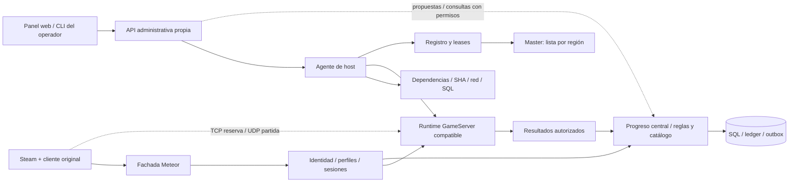

# HAWKEN — brainstorming y diseño del Server Creator

Fecha/base: 2026-10-10. **DISEÑO PROPUESTO — NO IMPLEMENTADO.** Investigación estática del cliente Steam; ningún servidor, panel, SQL de producto o DLL puente se construyó ni desplegó. El propósito es convertir las ideas solicitadas en capacidades comprobables, sin presentar una pantalla como prueba de compatibilidad.

## 1. Pedido vigente y éxito observable

El operador descarga un Creator para Windows o Linux con sus dependencias establecidas, prepara un host, configura una partida, comprueba por qué pueden o no entrar jugadores y administra su servidor desde un dashboard parecido a txAdmin. El jugador conserva Steam legítimo, inicia normalmente y selecciona la base de servicios mediante `MeteorUri` del INI; una DLL propia adicional se estudia si es necesaria para evitar la sobrescritura, sin editar EXE/DLL/UPK originales en disco. No hay launcher.

El MasterServer sólo lista servidores y regiones. Registro de hosts/leases, autenticación, perfil, sesiones, SQL y recompensas pertenecen a servicios separados bajo el operador de la comunidad. **Última precisión de economía:** XP, créditos y desbloqueos globales los gobierna el servicio central de cuentas/progreso, vinculado a identidad Steam validada; el Creator no puede emitirlos. El operador central establece rates, topes y eventos globales. Los cosméticos antes vendidos pueden ser candidatos a recompensas ganadas si su catálogo y concesión funcionan con el cliente original; no se afirma que todos sean concedibles. Dinero real, compras de saldo, monetización y ventajas por donación quedan excluidos.

**Última decisión del usuario:** UPK nuevos, cocina de paquetes y ampliaciones de contenido quedan para más adelante. La primera versión usa únicamente paquetes originales correspondientes a un manifiesto SHA-256 aprobado y comprueba que no se hayan alterado. La inspección de paquetes realizada anteriormente se conserva como evidencia, sin habilitar extensiones.

La aceptación necesita dos cuentas Steam legítimas entrando a una partida real, controles efectivos y datos persistentes. Todavía no se dispone de un dedicado compatible validado, autorización Steam backend demostrada ni un flujo de admisión completo; esos recursos son gates anteriores a publicar un Creator «jugable».

## 2. Brainstorming visible: ideas, fundamento y prueba

Todas las filas son **ideas de producto**, no funciones implementadas. «CONFIRMADO estático» significa presencia en la muestra; nunca un servidor ejecutado. Las coordenadas y hashes están en la sección3 y sus ledgers enlazados.

| Idea | Base y estado actual | Cómo demostrarla |
|---|---|---|
| Asistente «crear y comprobar» | Diseño nuevo sobre agente/instancia y contratos recuperados; NO VERIFICADO. | En un host limpio resuelve dependencias, SQL y puertos; un fallo muestra causa y evita publicar. |
| Botón «listo para recibir jugadores» | Listado, reserva y admisión son operaciones distintas, CONFIRMADO estático; entrada completa NO VERIFICADA. | Pruebas de alcance y dos clientes autenticados admitidos; proceso/listener por sí solos no cambian estado a listo. |
| Dashboard estilo txAdmin | Referencia primaria de UX/operación; integración Hawken NO VERIFICADA. | Start/drain/stop, salud, logs y sanciones tienen efecto real, permisos independientes y auditoría. |
| Eventos de fin de semana de XP/créditos | Fórmula XP y acumulación HP presentes, CONFIRMADO estático; configuración efectiva/commit NO VERIFICADOS. | Regla aprobada aplicada al resultado natural, horario de inicio/fin, saldo durable e idempotencia; el evento no vende un boost. |
| Noche de mapa/modo y rotación temática | Rotación y selección de clases presentes, CONFIRMADO estático; cada combinación requiere runtime. | Dos mapas originales presentes, transición y reconexión verificadas; no incluir VS-Rogue sólo por estar en INI. |
| Práctica con bots y completar equipos | Rutas generales/BotsTDM/FillNPC diferentes, CONFIRMADO estático. | Aparición, equipo, IA, respawn, entrada/salida humana y aforo correctos en el modo elegido. |
| Perfiles «práctica / local / compartido» | Diseño nuevo de autoridad, NO VERIFICADO. | Práctica no concede progreso; local queda en su comunidad; sólo hosts/reglas autorizados escriben el compartido. |
| Cosméticos ganados y catálogo rotativo | Diseño nuevo sobre inventario/ofertas/rewards recuperados parcialmente; compatibilidad de cada objeto NO VERIFICADA. | Conceder un ID permitido, reflejarlo en inventario y equiparlo con dos clientes, sin pago ni modificación de UPK. |
| Premiación del apoyo y objetivos | Diseño nuevo: asistencia, curación y objetivos sólo cuentan si el runtime aporta hechos verificables. | Curación efectiva y contribución elegible producen el premio previsto; autocuración, daño aliado o replay no lo fabrican. |
| Temporadas y objetivos colectivos | Diseño nuevo; primero contenido original y cuentas autorizadas. | Avance central único por resultado, recompensa cosmética utilizable; no inventar una interfaz nueva en el menú del cliente. |
| Eventos propuestos por la comunidad | Creator propone, operador central aprueba alcance/rate/version; NO VERIFICADO. | Host solicita x2, aprobación central limita la ventana y el cálculo; cambiar sólo la configuración del host no cambia saldo global. |
| Ficha de jugador Steam | Identidad, perfiles y stats recuperados parcialmente; historial SQL nuevo. | Alias nuevo conserva identidad; entradas, partidas, ledger, unlocks y sanciones consultables por alcance. |
| Consultas guardadas y mensajes por comandos | SQL es diseño nuevo; guards/flags de chat/admin presentes, efectos NO VERIFICADOS. | Consulta con parámetros y límites; mensaje llega sólo al destino comprobado, sin shell ni escalada. |
| Reinicios y avisos programados | Referencia txAdmin y diseño de scheduler; adaptador Hawken NO VERIFICADO. | Avisos entregados, servidor retirado del listado, drenado y reinicio; un crash del panel no duplica la tarea. |
| Indicador de paquetes originales íntegros | 360 paquetes rehashados, CONFIRMADO en el host de investigación; enforcement futuro NO VERIFICADO. | Archivo alterado/ausente/extra produce bloqueo; restauración legítima vuelve a pasar. |
| Varios servidores en una máquina | Diseño nuevo, NO VERIFICADO. | Dos instancias con puertos/datos/generaciones propios; apagar una conserva la otra. |

Recomendación para la primera versión: asistente, panel local, integridad, diagnóstico red/SQL, una partida original, administración y persistencia; después eventos y bots por modo demostrado. No ofrecer controles vacíos ni botones que sólo cambien una tabla sin afectar a la partida.

## 3. Evidencia que limita las ideas

| Alias | Archivo original | SHA-256 |
|---|---|---|
| EXE | `Binaries\Win64\HawkenGame-Win64-Shipping.exe` | `4a861ecb4ac7add9554f8daf8f98ad2c12b9cb6c1865a83e8be808beb46ea8a2` |
| SDK | `Binaries\Win64\Meteor.Sdk.Cpp.Win32.Client64.dll` | `f63fef02ffb517ca7844a769d03412ad82bd22198397302ee3c090c63a970c57` |
| GAME | `HawkenGame\CookedPCConsole\HawkenGame.upk` | `d1a33a064de4451e5a39e13a28e4a8f2913ce6d9b54ca65bae47118d32849ed0` |
| OSS | `HawkenGame\CookedPCConsole\OnlineSubsystemMeteor.upk` | `bab9ad82bd5fae5afe30707513caa27605c7ece8f296461678ae07cd759ed310` |
| GameCfg | `HawkenGame\Config\DefaultGame.ini` | `dc2a794217d13d8e7af4719c087dfbbfb4e36cbe433dd8474caaa893ddd7be00` |
| EngineCfg | `HawkenGame\Config\DefaultEngine.ini` | `6f839d73d16f512fbbf29e4d35ea12ba1e8604c8372ea72cad90dabff2526599` |
| BaseCfg | `Engine\Config\BaseEngine.ini` | `b550c921f85f41aa947e4502990e6f381163e82836ef64141aaff05cb5f222d9` |
| StormCfg | `Binaries\Win64\StormConsumerSettings.ini` | `08eda2cb20539996b7c1a91480c1ee2f64e02743c9bbee0bfc4f3543d8fec3d9` |

Los alias heredan archivo/hash en cada fila. Offsets UPK son virtuales del paquete descomprimido, no offsets del original comprimido. Cada ledger conserva bloques originales, tamaño, índice positivo, hash de extracción y observación completa. Declaración native no equivale a cuerpo C++.

| ID / estado | Función, export o localización | Evidencia e interpretación |
|---|---|---|
| SC-01 CONFIRMADO lectura/sobrescritura; puente NO VERIFICADO | StormCfg línea4/offset `0x4d`; SDK `0x74220`, `0x74810`; EXE `0xbc3510` | INI leído; setter posterior impone URI. El puente tendría que conservarla a tiempo, no solamente cargar. [Cadena](evidence/auth/ini-endpoint-flow.json). |
| SC-02 CONFIRMADO imports; portador PROBABLE | EXE DINPUT8 descriptor `0x1ad30a8`, IAT `0x128e078`; DXGI delay descriptor `0x1ad2c9c` | DirectInput8Create es import normal; CreateDXGIFactory diferido. VERSION no figura en imports de los 86 PE. [Bytes/factibilidad](evidence/dll-bridge-feasibility.json). Carga/forwarding/timing pendientes. |
| SC-03 CONFIRMADO cálculo local; saldo durable NO VERIFICADO | GAME IncrementPlayerHP #38615, virtual `0xbf18ec`; AwardEndofGameHawkenPoints #10128, `0x7e3b06`; CoOp #13992, `0x847828` | HP por tiempo/resultado/oleadas, factores y contadores/eventos. No constituye un commit de wallet. [Ledger de progresión](evidence/auth/creator-progression-findings.json). |
| SC-04 CONFIRMADO gate | GAME WriteStats #10231, `0x7e6407`; InitGame MP #9609, `0x7d2d1a`; ServerForceEndMatch #15801, `0x8723bf` | Regla modificada hace retornar WriteStats antes de premios; InitGame lee la opción y el final forzado admin marca true. No falsificar el flag para prometer recompensas. |
| SC-05 CONFIRMADO mapping/tarea; stub PROBABLE | OSS ConvertOfferCurrencyToStorm #1318, `0x6a49c`; EXE wrapper `0xb70f40`→`0xbae1e0`; Give wrapper `0xb718c0`→`0xbc23e0`→ctor `0xba0710`→tick `0xbe4400` | Enum0→`MP`, enum1→`HP`; tick Give sólo marca estado/acumula tiempo. No se recuperó grant backend en ese tick. [Métodos](evidence/ghidra-main-creator-wallet-method.jsonl), [vtable original](evidence/creator-task-vtables.json). |
| SC-06 CONFIRMADO bots estáticos; panel/runtime NO VERIFICADOS | GAME InitGame #4204, `0x7511b6`; AddBots #4272, `0x752d6b`; BotsTDM.UpdateBotPopulation #12230, `0x81a2c8` | NumBots/NumAutoBots, Min(cantidad,5) por llamada y ruta específica de equipos. NeedPlayers base devuelve false; no auto-fill universal. [BOT-01..06](evidence/game/creator-gameplay-findings.json). |
| SC-07 CONFIRMADO catálogo estático parcial | MODE-01 y MAP-01..03 del ledger GAME; ocho clases en sus paquetes `_SF`, cada archivo/hash/export allí registrado | Deathmatch, TeamDeathmatch, MissileAssault, Siege, CoOp, BotsTDM, Conquest y CTF tienen selección/clases presentes. No todos son modos jugables demostrados. 33 entradas de rotación, 13 nombres; VS-Rogue no coincide con inventario. |
| SC-08 CONFIRMADO configuración, actividad NO VERIFICADA | BaseCfg/EngineCfg/GameCfg, PORT-01/02 con líneas/offsets/bytes completos | Defaults stock 7777/7778, UDPbeacon8777/9777, statsUDP13000 y WebServer80 deshabilitado. No representan listeners activos, puerto query demostrado ni beacon Meteor. El panel nuevo usa su propia configuración. |
| SC-09 CONFIRMADO comparación distinta de SHA | EXE dispatcher `0x9e82d0` case7→`0x9ea730`, offsets `0x9e76d0`/`0x9e9b30`; EngineCfg AllowDownloads=False línea435/offset `0x3ee5` | Compara identidad/GUID y rechaza mismatch/NoDownload; no demuestra comprobación SHA-256 ni descarga de paquetes nueva. [Serializer](evidence/ghidra-main-creator-functions.jsonl) y CONTENT-01..03. |
| SC-10 CONFIRMADO integridad local | [Manifiesto SHA-256](evidence/original-upk-sha256-manifest.json), 360 rutas originales, hash/tamaño individual y origen inventario | Rehash actual: 360/360 coinciden, sin añadidos/ausentes/alterados/errores. Es baseline local sin firma Valve y sin enforcement runtime implementado. |
| SC-11 CONFIRMADO superficies cosméticas; grant gratis NO VERIFICADO | GAME y OSS, 25 exports positivos/40 hallazgos con archivo/hash/offset en [catálogo y progresión](evidence/auth/central-progression-findings.json) | Consumers de camuflaje, emblemas, cockpit, HUD/retículas y taunts requieren tipos/índices/datos existentes. Posesión e instancia son distintas del tipo. PurchaseOffer distingue HP/MP; rewards CoOp usan bundle/ofertas. No demuestra gratis, catálogo entero, commit ni licencia. |
| SC-12 CONFIRMADO métricas; premio central NO VERIFICADO | GAME RepairTorch.DoHealLogic #44330, `0xc931e5`; HealDamage #28161, `0x9fb9dd`; HandleAssists #10402, `0x7eaebf`; [55 exports/10 hechos](evidence/game/central-reward-stat-findings.json) | Reparación nominal y XP mostrado pueden diferir de vida efectiva/XP final; asistencia tiene guards/ventana y rutas PvP/CoOp/bots distintas. MatchEnded precede al guard de reglas modificadas. RoundEnded revisado no añade Heal/Repair/Assist; transporte/commit autoritativo pendientes. |

El [protocolo GameServer](HAWKEN_GAME_SERVER_PROTOCOL.md) contiene el apéndice completo y los hashes de las clases `_SF`, configuraciones, functions de travel y datos IA. [Cuentas/eventos](HAWKEN_ACCOUNT_AND_EVENT_FINDINGS.md) conserva el contrato de perfil/wallet y sus límites. No inferir control administrativo ni autoridad financiera del simple nombre de una función.

## 4. Tres enfoques y elección propuesta

| Enfoque | Qué incluye | Coste / límite |
|---|---|---|
| **Creator portátil, agente local y panel web — recomendado** | Un paquete propio por plataforma, UI/CLI y proceso de host; conecta al backend de comunidad. SQL local opcional o externo. | Fácil para host doméstico; requiere comprobar runtime, NAT y permisos. Acceso remoto se habilita por separado. |
| Panel central para varios hosts | Agentes salientes y administración desde comunidad, misma API y reglas. | Útil después del primer host; añade identidad de agentes, conexión sostenida y operación de un panel público. |
| Paquete de contenedor como distribución adicional | Servicios propios empaquetados para un operador que ya use contenedores. | No soluciona un dedicado ausente, contenido/licencias ni NAT; no es requisito de instalación inicial. |

El panel local podrá administrar varias instancias sin obligar a crear un servicio cloud. Publicar un servidor personal requiere registro/autorización de host; descargar el Creator no concede permiso para alterar progreso compartido.

## 5. Componentes, interfaces y límites de responsabilidad

Son interfaces **nuevas propuestas** salvo el wire Meteor/UE3 recuperado. No se añade una API txAdmin/FiveM al cliente Hawken. Start, mapa o bot se traducen mediante un adaptador del runtime, que sólo anuncia una capability tras una prueba registrada.

| Unidad | Responsabilidad | Interfaz propia propuesta |
|---|---|---|
| Bootstrap/doctor | Plataforma, dependencias, runtime permitido, build y estado de preparación | `HostReadinessReport` con checks y causas, sin secretos. |
| Gestor de instancias | Configuración, generación, proceso, recursos, inicio/drenado/parada | `InstanceCommand`, `CommandResult`, estado deseado/observado. |
| Verificador de contenido | Comparar paquete real con perfil aprobado; controlar falta/extras | `PackageIntegrityReport` con path relativo, hash esperado/observado y resultado. |
| Diagnóstico de red | Bind/escucha/rutas/NAT y alcance externo por transporte | `ReachabilityReport` con prueba, origen, fecha y resultado; expira. |
| Conector SQL | Esquema/rol/lectura/transacción/migraciones y recuperación | `DatabaseReadinessReport`; credenciales por almacén propio del host. |
| Adaptador de juego | Mapas/modos, jugadores/bots, comandos y health del runtime real | `RuntimeCapabilities`, `ApplyCommand`, resultado observable/correlación. |
| Scheduler | Eventos/reinicios/avisos con recuperación tras crash | Definición versionada y ocurrencia única por job/slot. |
| Progreso central, fuera del Creator | Autoridad/elegibilidad, reglas, saldo/canjes y unlocks bajo el operador de comunidad | Recibe resultados, calcula recompensas y escribe ledger/outbox; Creator sólo consulta/proporciona propuestas según permiso. |
| Panel/CLI | Mismas operaciones/permisos, estado legible | API propia autenticada; nunca shell remoto libre. |

Comando propio: ID, actor, alcance, target, generación esperada, tipo, parámetros tipados, revisión de configuración y clave de idempotencia. Resultado: aceptado, ejecutando, aplicado, denegado, expirado o fallido; evidencia/correlación del efecto. «HTTP202» significa aceptado para procesar, no mapa cambiado ni jugador expulsado.

`RuntimeCapabilities` diferencia no soportado, encontrado estáticamente, probado en laboratorio y habilitado para esta build. El panel deshabilita la operación pendiente y muestra qué prueba falta. No crear botones universales a partir de todos los nombres Exec encontrados.

## 6. Descarga, dependencias y asistente inicial

Distribuciones Windows/Linux por arquitectura probada, manifest de herramienta/runtime/dependencias, checksums/firma y licencias. Publicación propia self-contained cuando el stack lo permita; el host no necesita compilador/SDK. No incluir archivos originales Hawken, secretos Steam, contenido ajeno ni un dedicado cuya redistribución no esté permitida. La ausencia de runtime compatible se presenta como bloqueo real.

Datos del Creator fuera del juego: perfil de usuario o directorio de servicio propio en Windows; datos/config de usuario o servicio propios en Linux. Cada instancia tiene logs, configuración y generación distintos. El agente no escribe dentro de la instalación Steam para configurar XP/mapas/bots.

El asistente recorre: verificar distribución/dependencias → localizar material permitido → elegir comunidad y build → configurar SQL si corresponde al host → validar paquetes → elegir mapa/modo/aforo/bots → definir red/visibilidad → probar salud → registrar → probar admisión. Se puede guardar un borrador bloqueado; no publicar un listing antes de salud/registro válidos.

SQL de comunidad no obliga a cada servidor de partida a recibir credenciales de toda la población. Un operador conectado a esa comunidad usa sus APIs; un despliegue independiente puede instalar SQL mediante receta/paquete autorizado o apuntar a servicio externo. La dependencia y versiones exactas se fijan al empaquetar; no se instala SQL en el PC del jugador.

Vista previa antes de aplicar: puerto/transporte, destino publicado, región, versión, mapa/modo, bots/humanos, progreso local/compartido, reglas vigentes, integridad y si exige próximo mapa/reinicio. Un control de configuración no se presenta como hot reload cuando el adaptador no lo soporta.

## 7. Puertos y criterio «pueden entrar»

| Comprobación | Resultado comprobable | Qué no demuestra |
|---|---|---|
| Dependencias de host | Runtime/herramientas disponibles y build coincidente | GameServer jugable. |
| Bind temporal por TCP/UDP y familia IP | Puerto disponible/asignación exclusiva en ese momento | Que seguirá libre ni que sea accesible desde Internet. Reservar/asignar de nuevo al arrancar. |
| Escucha del proceso correcto | PID/generación y socket esperado; health del adaptador | Ruta WAN, autenticación o entrada de un cliente. |
| Red local | Cliente/probe permitido alcanza el transporte de destino | NAT/CGNAT/hairpin desde fuera. |
| Alcance externo | Verificador propio en otra red observa ida/vuelta correlacionada | Que un puerto de diagnóstico diferente acredita el UDP de gameplay. |
| Backend/Steam/TLS | Operación autorizada y sesión correspondiente a esa cuenta/build | Replicación/spawn/gameplay. |
| Admisión completa | Cliente aceptado, mapa cargado, actor/posesión y segundo jugador visibles | Todos los mapas/modos o todas las redes. |

Cada puerto tiene propósito, transporte, bind, dirección pública, prueba y vigencia. No deducir puertos Hawken activos de defaults stock; el puerto devuelto en el listing/sesión y el socket observado deben coincidir. Un test TCP no verifica UDP; timeout UDP se muestra como no concluyente cuando el protocolo puede ignorar el probe.

Probe externo únicamente contra el host propio autorizado. Para UDP de juego, usar handshake/cliente controlado o diagnóstico soportado por el runtime propio; no insertar mensajes inventados en el protocolo original. Un servicio eco en otro puerto no concede «gameplay alcanzable».

Informar dirección privada/no enrutable, IPv4/IPv6, doble NAT/posible CGNAT, firewall y red de origen, sin prometer diagnóstico por una comparación de IP sola. Guía de forwarding o hosting/VPN permitida para operador; no abrir router/firewall automáticamente durante un diagnóstico. Si una instalación futura aplica una regla propia, muestra su alcance y registra qué revertir. SQL y panel administrativos no se abren como puertos de juego.

Estados de instancia: borrador → bloqueada o validada local → iniciando → escuchando → alcanzable → registrada → admisión probada → operativa. También drenando, detenida, degradada y fallida. «Admisión probada» lleva build, escenario y fecha; se invalida tras cambios relevantes. Un host LAN válido se etiqueta LAN, sin exigir WAN para ese perfil.

## 8. SQL, seguimiento y consultas personalizadas

Comprobar endpoint/TLS cuando aplique, credencial de rol, base, versión admitida, migración/esquema, SELECT de salud y una transacción de prueba sobre una tabla propia destinada a ese fin. Separar lectura, escritura y rol de migración. Un socket SQL abierto no demuestra conexión autenticada o permisos correctos.

No almacenar tickets Steam, grants, SessionKey o contraseñas de jugadores. SteamID64 como string decimal validada, identidad interna estable y realm; alias mutable. Guardar admisión/visitas, match/participación, reglas aplicadas, XP, ledger de créditos, inventario/unlocks, sanciones y auditoría de actor/alcance.

| Modelo propio adicional | Invariante |
|---|---|
| `instance_configs` / `runtime_capabilities` | Revisión aplicada y build/generación; no asumir capabilities de otra build. |
| `readiness_checks` / `reachability_checks` | Resultado, método y vigencia; sin contraseñas/packets completos. |
| `package_profiles` / `package_integrity_checks` | Perfil aprobado, hash exacto, directorios y reporte; no aprobar automáticamente el hash encontrado. |
| `reward_rule_versions` / `earned_credit_ledger` | Regla inmutable para el resultado, razón earned-only, clave única y saldo consistente. |
| `trusted_server_grants` / `reward_proposals` | Sólo la autoridad central habilita hosts/reglas para progreso global; propuesta del Creator no es aprobación. |
| `cosmetic_reward_catalog` / `item_grants` | ID, build, compatibilidad y método de entrega verificados por objeto; grant único y sin pago. |
| `scheduled_events` / `event_occurrences` | UTC, target, revisión, ocurrencia/aplicación única y restauración. |
| `map_mode_catalog` / `bot_profiles` | Pares/capabilities ensayados y política de aforo/progreso. |

Ledger, reglas/grants de host y catálogo cosmético global residen en SQL del servicio central. El agente del Creator consulta las APIs autorizadas; sus tablas locales de instancias/diagnóstico no le otorgan escritura sobre cuentas. SQL local opcional de un realm particular tiene identidades de alcance distintas y no puede importar saldo a la cuenta global.

Consultas guardadas sobre vistas con rol no superuser, parámetros, alcance, timeout y límite de filas. SQL de lectura no equivale a permiso para consultar todos los jugadores: autorización por realm/servidor/columna y pruebas negativas. Separar valores parametrizados de identificadores SQL permitidos. Nunca exponer DDL/DML, funciones de sistema o esquema de secretos al panel avanzado.

PostgreSQL documenta [roles/privilegios](https://www.postgresql.org/docs/18/sql-createrole.html), [read-only y statement_timeout](https://www.postgresql.org/docs/18/runtime-config-client.html) y [parámetros separados](https://www.postgresql.org/docs/18/libpq-exec.html). Son mecanismos para implementar/probar; una regex que acepte SELECT no garantiza una consulta segura. SQL caído deja recompensas pendientes/no confirmadas según política duradera probada; nunca sumar saldo sólo en la UI.

## 9. XP, créditos y desbloqueos: quién manda

La unidad original enum1 se convierte a `HP`; enum0 a `MP`. HP acumulado/HC mostrado y saldo durable son superficies distintas. **Recomendación actual:** comenzar con XP y un saldo de créditos ganados, usando HP/HC únicamente tras verificar el contrato completo. No hace falta crear dos monedas para desbloquear cosméticos. Un objeto antes vendido por MP puede entrar en un catálogo de premios directos o canjes earned-only si se demuestra que el inventario/loadout original lo acepta. La etiqueta histórica «premium» del objeto no implica una compra nueva. No se habilitan pagos ni compra de MP; tampoco se asume que cambiar un precio desbloquee cualquier objeto.

El operador del Master/comunidad administra **un servicio de cuentas y progreso separado del directorio regional**. Este servicio posee el ledger SQL, catálogo, rates, eventos globales y grants. El GameServer mide/reportará hechos; el backend central decide y concede. Creator no recibe credenciales SQL de escritura global, claves que aprueben hosts o una operación «sumar créditos globales». El directorio sigue limitado a listar; compartir despliegue u operador no mezcla las responsabilidades.

Steam vincula la identidad; no certifica kills, curaciones, integridad de paquetes o verdad de resultados. La documentación de [autenticación Steam](https://partner.steamgames.com/doc/features/auth) distingue identidad/propiedad y métodos de tickets; [BeginAuthSession](https://partner.steamgames.com/doc/api/ISteamGameServer#BeginAuthSession) exige comprobar el callback de validación. La vía apta para el ticket/AppID de Hawken sigue pendiente. OpenID del panel, un SteamID declarado o un retorno inicial exitoso no sustituyen la admisión legítima del cliente.

| Perfil de servidor | Reglas que selecciona operador | Progreso permitido propuesto |
|---|---|---|
| Práctica / laboratorio | Reglas probadas, bots y escenarios de ensayo | Sin progreso productivo; no mezclar datos de pruebas con cuentas productivas. |
| Particular / reglas libres | El dueño configura mapas/bots y reglas locales | Sin acceso al progreso global. Progreso local opcional sólo en un realm/backend aislado, sin mezcla automática con la cuenta principal. |
| Comunidad central / compartido autorizado | Creator selecciona un preset central o propone otro para aprobación | Sólo resultados del host/build/modo/regla elegibles; rates/grants pertenecen al servicio central, no al operador local. |

Publicar resultado con MatchID, generación, identidad de servidor, participantes admitidos, regla/version, mapa/modo y secuencia; backend correlaciona contra la asignación, valida elegibilidad, calcula recompensa y registra ledger/saldo/unlocks/outbox en transacción. Firma/autenticación de un host acredita origen, no verdad de su simulación: progreso compartido requiere confianza y autorización del servidor, no basta descargar el Creator.

Dos modalidades de confianza propuestas: hosts operados/controlados por la comunidad para progreso global inicial; posteriormente terceros aprobados con credencial revocable, runtime/build/reglas fijados y auditoría. Un host malicioso autorizado aún puede mentir aunque firme: límites/anomalías reducen exposición, no son una prueba de simulación. No anunciar «seguro contra fabricación» por usar HTTPS, Steam o SHA. Ante revocación, resultados nuevos quedan rechazados/pendientes según decisión registrada; la cuenta no recibe saldo sin validación.

### 9.1 Rates y premios por desempeño

Configurar en el servicio central una versión inmutable por modo: elegibilidad, XP base, créditos base, coeficientes por métrica, topes por categoría/partida, reglas bots/PvE, participación mínima y multiplicador global aprobado. XP de cuenta y XP de mech se mantienen separados si así exige el contrato original. La regla efectiva se fija al asignar/iniciar el match; un cambio de rate no reescribe partidas cerradas.

Fórmula **de diseño, no balance histórico**: `créditos = límite_partida(base_por_participación + Σ(coeficiente_categoría × contribución_elegible)) × multiplicador_aprobado`, aplicando redondeo y límite final explícitos. XP tiene su propia función versionada; no duplicar recompensas contando tanto score agregado como todas las acciones que ya lo componen. Los valores numéricos se eligen después de medir escenarios reales; no hay una tarifa confirmada por punto/curación.

| Métrica candidata | Qué debe probar el adaptador | Política propuesta contra fabricación |
|---|---|---|
| Puntuación / objetivos | Regla del modo y aportación que compone el score; evitar doble cómputo | Premio acotado a objetivos/participación elegibles, no aceptar score arbitrario del cliente. |
| Eliminaciones / asistencias | Actor/víctima/participantes y contribución única de servidor | No contar aliados/autobajas; repetición entre las mismas cuentas y bots según regla explícita. |
| Curación / reparación de apoyo | Vida realmente recuperada de aliado elegible, autor/objetivo y procedencia del daño cuando esté disponible | Excluir exceso sobre vida máxima y autocuración; impedir ciclos de daño aliado/reparación. Si faltan datos verificables, dejar la categoría deshabilitada. |
| Participación / victoria | Tiempo activo y final natural de un resultado admisible | AFK, abandono e interrupción tratados explícitamente; ganar no sustituye contribución. |
| PvE / bots | Modo, oleada/objetivo y clasificación de humanos/NPC | Preset central distinto; bots no tienen saldo ni cuentan como identidades Steam. |

La evidencia script adicional de métricas/persistencia se registra en [partida](HAWKEN_GAME_SERVER_PROTOCOL.md); las rutas de catálogo/concesión en [autenticación](HAWKEN_AUTH_PROTOCOL.md). Un contador acumulado, una notificación XP o telemetría sólo demuestra esa superficie observada; su disponibilidad autoritativa al backend central necesita una prueba separada.

### 9.2 Cosméticos sin dinero real

Catálogo central cerrado por build: ID original de objeto/oferta, categoría cosmética comprobada, compatibilidad de mech/slot, paquete SHA permitido, forma de grant/canje, coste ganado o logro requerido, frecuencia, vigencia y tratamiento de propiedad previa. No incluir un ID sólo por nombre ni recrear archivos ausentes. DLC/propiedad Steam y permisos de uso mantienen sus validaciones; el plan no suplanta licencias.

Revisar atributos originales, bonusXpMultiplier, rental/expiry/use-limit y dependencias antes de clasificarlo. Un nombre de camuflaje no garantiza que sea puramente visual; cualquier efecto en XP se incluye en la regla central aprobada y no se aplica dos veces. Oferta, tipo de objeto e instancia poseída son entidades distintas.

Preferir una ruta de grant original verificada antes de inventar un protocolo o moneda. Probar primer grant, repetido, saldo insuficiente si hay canje, ítem ya poseído, persistencia tras relogin, equipamiento y visualización en dos clientes. Si la UI original no acepta el grant/precio earned-only, el objeto queda pendiente; un dashboard que muestra «desbloqueado» no acredita inventario utilizable. No se promete que todos los cosméticos antes vendidos estén presentes o puedan habilitarse sin cambios.

Idempotencia por resultado+cuenta+regla y claves del canje. Canje de un objeto permitido comprueba saldo/inventario y consume una sola vez; concurrencia no permite gasto doble o negativo. Reversión administrativa registra movimiento inverso y motivo, sin borrar historial. No hay endpoint de compra de saldo, conversión dinero→HP ni recompensa por donación.

**Gate del original:** WriteStats retorna si bModifiedGameRules; ServerForceEndMatch marca ese estado. GiveWalletCurrency observado tiene tarea/tick local, sin grant remoto recuperado. El Creator no puede prometer «x2 XP/créditos persistentes» por escribir un multiplicador o invocar esa función. Antes de habilitarlo: probar factor efectivo, fin natural, callback/UI, resultado autorizado y commit/refresco durables. No falsificar el flag ni usar el puente URI para saltar reglas de progreso.

Tratamiento de bots, AFK, entrada tardía, abandono e interrupción se versiona. Política inicial propuesta: pruebas/práctica sin progreso compartido; PvE oficial o modo bots sólo se habilita como elegible cuando regla y escenario se aprueben. Bots no son cuentas Steam, no tienen wallet y no inflan visitas humanas.

## 10. Eventos de XP/créditos, mapas y avisos

Definición propia: ID, target/realm, inicio/fin UTC, zona mostrada al usuario, preset/version, objetivo, prioridad, condiciones, política de solape y estado. Evento de recompensas globales se crea/aprueba en el servicio central; el Creator sólo propone o selecciona presets autorizados. Mapas/bots y avisos locales los administra el host. Evento de recompensas modifica reglas futuras, no reescribe partidas liquidadas. Guardar la regla efectiva al iniciar cada match.

Aplicación preferida en frontera de partida: activar preset al siguiente match y retirarlo al finalizar la ventana, sin resetear partidas activas salvo soporte demostrado. Dos eventos solapados no multiplican silenciosamente factores: bloquear el conflicto o seleccionar prioridad única visible. El panel muestra próximo efecto y reglas vigentes.

Evento de mapa/modo elige únicamente un par verificado presente en el perfil SHA aprobado. Rotación después de fin natural, con aviso y travel observado. Cambio inmediato o force-end indica interrupción y el gate de recompensas; no inventar un resultado completo para pagar créditos.

Scheduler persiste ocurrencias, revisión aplicada y comando; reinicio retoma estado, no entrega la misma recompensa dos veces. Al terminar restaura la configuración anterior compatible, sin borrar XP/créditos ya ganados. Si el operador cambia reglas durante el evento, una restauración por revisión evita pisar su nueva decisión y deja el conflicto visible.

Avisos: plantillas con destinatario/canal, cooldown, permiso y longitud compatibles con adaptador. AdminSay/Say/TeamSay no se intercambian sólo por nombre: TeamSay Hawken examinado llama ServerSay y no demuestra aislamiento de equipo. Webhooks/exportaciones contienen hechos depurados; replay de eventos informativos no ejecuta otra vez XP, créditos o un ban.

## 11. Bots, mapas y modos existentes

Catálogo inicial contiene clases/mapas originales presentes, build, hashes, compatibilidad estática y estado del ensayo runtime. Ocho clases `_SF` recuperadas no significan ocho modos ya operativos. Propuesta para primera partida: un par original de TDM validado, dos humanos y bots apagados; ampliar por modo con su propio escenario.

Ruta estática de la partida multijugador confirmada en `HawkenGame.upk` SHA-256 `d1a33a064de4451e5a39e13a28e4a8f2913ce6d9b54ca65bae47118d32849ed0`: `R_GameInfoBase.InitGame` (export 4204, offset virtual `0x7511b6`) lee la opción URL `NumBots` en `NumAutoBots`; `R_GameInfoBase.StartMatch` (export 4289, `0x7534be`; fuente SHA-256 `c01b32b176d02467d5c34901ac2b3ef4602ee8f07d37ef8ba49cad7a10a181fd`) copia `NumBots` a `NumAutoBots` y llama `PlayerController.UpdateURL("NumBots", ...)`; `R_MPGameBase.PendingMatch.BeginState` (export 9710, `0x7d67ea`) llama `AddBots(NumAutoBots)` cuando es mayor que cero, incluso si `MeteorOSS` no está asignado. `DefaultGame.ini` original SHA-256 `dc2a794217d13d8e7af4719c087dfbbfb4e36cbe433dd8474caaa893ddd7be00` establece `NumAutoBots=0` en la línea 83; sin opción/override, el flujo no agrega bots. `AddBots` (export 4272, `0x752d6b`; fuente decompilada SHA-256 `37be9317505c55c474e18a953636d7920dc8e3830aaa4df92fa244f5c143a12c`) limita a cinco intentos por llamada, no a cinco NPC válidos, y llama `SpawnBTBot` (export 4278, `0x752f09`), que elige una plantilla aleatoria, crea su controlador de IA, marca el PRI como bot/listo y ejecuta respawn/configuración. Es evidencia estática del flujo UnrealScript, no una prueba de ejecución con nuestro Core.

Detalle del actor: `SpawnBTBot` (`008006-HawkenGame.R_GameInfoBase.SpawnBTBot.uc`, SHA-256 `880d9f96f7501ce7fed6ec42630985e67bb800b281463f38f38fad744027887e`) instancia `R_NPC_Template`, llama `RandomizeTemplate`, asigna `PawnType` desde `DefaultPawnClass` (con fallback a `R_Pawn`), crea `ControllerType`, configura `PlayerReplicationInfo.bBot`, y ejecuta `SetupBehaviorTree`, `Respawn` y `SetupFromTemplate`. El `AddBots` decompilado también admite `TeamIndex` y asigna el equipo después de crear cada controlador. La definición `R_NPC_Template` (`041068-HawkenGame.R_NPC_Template.uc`, SHA-256 `119356647b0a5304f1e7d83ca3c061d3b4d07a76db5ba4ab9b5dbdc18b1c1898`) contiene opciones de IA/árbol de comportamiento y overrides de movimiento, salud y daño. `SetupBehaviorTree` (export 37421, `0xbc5af0`, fuente SHA-256 `caed5f442472f00800c5a5c8f09c02b0c4a7454cb0c41ce0a92f88533b1c90e7`) sólo carga y asigna un árbol cuando `BehaviorTreeTemplateToUse` existe; eso no demuestra que un controlador sin árbol quede inmóvil. **NO VERIFICADO:** `NumBots` no es una ruta confirmada para un blanco estacionario; el objetivo de entrenamiento requiere una ruta de actor distinta o evidencia runtime de un NPC realmente inmóvil.

El spawn de IA necesita más que `bBot`: [`HawkenAi_ControllerBase.Respawn`](evidence/upk/packages/HawkenGame/005441-HawkenGame.HawkenAi_ControllerBase.Respawn.uc), export 5441, SHA-256 `0e6bbae04ef08d6d4709cd211b1ca8e0b212f5db9a3ab019dfa05ef657472749`, llama `RestartPlayer`, reinicia el árbol y procesa `SpawnedFromTemplate`; [`SetupFromTemplate`](evidence/upk/packages/HawkenGame/005474-HawkenGame.HawkenAi_ControllerBase.SetupFromTemplate.uc), export 5474, SHA-256 `3c0e4c25cb2709916deab16462f507d6f54cab80234e81b7dc5a6766f88950d5`, marca el Pawn `bIsAI`, asigna `MyHawkenAi`, crea DualWeapon y configura mech/armas/ítems. [`SetupMechAndWeapsFromTemplate`](evidence/upk/packages/HawkenGame/005479-HawkenGame.HawkenAi_ControllerBase.SetupMechAndWeapsFromTemplate.uc), export 5479, SHA-256 `81f619db96010e53c3d0eb9180c693eb63fb8275062a896afff0d934d7fd84c2`, construye un preset y llama [`NpcServerSetStartMech`](evidence/upk/packages/HawkenGame/005487-HawkenGame.HawkenAi_ControllerBase.NpcServerSetStartMech.uc), export 5487, SHA-256 `b73aba8286b8524b69ec95c2f8626769f68a0ded765cba321d5e6228157a240e`; éste rellena el `MechSetupStruct` del PRI con mech, arma primaria, apariencia y plantilla.

En el cliente, [`R_PlayerReplicationInfo.uc`](evidence/upk/packages/HawkenGame/008752-HawkenGame.R_PlayerReplicationInfo.uc), SHA-256 `ab7c117e4031a913450c59e288e05e179dfd240ef09f6d1e6ee0cac3c0b424ca`, muestra que `ConditionalSetupMechStuff` espera `bReadyForSetup`, un Pawn resoluble mediante `GetRP` y `SetupID` coincidentes; entonces ejecuta `SetMechType` y `SetWeapons`. Lo corroboran [`R_Pawn.SetMechType`](evidence/upk/packages/HawkenGame/031548-HawkenGame.R_Pawn.SetMechType.uc), SHA-256 `815f4794567e388f21baa6e6fd6ed9d3c5fc96651fb096f5ed871033e8094288`, y [`R_Pawn.ReplicatedEvent`](evidence/upk/packages/HawkenGame/030610-HawkenGame.R_Pawn.ReplicatedEvent.uc), SHA-256 `1a459c8454d83b6028ca1ab1735310236e504109b410a7b5f519c81bf1fc8be8`. Todos proceden de `HawkenGame.upk` SHA-256 `d1a33a064de4451e5a39e13a28e4a8f2913ce6d9b54ca65bae47118d32849ed0`.

**Candidato estático, no valor listo para enviar:** `Engine.PlayerReplicationInfo.bBot` es `BoolProperty` replicada; el derivador [`derive_pri_cache.py`](../../implementation/evidence/controller-effective-field-cache/pri-schema-20261013/derive_pri_cache.py), SHA-256 `816e4e3e725891640097439e8ac95d7a71214712142ddaca1874137a1545b50a`, la coloca en conditional ID 24 (base 21, bound 42; NetIndex local 32787; serial offset `0x5a6f8a`) en [`derive-output.json`](../../implementation/evidence/controller-effective-field-cache/pri-schema-20261013/derive-output.json), SHA-256 `727e3db4237c8b9e56aec3532e23b793a06a9af9db96ab1b65034f0df30f0f9c`. La referencia procede del `Engine.upk` original SHA-256 `8fff59b404ea4f9dd41330da618432fe50e4a26ce7487379efeb76ce0c4e859c`. La elegibilidad efectiva del campo y la resolución de la instancia de `R_NPC_Template` en el cliente siguen **NO VERIFICADAS en runtime**.

El límite de cinco intentos es por llamada; no demuestra un aforo total máximo de cinco ni garantiza cinco spawns válidos. La base `NeedPlayers=false`/`StartBots` vacío no demuestra auto-fill general ni invalida la llamada explícita de `PendingMatch` descrita arriba. `BotsTDM` tiene otra ruta: `UpdateBotPopulation` (export 12230, `0x81a2c8`) ajusta cada equipo contra `GetMaxTeamSize`; CoOp y FillNPC tienen población, plazas y respawn propios. El adaptador debe declarar qué ruta corresponde al modo elegido.

`R_GameSettingsCommon.UpdateFromURL` (export 28804, fuente extraída SHA-256 `c9a35245d56db04626de4e732bf251ba7bf7cc9259269f2c4b7c80b33ffc1fe1`) lee `NumPlay` de la URL y guarda `NumPlay-1` en la propiedad `NumBots` (`0x100000F7`). Su función pareja `R_GameSettingsCommon.BuildURL` (export 28796, fuente SHA-256 `dfda3949e7b65718e50884d820fab6fef793f997c50f339b240f98743aa75b2a`) omite esa propiedad: puede emitir `VsBots` para un ajuste localizado distinto, pero no serializa este conteo. La conexión del control de menú con la opción `NumBots` que lee `InitGame` no está demostrada. Un runtime compatible tendría que recibir la población en sus opciones reales de arranque; el Creator no debe presentar el campo como funcional antes de ello.

El Creator descargable aún no existe como aplicación: `CMakeLists.txt` SHA-256 `15750b7c117a2d18985a30ae8c03aaeb4a723593d3393cbaab12094dea21a01b` define `hawken-server`, `hawken-master` y `hawken-tools`, sin un target Creator; `src/cli.cpp` SHA-256 `81c67ef460f1e48e8af8e2e17decb9bd5e9d26ec8162f4808df8280894bebf53` sólo ofrece `verify-packages` y `preflight`; `src/creator_query.cpp` SHA-256 `35a2d181837ff4e277eb63aba7b27ec48820ebeb765584b9c75d479aba54b3c0` abre la base SQLite en modo de sólo lectura. El Core C++ actual tampoco tiene opción de bots ni ejecuta `R_MPGameBase`/`GameInfo` o su ciclo de IA: `src/server_main.cpp` SHA-256 `81C3D3DF2A9F9815A4E4D74CE7694A320C6B9F69C0259CF6575B3846EC86A4EE` sólo prepara el ensayo UDP/Wreckage, y el parser rechaza opciones desconocidas; `src/wreckage_trial.cpp` SHA-256 `B78662F87AFDD778E2CF1715DA7DF430DF8D782DA8762FAEBC13BAD0E0405305` configura planes fijos del jugador, no una colección de NPCs, controlador de IA o ciclo de vida/respawn; `include/hawken/local_udp_owner.hpp` SHA-256 `E22CDA6784426A6A1B00A54E51B7CCBCB10895D9E8F70324CF6D26D53B6C7EB9` expone canales fijos de Controller/Pawn/PRI, GRI e inventario/mech. Por tanto, añadir ahora una casilla o CLI `NumBots` no crearía un bot: falta el runtime/adaptador que construya y replique el actor NPC y ejecute su ciclo de vida e IA. El blanco inmóvil para probar armas es una función separada de la población IA.

Panel de bots: preset permitido, población deseada/actual por equipo, dificultad/template admitido, reemplazo al entrar humano, política de respawn y elegibilidad. No exponer árboles/ConsoleCommand arbitrarios ni activar cheats para obtener un comando genérico; bServerAllowCheats=false forma parte de la configuración observada. Dificultad/opciones sólo visibles cuando el runtime y las tablas las hayan demostrado.

Plazas separadas: humanos presentes, bots, reservas y capacidad por modo/equipo. No publicar bots como jugadores Steam ni usar MaxPlayers como aforo total si la ruta observada lo interpreta por equipo. Simular entrada/salida/respawn para demostrar conteo y evitar que una última reserva sobreocupe.

Rotaciones: usar basename/hash y dependencias presentes, ValidMapInfo/clase admitida y carga efectiva. VS-Rogue está en configuración pero ausente del inventario cotejado; excluirlo hasta evidencia nueva. IsMapAvailable nominal no acredita existencia/carga. Cada mapa/modo prueba spawn, objetivos, fin, travel y vuelta al siguiente mapa con dos clientes.

## 12. Integridad SHA-256 y UPK aplazados

El [manifiesto de investigación](evidence/original-upk-sha256-manifest.json) conserva ruta relativa, SHA-256, tamaño, hash del inventario origen y hash/tamaño observados para 360 paquetes. La lectura actual pasó 360/360, sin modificaciones. **No está firmado** y acredita una baseline local observada, no aprobación Valve ni identidad remota. Una política productiva futura necesita perfil por build revisado/aprobado y manifest firmado por su autoridad; nunca sustituir expected SHA por lo encontrado en un equipo que falló.

Primera entrega propuesta:

1. Perfil cerrado por build y rutas de carga demostradas. Lista exacta de paquetes originales requeridos/permitidos, SHA-256/tamaño y identidad del manifest.
2. Verificar el manifest y calcular SHA real antes de iniciar/publicar. Rechazar paquete modificado, faltante, extra en la raíz de carga admitida o build no reconocida. Mostrar causa, sin borrar ni parchear originales.
3. Cotejar nuevamente tras actualización/cambio relevante y antes de volver a declarar operativa la instancia. Cache por metadata sirve para decidir volver a leer, no sustituye evidencia del hash exigido.
4. Evitar que el proceso use bytes distintos después de comprobar: medir y probar mecanismo de acceso/copia autorizada/mount o archivos abiertos que el runtime realmente soporte. La carrera hash→carga es un gate, no se resuelve sólo observando mtime.
5. Cliente: demostrar un verificador local que actúe antes de admisión, posiblemente en el puente propio, sin escribir UPK/EXE originales. El wrapper de paquete/GUID recuperado no ofrece por sí mismo este mecanismo.
6. Pruebas negativas únicamente sobre copias/fixtures propios: un byte cambiado, tamaño modificado, archivo ausente, extra, ruta/case conflictiva, manifest alterado, build nueva y cambio después del hash. Restaurar por Steam/medio legítimo, no permitir «aceptar cualquier hash» desde el panel.

El servidor puede comprobar los archivos que controla. **Un SHA enviado por un cliente no prueba que esos bytes sean los que cargó**; un cliente manipulado puede declarar el esperado. No se recuperó un desafío SHA-256/attestation fiable del cliente original. Verificación local y restricción remota absoluta son objetivos distintos: el último permanece NO VERIFICADO y debe anunciarse con ese límite. No se implementa un anticheat ficticio.

No se añaden/cocinan/distribuyen UPK nuevos en esta etapa. La futura investigación, si el usuario la retoma, tendría gates separados de contenido autorizado, revisión del hash exacto, herramienta de cook compatible con el fork, ruta de carga y replicación. UE Explorer/UELib inspeccionan/decompilan; no son un certificado de seguridad ni un cooker. No usar formatos/documentación UE5 para afirmar soporte UE3 Hawken.

## 13. Dashboard y permisos, inspirado en txAdmin

[txAdmin](https://github.com/citizenfx/txAdmin/blob/master/README.md) documenta gestión/monitorización web de FXServer; su [modelo de permisos](https://github.com/citizenfx/txAdmin/blob/master/docs/permissions.md) distingue consola, proceso y acciones de jugadores. Se toma como referencia de experiencia; no se instala txAdmin ni se atribuyen a Hawken sus endpoints/recursos/eventos.

| Pantalla | Contenido y acciones | Prueba del efecto |
|---|---|---|
| Inicio | Estado real, humanos/bots/reservas, mapa/modo, CPU/RAM/tick si medible, red/SQL/SHA y próxima tarea | Métrica con origen/fecha; lo no disponible se muestra sin valor inventado. |
| Crear / instancias | Asistente, región, build, red, perfil, revisión y procesos | Creación/inicio/listing/admisión por estados; rechazo explicado. |
| Jugadores | SteamID/perfil autorizado, alias, equipo, visita, kick/mute/ban/mensaje | Target resuelto por cuenta/sesión, acción confirmada o pendiente visible. |
| Mapas / modos | Catálogo original verificado, rotación, siguiente mapa, prueba y viaje | Mismo mapa/modo y estado vistos por dos clientes. |
| Bots | Población por equipo, preset, aforo, respawn y restricciones | Conteos y comportamiento reales, ningún bot como persona en SQL. |
| Eventos | Calendario local y propuestas/presets centrales, aprobación, solapes, próxima aplicación, historia y fin | Configuración local no altera premios globales; ventana central aplicada una vez y restauración por revisión. |
| Progreso | Consulta autorizada de XP/saldo/ledger/unlocks y resultados pendientes; corrección sólo con rol central explícito | Commit y refresco cliente; duplicado no incrementa y dueño del host no concede global. |
| Diagnóstico | Dependencias, SHA, sockets, pruebas LAN/WAN y SQL, último error | Cada indicador enlaza su prueba; distinguir no concluyente de cerrado. |
| Consola / logs | Flujo depurado, búsqueda, filtros y comandos de catálogo | Permiso lectura separado de ejecutar; sin consola de sistema libre. |
| Sanciones / auditoría | Alcance, motivo, actor, duración, revocación, efectos | Ban persistente y denegación de admisión; no sólo quitar una fila UI. |
| Consultas / mensajes | Queries con parámetros y plantillas/programación | Alcance, límite y entrega al destinatario correcto. |
| Operación | Drain, reinicio programado, actualización propia y backup/restore | Recuperación probada; no modifica binarios/contenido original del juego. |

Permisos propuestos: instancias/proceso, consola lectura, comandos de catálogo, jugadores lectura, kick, sanción local, sanción comunidad, eventos configuración, progreso corrección, consultas ejecutar/definir, logs privados y roles. El dueño de un host no obtiene por ello rol de administrador global.

Panel local por defecto en loopback con autenticación del dueño. Administración remota opcional, identidad/TLS/acceso y pruebas de permisos propios. Sesiones de panel, identidad del agente y tickets Steam son credenciales distintas. Desconectar panel no detiene la partida; perder backend/SQL aplica la política explícita del servidor, sin confirmar recompensas inexistentes.

Logs separan consola del runtime, actividad de juego y auditoría administrativa. Rotación, límites de disco, timestamps y correlación; sin tickets/grants/claves/contraseñas. No usar un evento en memoria como única constancia de un reinicio o premio: las [limitaciones de eventos de txAdmin](https://github.com/citizenfx/txAdmin/blob/master/docs/events.md) también motivan un scheduler/outbox durable propio.

## 14. Pruebas de aceptación y orden de entrega

Ninguna prueba de esta tabla se declara ejecutada por escribir el diseño.

| Gate | Escenario positivo | Negativo / fallo que debe distinguir |
|---|---|---|
| C0 — Recursos | Runtime compatible autorizado, Steam válido y URI del INI efectiva | Falta API/runtime/bridge probado: bloqueo visible, ninguna sesión falsa. |
| C1 — Paquete Creator | Host limpio Windows/Linux sin SDK inicia herramientas propias | Dependencia/build/firma incorrectas; no incluye originales redistribuidos. |
| C2 — Integridad | Perfil firmado futuro y hashes originales coinciden antes de carga | Alterado/ausente/extra/cambio tras hash bloqueados; alcance remoto no inventado. |
| C3 — SQL | Roles/migración y transacción propias válidas; backup restaurado | Contraseña errónea, esquema viejo, read-only inesperado, caída y DML desde query. |
| C4 — Red | Dos instancias, TCP/UDP/familia IP correctos, LAN/WAN según perfil | Puerto ocupado, UDP silencioso, NAT/CGNAT, prueba caducada; no falso verde. |
| C5 — Entrada | Dos cuentas Steam entran y completan partida original | Ticket inválido, identidad/sesión/build discordantes, reserva vencida, ban durante entrada. |
| C6 — Operación | Panel start/drain/stop y generación/listado correctos | Proceso vivo pero no sano; crash/restart sin listing fantasma ni bucle infinito. |
| C7 — Recompensas | Resultado natural, regla central aplicada, XP/HP/cosmético permitido durables y utilizables | Host sin grant o x100 local, manipulación de score/curación, Modified rules/force-end, duplicado/concurrencia, SQL crash. |
| C8 — Mapas/modos | Par original probado, rotación de dos mapas y reconexión | VS-Rogue ausente, dependencias/GUID, modo sin prueba, texto travel malformado. |
| C9 — Bots | 0/1/5/6 solicitados con aforo real, equipos/respawn/IA y humano que entra | Per-call cap tratado como global, AI sin template, sobrecupo o créditos para identidad bot. |
| C10 — Eventos | Aprobación central, activación/fin UTC y frontera de match, preset y restauración por revisión | Propuesta local sin aprobar, solape, reinicio scheduler, ventana pasada o force-end sin premios inventados. |
| C11 — Admin | Target y permiso correctos, sanción persistente y acción confirmada | Moderador fuera de alcance, alias ambiguo, mensaje largo, TeamSay público, shell/SQL libre. |
| C12 — Linux | Backend/agente/herramientas nativos con mismas pruebas | Distinguir runtime GameServer nativo pendiente y cliente Steam/Proton no probado. |

Primero C0–C6 con un mapa/modo original. Después C7–C11 por adaptador y capacidad; bots/eventos no ocultan la ausencia de gameplay. C12 se ejecuta en paralelo por componentes que ya tengan runtime portable. UPK nuevos/cook quedan fuera de esta secuencia.

El [plan global](HAWKEN_FULL_IMPLEMENTATION_PLAN.md) conserva fases M0–M15 y M16 aplazada; este diseño refina el Creator, no implementa ni reemplaza esas dependencias. Recursos pendientes y pruebas de protocolo están en [desconocidos](HAWKEN_UNKNOWN_AND_BLOCKERS.md).

## 15. Revisión del diseño y estado de entrega

Entendimiento utilizado: Creator descargable y administrable por operadores domésticos o de comunidad, Master dedicado al listado regional y servicio central de cuentas/progreso bajo su operador, Steam obligatorio, Windows/Linux, SQL, XP/créditos/cosméticos ganados, bots/modos existentes y paquetes originales sin modificación. El Creator no concede progreso global. Las propuestas se distinguen de las funciones estáticas verificadas y de la compatibilidad runtime ausente.

Decisiones propuestas revisables: portátil/local primero; remoto opcional; práctica/local/compartido separados; reglas y ledger con autoridad; eventos en frontera de partida; modos/bots por capabilities; perfil SHA cerrado. No se solicita autorización para implementarlas en esta entrega: el alcance vigente sigue siendo investigación/diseño, sin servidores ni launcher. La siguiente implementación necesitará revisar este diseño junto con sus gates y materiales disponibles.

Fuentes primarias y sus límites: [registro](evidence/creator-primary-sources.json), [UELib](https://github.com/EliotVU/Unreal-Library), [UE Explorer](https://github.com/UE-Explorer/UE-Explorer/releases), txAdmin/PostgreSQL citados arriba y [loader Windows](https://learn.microsoft.com/en-us/windows/win32/dlls/dynamic-link-library-search-order). Documentación general de herramientas no acredita seguridad de paquetes, cook ni compatibilidad de esta build.
# Administración delegada y rotación solicitadas

**REQUISITO PENDIENTE DE IMPLEMENTACIÓN Y PRUEBA:** el propietario del servidor asigna roles de propietario, administrador, moderador o roles personalizados desde Creator. Cada rol concede permisos separados para expulsar, banear/desbanear, cambiar mapa/modo, editar la rotación y ejecutar otros comandos habilitados. Core valida los permisos y aplica las acciones a su propio servidor; Nexus sigue siendo el directorio regional. Los permisos de administración de una comunidad no conceden por sí solos control sobre cuentas o economía globales.

Las sanciones se vinculan a la identidad Steam verificada y persisten en SQL con autor, motivo, alcance y duración. El panel debe registrar los cambios de permisos y las acciones administrativas. La aceptación incluye rechazar acciones sin permiso y comprobar su efecto real en admisión o partida; guardar una orden en la base de datos no basta.

La rotación automática usa una lista ordenada de pares mapa/modo compatibles y paquetes originales verificados, avanza al finalizar la partida y permite editar la próxima selección. La rotación manual permite elegir el siguiente mapa o solicitar un cambio inmediato con aviso explícito de interrupción. Deben comprobarse la transición del cliente, el tratamiento del resultado pendiente y el comportamiento de la cola después del cambio manual antes de habilitarlo. No hay todavía comandos nativos ni transiciones validadas para presentar estas opciones como funcionales.

